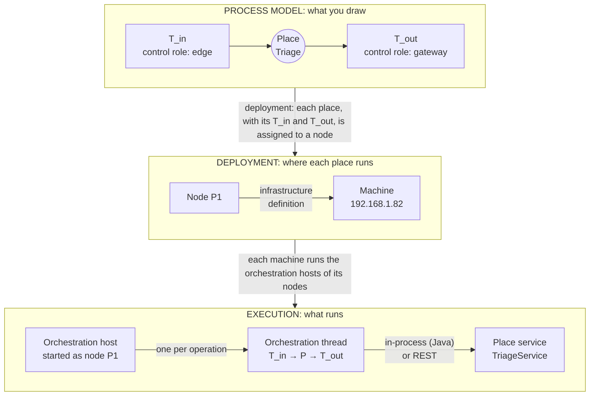
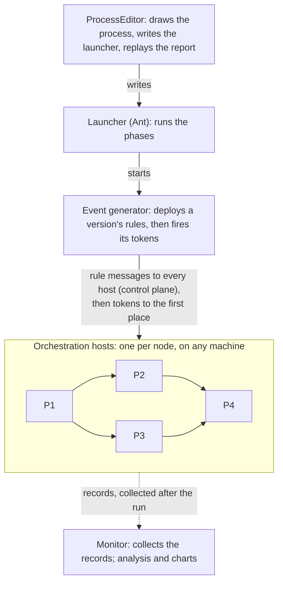
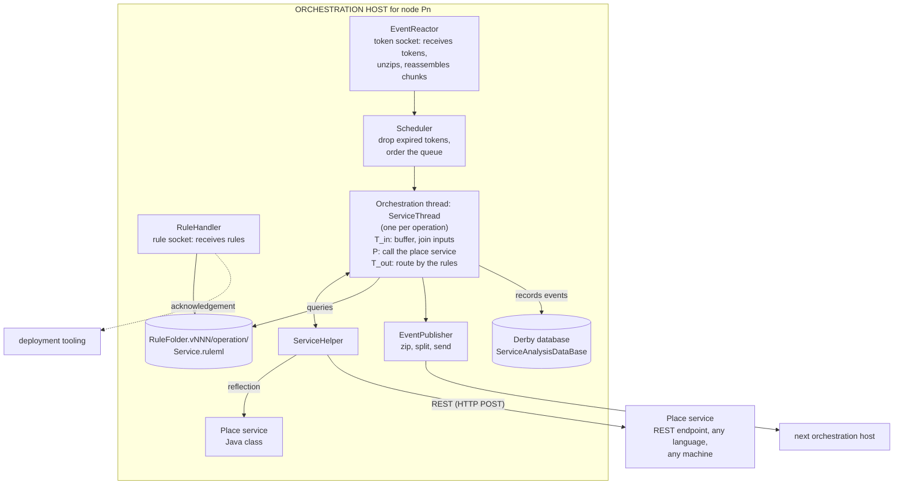
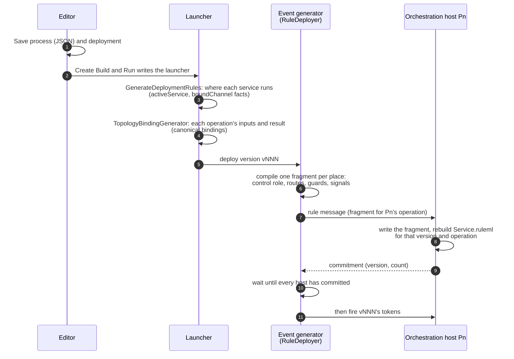
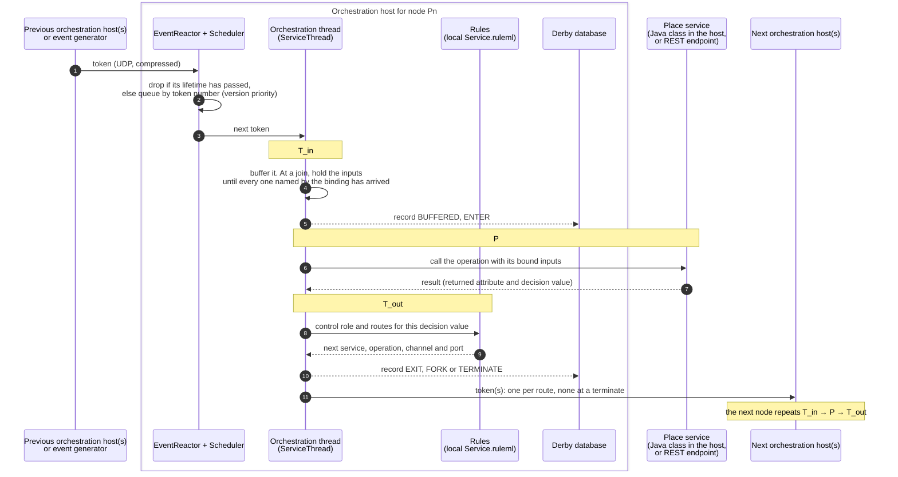

# How RPSO is implemented

[Reference.md](Reference.md#architecture-coordination-and-business-meaning) explains the
architecture's ideas: places bound to services, transitions as rules, tokens as messages.
This page shows the machinery underneath: which programs run, what they send each other,
where the rules live, and what happens, step by step, when you run a process.

## Terms

The terms belong to three layers, and the layers are different kinds of thing: a place is part of the
process model, a node is a name in the deployment, and an orchestration host is a running program.



| Layer | Term | Meaning |
|---|---|---|
| **Process model** | **Place** | A place of the Petri net: one step of the process, bound to a place service operation. P1 and so on in the examples |
| | **Transition** | A place's T_in (gathers its inputs) or T_out (sends its result on). Transitions are not deployed separately: they go wherever their place goes |
| | **Control role** | What a transition does: for example edge, gateway, fork, join, merge, terminate or signal. The editor calls it the transition's Node Type |
| **Deployment** | **Node** | The name a place is assigned to (P1, P2, …). It is not a program: the deployment says which places each node serves, and the infrastructure definition gives it a machine, an address and ports |
| | **Machine** | A computer. One machine can run several nodes |
| **Execution** | **Orchestration host** (host, for short) | The program started as a node on its machine. Every orchestration host is the same program, and holds no business code of its own |
| | **Orchestration thread** | The thread inside an orchestration host that carries out T_in → P → T_out for one operation of a place (`ServiceThread`), using the rules installed on that host |
| | **Place service** | The business code bound to a place: a Java class called in-process, or a service behind a REST endpoint in any language, on any machine |

Read down the layers: **a place, with its T_in and T_out, is assigned to a node; the node is on a machine;
the machine runs the orchestration host started as that node; and the host's orchestration thread calls
the place service.** None of these is one-to-one. A node can serve places from several processes and
versions at once (in the concurrent healthcare run, node P4 serves Radiology for the patient workflow and
for federated requests, told apart by version and operation); a machine can run several nodes (in the
tutorials all six run on one); and a REST place service need not run on the host's machine at all.

## The programs in a run

A run is a handful of ordinary Java programs exchanging UDP messages. Nothing in it is a
central engine: once the rules are installed, the orchestration hosts pass tokens directly
to each other.



| Program | Where the code is | What it does |
|---|---|---|
| Orchestration host | `btsn.rpso.host` (`ServiceLoader -node Pn`) | One per node. Receives rules and tokens, calls its place service, routes the result, records what happened |
| Deployment tooling | `btsn.common/src/org/btsn/rulecontroller` | `TopologyBindingGenerator` writes each operation's inputs and result; `RuleDeployer` compiles the process into a rule fragment for each place and sends each host its fragment |
| Event generator | `btsn.common.eventgenerators` (`GenericPetriNetTokenGenerator`) | Deploys a version (through `RuleDeployer`), then fires that version's tokens on a schedule |
| Monitor | `btsn.common.Monitor` (`MonitorService`, `derby/Analysis`) | Gathers every host's records after the run; the analysis and charts read them |
| Launcher | `btsn.services/build/workflows/process-runtime.xml` | Starts the hosts and Monitor, then runs the phases below; `HostLaunch` does the per-host steps |
| Editor | `btsn.workflowEditor` | Saves the process as JSON, writes the launcher (Create Build and Run), runs it (Run on hosts) and replays the report |

Every orchestration host is the same program. What makes P2 a credit check and P4 an
underwriting join is only the rules it holds and the place service its deployment names.

## Inside an orchestration host

The orchestration host for node `Pn` serves three places: `Pn_Place`, the node's place in
the business process, and `Pn_InitializationService` and `Pn_CollectorService`, its places
in the initialisation and collection processes. For each operation of each place it starts
an orchestration thread (`ServiceThread`) on a token socket, and a `RuleHandler` on a rule
socket. A Java place service is loaded into the orchestration host and called in-process; a
REST place service runs on whatever machine serves its endpoint.



- **Receiving a token.** `EventReactor` listens on the operation's token socket. It
  decompresses each message (GZIP) and reassembles messages that were split into chunks.
- **Queueing.** `Scheduler` drops a token whose lifetime (`notAfter`) has passed, or that
  arrives at a full queue, and reports it. Otherwise it orders the queue by token number,
  so lower versions are served first: the static priority between versions.
- **T_in.** The orchestration thread buffers the token. At a join it holds the inputs, keyed by
  workflow and version, until every input named by the operation's canonical binding has
  arrived.
- **P.** `ServiceHelper` calls the place service: the class the catalogue names, by Java
  reflection, or the deployment's REST endpoint through `RestAdapter`.
- **T_out.** `TransitionHandler` takes the transition's control role from the rules (edge,
  gateway, fork, join, terminate, signal) and asks the rule engine where the result goes. The answer names the
  next service and operation, its channel and port, and the guard value each route needs.
  `EventPublisher` sends the token on, compressed, and split into chunks if it is large.
- **Recording.** `PetriNetInstrumentationHelper` writes every event (GENERATED, BUFFERED,
  ENTER, EXIT, FORK, FORK_CONSUMED, JOIN_CONSUMED, TERMINATE, FAILED) to the host's own
  Derby database, on the host's own clock. A Signal node records TERMINATE; the process
  it launches starts with GENERATED.
- **Rules.** `RuleHandler` listens on the operation's rule socket; see below.

The rule engine is OO jDREW, evaluating RuleML: facts and Horn rules, queried by the host
for each token.

## From the drawing to installed rules



1. **Definitions.** The editor saves three things: the process
   (`ProcessDefinitionFolder/…/X.json`: places, transitions, arcs, guards), the deployment
   (`ServiceDeploymentFolder`: which node runs each service operation) and, once, the
   machines (`InfrastructureDefinitionFolder`: each node's channel, address and base ports).
2. **Deployment facts.** `GenerateDeploymentRules` turns the deployment and machines into
   `RuleBase/Generated/InfrastructureDeployment.ruleml.xml`: facts such as
   `activeService(P2_Place, processToken, ip0, 4002)` and `boundChannel(ip0, 192.168.1.82)`.
   Every host holds them, so any host can find any other.
3. **Bindings.** `TopologyBindingGenerator` writes each service's canonical bindings
   (`ServiceAttributeBindings`): an operation's named inputs and returned attribute. Joins
   are ready when every named input has arrived.
4. **Fragments.** `RuleDeployer` compiles the process into one fragment per place and sends
   each to its host as a rule message (XML: version, commitment count, target service and
   operation, and the fragment).
5. **Installation.** The host's `RuleHandler` saves the fragment under
   `RuleFolder.vNNN/<operation>/` and rebuilds that operation's `Service.ruleml`: the core
   rules (`RuleBase/CoreRuleBase.ruleml.xml`), the deployment facts, the service's canonical
   bindings and the fragment. Versions are kept in separate folders, so a new version never
   changes an old one.
6. **Commitment barrier.** The host replies with a commitment. `RuleDeployer` retries until
   every host the version uses has committed; only then are that version's tokens fired. A
   host also drops any token whose version it has not registered.

### What a fragment looks like

This is the fragment the loan process installs on P4, the underwriting place (shown as one
fact per line):

```xml
<Atom><Rel>NodeType</Rel><Ind>GatewayNode</Ind></Atom>
<Atom><Rel>meetsCondition</Rel><Ind>P5_Place</Ind><Ind>processToken</Ind><Ind>GATEWAY_NODE</Ind><Ind>approved</Ind></Atom>
<Atom><Rel>meetsCondition</Rel><Ind>P5_Place</Ind><Ind>processToken</Ind><Ind>GATEWAY_NODE</Ind><Ind>conditional</Ind></Atom>
<Atom><Rel>meetsCondition</Rel><Ind>TERMINATE</Ind><Ind>TERMINATE</Ind><Ind>GATEWAY_NODE</Ind><Ind>declined</Ind></Atom>
<Atom><Rel>meetsCondition</Rel><Ind>SIGNAL</Ind><Ind>Signal_LoanAbandoned</Ind><Ind>GATEWAY_NODE</Ind><Ind>abandoned</Ind></Atom>
<Atom><Rel>signalLaunch</Rel><Ind>Signal_LoanAbandoned</Ind><Ind>Loan Abandoned</Ind><Ind>v002</Ind>
      <Ind>P2_Place</Ind><Ind>withdrawEnquiry</Ind><Ind>LOAN_ABANDONED</Ind><Ind>20000</Ind>
      <Ind>financial/Workflow/Loan_Compensation_Workflow</Ind></Atom>
```

Read it as: P4's T_out has the control role gateway (`NodeType` in the rules). "approved" and "conditional" go to P5's
`processToken`, "declined" ends the workflow, and "abandoned" ends it at the Signal node
"Loan Abandoned", which launches Loan Compensation (v002) at P2's `withdrawEnquiry`.

One rule in `CoreRuleBase.ruleml.xml` joins a fragment's `meetsCondition` facts to the
deployment facts. For each route, it gives the next service and operation, the channel
and port to send to, and the guard value. The host asks that one question after each
service call, and compares the guard values with the routing value the service returned.

## A token through an orchestration host

Once a version's rules are installed, every token takes the same path through each orchestration host
it reaches, whatever the place service does:



- **Queue (1–3).** Tokens arrive over UDP. The scheduler drops a token whose lifetime has passed and
  serves the rest lowest token number first, so an earlier version has priority over a later one.
- **T_in (4–5).** The orchestration thread buffers the token. At a join it holds the inputs until every
  input named by the operation's canonical binding has arrived for that workflow and version.
- **P (6–7).** The place service is called with the bound inputs and returns its result: the attribute it
  owns and, at a gateway, the decision value.
- **T_out (8–11).** The thread asks the host's own rule base, not a central engine, what the control role
  and routes are for that decision value, and sends the token on: one token per route at a fork, none at
  a terminate. Each step is recorded in the host's own database, on its own clock; the replay and the
  analysis are built from those records.

## A token on the wire

A token is an XML message. The business data travels as JSON inside it:

```xml
<payload>
  <header>
    <sequenceId>1030001</sequenceId>          <!-- token number: version, workflow and fork child -->
    <ruleBaseVersion>v001</ruleBaseVersion>   <!-- whose rules handle it -->
  </header>
  <service>
    <serviceName>P4_Place</serviceName>       <!-- where it is going -->
    <operation>processToken</operation>
  </service>
  <joinAttribute>
    <attributeName>creditCheckResults</attributeName>  <!-- which input of the operation it fills -->
    <attributeValue>{ "creditCheckResults": { ... } }</attributeValue>
    <notAfter>1793584871749</notAfter>        <!-- end of its lifetime -->
  </joinAttribute>
  <monitorData>...</monitorData>              <!-- timings for observation only -->
</payload>
```

A token's number tells the host its version and its workflow. Version v001 numbers
from 1,000,000 and v002 from 2,000,000. Each workflow takes a block of 10,000, so
1030000 is the fourth workflow of v001, and 1030001 and 1030002 are the children of its
fork. A join waits for the children of one workflow in one version.

## A run, phase by phase

`process-runtime.xml` runs every launcher, whether written by hand or by the editor:

| Step | What happens |
|---|---|
| Prepare | Copy the definitions into the launcher's own folder (`btsn.services/target/launchers/<launcher>/btsn.common`), generate the deployment facts and bindings, build the host and service packages |
| Start | Start each host listed in `hosts=` in its own folder (`…/<launcher>/Pn`, with its own rules and database) and Monitor. Hosts for other machines are started there from their packages |
| Phase 1: initialise | Each host's initialisation place (`Pn_InitializationService`) clears its database. This is itself a small process, version v999 |
| Phase 2: run | Deploy each generator's version behind the commitment barrier, then fire all generators together. A process started by Signal nodes is deployed but fires nothing itself |
| Drain | Wait until nothing has moved for a few seconds, or until every token's lifetime has run out |
| Phase 3: collect | Each host's collection place (`Pn_CollectorService`) sends its records to Monitor (again a v999 process). The run waits until Monitor has a receipt from every host for every version |
| Analyse | `ant -f <launcher> analyse` runs `PetriNetAnalyzer`, which reconstructs each workflow from the records; the editor replays the same report |

Initialisation and collection are processes like any other: they are drawn, deployed and
run on the same hosts. Monitor sits outside the business process: no business token
passes through it.

## Observation

- **Recorded where it happens.** Each host writes its own events to its own database.
  Nothing is sent to Monitor while the process runs.
- **Gathered afterwards.** The collectors send the records to Monitor, which merges them
  into its own database (tables such as `CONSOLIDATED_TRANSITION_FIRINGS` and
  `CONSOLIDATED_MARKING_EVOLUTION`).
- **Reconstructed, not assumed.** `PetriNetAnalyzer` rebuilds each workflow per version:
  its root, its fork children, which child continued after each join, and how it ended.
  Only then does it count completions or measure times.
- **Clocks.** Each host stamps events with its own clock. The analysis bounds the
  differences between machines from causal order (a token cannot arrive before it was
  sent), and the replay and cross-machine timings use those bounds.

## Ports

Each node has a channel (`ip0`, `ip1`, …, each bound to a machine's address) and base
ports, one per operation slot, in the infrastructure definition. From these:

| Socket | Port | Example: P2 on `ip0`, base port 4002 |
|---|---|---|
| Tokens for an operation | 10000 + 1000 × channel number + base port | 14002 |
| Rules for an operation | 20000 + 1000 × channel number + base port | 24002 |
| Commitments, received by the deployment tooling | 35000 + version number | 35001 for v001 |
| Shutdown, per host | 39000 + version number | 39001 |

All messages are UDP datagrams. Tokens are compressed, and one too large for a datagram is
split into chunks and reassembled on arrival. There is no retransmission: a lost message is reported
by the analysis as an incomplete workflow, not repaired.

## Where to go next

- [Tutorial.md](Tutorial.md): draw, run and replay a first process.
- [Reference.md](Reference.md): every editor step, launcher and analysis tool in detail.
- [ServiceTutorial.md](ServiceTutorial.md): write a service in Java or behind a REST endpoint.
