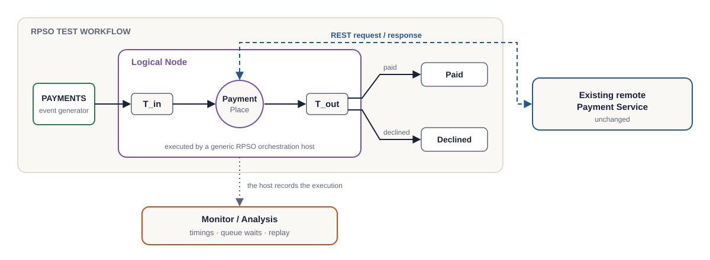
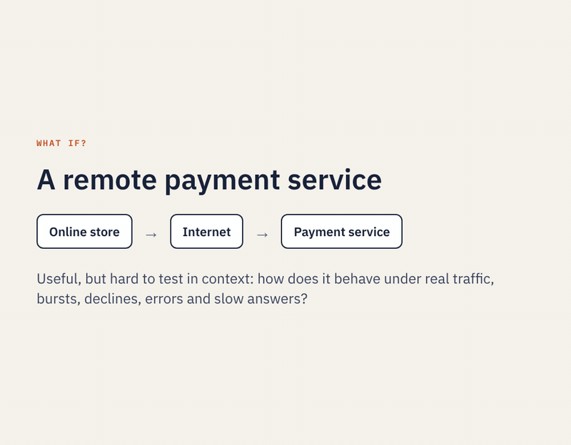

# Rule-Propagated Service Orchestration (RPSO)

**RPSO uses Petri net concepts to transform ordinary callable services into a logically defined, distributed orchestration system.**

For example, say you have an online store that relies on a remote Payment Service. It works well under normal conditions, but what happens when order volumes rise, calls become slow, or the service fails? How do those problems affect the rest of the checkout process?

With **RPSO**, you can leave the Payment Service where it is and bind its existing REST endpoint to a **Place** in a Petri-net model. Define the operation's inputs and result, connect the transitions that govern its execution, then generate test requests through the process. RPSO records the execution so you can measure, analyse and replay what actually happened.

This example is deliberately simple, but the architectural pattern behind it goes much further. Each Place is one step of a process; add more, and RPSO coordinates them with no central engine:

- **BPMN-style control flow.** Gateways route on a service's own answer, forks run branches in parallel and joins wait for all of them, merges take whichever path arrives, and a signal can start a compensation process that undoes earlier work.
- **Several versions at once.** Different versions of a process run on the same hosts at the same time, each deployed and measured separately. Where they share a service, the higher-priority version is served first ([Priority at a shared service](ServiceTutorial.md#priority-at-a-shared-service)).
- **Changes on the fly.** A new version of a process can be published to hosts that are already running. No host restarts, and tokens already in flight finish under the version they started with ([Change a running process](Reference.md#8-change-a-running-process)).
- **Process-driven infrastructure.** Everything RPSO does is a process, with no custom glue code. Resetting each host before a run and collecting its records afterwards are themselves processes (administrative version `v999`), deployed and run on the same hosts as your own, and undoing earlier work is a compensation process. Asking a service for its data is no different: you draw a process that does it ([A run, phase by phase](Architecture.md#a-run-phase-by-phase)).
- **Across machines and organisations.** The steps can run on different machines, or in different organisations that each run their own hosts, as in the [stroke code](StrokeCode.md), which spans an ambulance service, two hospitals and shared imaging and pathology providers.
- **Measured and replayed.** However large the process grows, every run can be measured and replayed against the same model.

[Where RPSO fits](#where-rpso-fits) compares it with workflow engines, service meshes and load-testing tools.

## Start with one service

A minimal experiment needs only an event generator, a Place bound to the remote service, its incoming and outgoing transitions, and an outcome:

<picture>
  <source media="(prefers-color-scheme: dark)" srcset="images/rpso-first-use-dark.svg">
  
</picture>

*The **Payment Place is logical**, not the Payment Service itself. A generic RPSO orchestration host executes the whole Node (**T_in → Place → T_out**): it calls the unchanged service over REST, hands the response to T_out and records the run for analysis and replay. The host can run on your machine or next to the service on another one ([Run on several machines](Reference.md#7-run-on-several-machines)).*

1. **Bind the service.** Describe the existing REST operation and its inputs and result; no change to the service's business logic is required. [Follow one payment](ServiceTutorial.md#follow-one-payment-what-a-service-receives-and-returns) shows exactly what a service receives and returns.
2. **Exercise it.** Generate tokens at a chosen rate and timing: steady traffic, bursts or a long soak. To see failures, point the Place at a test copy of the service that you can slow down or make fail, and set how long the Place waits for an answer.
3. **Observe it.** Inspect service times, queue waits, routing and token flow; replay the recorded run against the same model.

**See it run.** The animation replays a recorded run of the workflow in the diagram above: a mock payment service on Vercel receives steady payments, then a burst of twelve.

30 payments: 24 paid and 3 declined, each routed on the service's own answer; 3 failed at the Place with the reason recorded (two HTTP 503s, one answer slower than 2.5 s). The burst queued for up to 10.8 s; steady traffic hardly queued.
[▶ Watch the recorded run](https://alexanderadelau.github.io/Rule-Propagated-Service-Orchestration/docs/replay/?model=../../btsn.common/ProcessDefinitionFolder/payments/Workflow/Remote_Payment_Test.json&run=../../btsn.common/AnalysisFolder/Payments/Analysis_Remote_Payment_Test.txt) · [Build it yourself in the editor, then test your own service](#from-an-idea-to-a-measured-run)

From one remote service, the model can grow into a complete checkout process with inventory, payment and order handling. Load, stress, soak and failure scenarios can then be studied *in the context of that workflow*. RPSO provides orchestration, token generation, execution records and analysis; realistic workloads and fault-injection conditions still need to be configured as part of the test.

## How RPSO works

<picture>
  <source media="(prefers-color-scheme: dark)" srcset="images/rpso-at-a-glance-dark.svg">
  
</picture>

A service operation, whether a Java method or a REST endpoint, is bound to a **Place** within a logical **Node (T_in → Place → T_out)**. T_in collects the required inputs; the assigned orchestration host invokes the service bound to the Place; T_out propagates its result.

The Petri-net representation provides a formal foundation for sequencing, conditional routing, concurrency, forks, joins and synchronisation, without requiring those behaviours to be implemented inside the business services.

**RPSO turns this logical representation into a live distributed system.** Each logical Node is assigned to a host target, where a generic [orchestration host](Architecture.md#terms) executes its behaviour. Using installed coordination rules and canonical bindings, the host determines when the required inputs are available, invokes the bound Place Service and propagates the result. Tokens carry information directly between hosts, so no central orchestration engine directs their execution.

The process drawn in the editor is therefore more than a visual model: **it is the definition of the system that executes.** Its behaviour can be observed, measured, analysed and replayed against the original Petri-net representation.

The same generic machinery supports very different processes: from a Boolean test or a remote payment check to a loan application or an emergency-department workflow. Bind different services to the Places to change the work performed; change the deployment to run the same process across different machines. A Java service can run in-process inside its orchestration host, while a REST service can run anywhere its endpoint is reachable, in any language.

**Reading the diagram**
- **Circles** represent Places: the logical processing steps, each bound to a service (Triage, Laboratory, …).
- **P1–P6 badges** are host targets: where each logical Node (T_in → Place → T_out) is deployed. A generic orchestration host runs as each one and executes the Node's behaviour.
- **Bars** on either side of a Place represent its T_in and T_out transition behaviour. T_in (grey) gathers inputs; T_out (yellow) propagates results. The deployed host carries out both using installed rules.
- **Letters** on the bars identify their control roles: **E** edge, **G** gateway (routes by the service's decision), **J** join (waits for every input), **M** merge (takes either input), **T** terminate, and ***S*** Signal (e.g. kick off a Compensation process).
- **EG** is an event generator, which starts the tokens for one process version.
- **Guarded arcs** leave a gateway. A route is taken when the service's decision matches the arc's guard. Laboratory, Cardiology and Radiology share the guard STANDARD_WORKFLOW, so all three receive the work-up request; DIRECT_TO_TREATMENT selects the direct route. Labels v001–v003 show which versions use an arc.
- **Dashed arcs** indicate network connections between hosts; a **2** on an arc marks a Place with two operations.

*This example shows three versions of an emergency-department process running concurrently on six hosts: the full patient workflow (v003), a triage canary (v002) and federated radiology requests from another hospital (v001). Each is deployed and measured separately. [Browse more examples by category](https://alexanderadelau.github.io/Rule-Propagated-Service-Orchestration/docs/replay/examples.html).*

[▶ Watch a recorded run of this process](https://alexanderadelau.github.io/Rule-Propagated-Service-Orchestration/docs/replay/?model=../../btsn.common/ProcessDefinitionFolder/healthcare/Workflow/Emergency_Department_With_Federated_Radiology.json&run=../../btsn.common/AnalysisFolder/Healthcare/Emergency_Department_With_Federated_Radiology.txt)

**A federated example.** [A stroke code across four organisations](StrokeCode.md): an ambulance, a receiving hospital, a stroke centre and shared imaging and pathology providers, on twelve hosts with no central engine. It was recorded across two machines, with the stroke centre's host on its own machine. A compensation process undoes the stroke centre's booking when it isn't needed, and stroke codes overtake routine patients at the shared providers.
[▶ Watch it](https://alexanderadelau.github.io/Rule-Propagated-Service-Orchestration/docs/replay/?model=../../btsn.common/ProcessDefinitionFolder/healthcare/Workflow/Stroke_Code_With_Emergency_Department.json&run=../../btsn.common/AnalysisFolder/Healthcare/Stroke_Code_With_Emergency_Department.txt)

How does a drawing become a running system? In this four-Node example, each Node is deployed to its own host target, run by a separate orchestration host:

*Draw the net, deploy its rules and run it across hosts. A Place can be bound to anything from a Boolean function to a credit check or a clinical service.*

[▶ Watch a recorded run of this process](https://alexanderadelau.github.io/Rule-Propagated-Service-Orchestration/docs/replay/?model=../../btsn.common/ProcessDefinitionFolder/petrinet/Workflow/P1_P2_P3_P4_Fork_Join_Workflow.json&run=../../btsn.common/AnalysisFolder/PetriNet/Analysis_P1_P2_P3_P4_Fork_Join_Workflow.txt)

During execution, each host records events that can later be analysed for queue
waits, service times, join waits and end-to-end workflow time. The recorded run
can then be replayed against the model. These are measurements, not guarantees
of meeting hard real-time deadlines.

## Where RPSO fits

RPSO is a research and design platform. It does not replace production workflow engines, service meshes or load-testing tools; it sits beside them and answers a different question: *what does this process do when it runs, step by step, across the machines and organisations that take part?*

| Tools | What they do | How RPSO differs |
|---|---|---|
| **Workflow engines** (Temporal, AWS Step Functions, Camunda) | Run long-lived processes reliably; a central engine or cluster keeps each process's state | No central engine: each Node's host decides locally from its installed rules, and tokens travel directly between hosts. Each organisation can run its own hosts without sharing an engine, as in the [stroke code](StrokeCode.md) |
| **Service meshes** (Istio, Linkerd, Envoy) | Manage traffic between services: routing, retries, encryption, telemetry | Works at the level of the process, not the network: forks, joins, priorities and routing on a service's own decision |
| **Load and chaos tools** (k6, Locust, JMeter, Chaos Mesh) | Generate heavy traffic and inject faults | Sends scheduled traffic *through the process*, so a slow or failing service is seen in its effect on the rest of the workflow |
| **Tracing** (OpenTelemetry, APM tools) | Record each call as it crosses services | Records each token against the Petri-net model, so a run can be replayed on the diagram and analysed for queue order, join waits and capacity |

They work together: the same service can sit behind a mesh, take raw load from k6, and be tested in the context of its process with RPSO.

RPSO already works with current practice:

- **Services in any language, hosted anywhere**, called over REST; the supplied examples include functions hosted on Vercel.
- **Regression suites** run in GitHub Actions on every change.
- **Recorded runs replay in the browser**, on [the examples page](https://alexanderadelau.github.io/Rule-Propagated-Service-Orchestration/docs/replay/examples.html).

## From an idea to a measured run

Start by drawing a process in the editor, binding services to its Places,
running it on orchestration hosts and replaying the recorded execution on the
same model. [Tutorial.md](Tutorial.md) walks through four examples:

1. [**A standard service**](Tutorial.md#example-1-a-standard-service) that returns true or false: one Place, a loop and ten tokens.
2. [**A claims process**](Tutorial.md#example-2-a-claims-process-with-a-remote-service) that calls a remote service over REST.
3. [**A new host target**](Tutorial.md#example-3-add-a-host-target): add P7 and move Example 1 onto it.
4. [**Test your own remote service**](Tutorial.md#example-4-test-your-own-remote-service): build the payment test above in the editor, then point it at your own service.

The business services do not have to exist before you start modelling. Name them
as you draw: the editor can generate starting Java code, allowing you to run the
process and replace the starting implementations with real business logic one
service at a time.

## What you need

- A JDK, version 15 or later (tested with 21).
- Apache Ant 1.10.2 or later. It comes with Eclipse, and the editor finds it there.
- The repository's projects imported into Eclipse (**File → Import → Existing Projects into
  Workspace**). The runtime libraries are supplied; no Maven or Python is needed.

Then start with [Tutorial.md](Tutorial.md).

## Learn more

For detailed instructions and technical background, see [Reference.md](Reference.md).

**Using the editor**

- [The editor, step by step](Reference.md#the-editor-step-by-step)
- [Adding services while designing](Reference.md#adding-services-while-designing): catalogues, starting code and what Validate checks
- [Each step in detail](Reference.md#each-step-in-detail): design, deploy, Build and Run, results, several machines, changing a running process
- [Writing a service](ServiceTutorial.md), in Java or behind a REST endpoint in any language

**Running and observing**

- [Quick start: run, observe and replay](Reference.md#quick-start-run-observe-and-replay), from the editor or the command line
- [Run an example](Reference.md#run-an-example): every supplied launcher
- [Observe and interpret a run](Reference.md#observe-and-interpret-a-run)

**How RPSO works**

- [How RPSO is implemented](Architecture.md): terminology, runtime programs, hosts, rule deployment, token execution, run phases and network ports
- [Inside each host](Reference.md#inside-each-host)
- [From the architecture pattern to a running service](Reference.md#from-the-architecture-pattern-to-a-running-service): from one Place to six, and the financial and healthcare workflows
- [Architecture: coordination and business meaning](Reference.md#architecture-coordination-and-business-meaning)
- [Rule deployment and token execution](Reference.md#rule-deployment-and-token-execution)
- [Execution examples](Reference.md#execution-examples), including the [concurrent healthcare run](Reference.md#concurrent-healthcare-execution) pictured above
- [Stroke code](StrokeCode.md): a federated process across four organisations, with a compensation process and priority at shared providers

**The repository**

- [Project layout and build support](Reference.md#project-layout-and-build-support)
- [Repository artefacts](Reference.md#repository-artefacts)

## License

The licensing terms for the software and accompanying documentation follow.

**Copyright (c) 2025 Alexander Cameron**

Permission is hereby granted, free of charge, to any person obtaining a copy of this software and associated documentation files (the "Software"), to use, copy, modify, merge, and distribute the Software for non-commercial purposes, subject to the following conditions: the above copyright notice and this permission notice shall be included in all copies or substantial portions of the Software.

**Commons Clause Restriction:** The grant of rights under this license does not include the right to Sell the Software. "Sell" means providing the Software, or any derivative work, to third parties for a fee or other consideration, or offering a product or service whose value derives substantially from the Software's functionality. For commercial licensing enquiries, contact the author through [GitHub](https://github.com/AlexanderAdelAU).

THE SOFTWARE IS PROVIDED "AS IS", WITHOUT WARRANTY OF ANY KIND, EXPRESS OR IMPLIED.

## Author

Alexander Cameron
