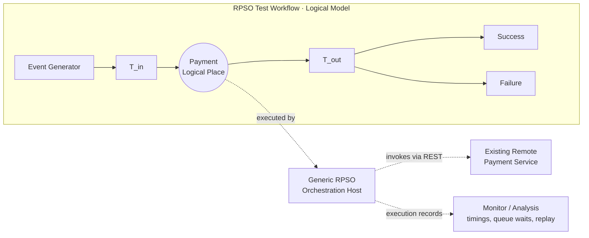

# Rule-Propagated Service Orchestration (RPSO)

**RPSO uses Petri net concepts to transform ordinary callable services into a logically defined, distributed orchestration system.**

For example, say you have an online store that relies on a remote Payment Service. It works well under normal conditions, but what happens when order volumes rise, calls become slow, or the service fails? How do those problems affect the rest of the checkout process?

With **RPSO**, you can leave the Payment Service where it is and bind its existing REST endpoint to a **Place** in a Petri-net model. Define the operation's inputs and result, connect the transitions that govern its execution, then generate test requests through the process. RPSO records the execution so you can measure, analyse and replay what actually happened.

**A simple first use: turn an existing service into part of an executable, observable test workflow.**

## Start with one service

A minimal experiment needs only an event generator, a Place bound to the remote service, its incoming and outgoing transitions, and an outcome:

*The Payment Place represents a service operation in the logical model. The generic RPSO orchestration host invokes the existing remote Payment Service and records the execution for analysis and replay.*

The **Payment Place is logical**, not the Payment Service itself. An RPSO orchestration host executes the logical Node (`T_in → Place → T_out`) and invokes the unchanged Payment Service over REST. The host can run locally or alongside the service on the remote machine. **Build and Run** generates an Ant launcher; running it builds the runtime JARs. For remote deployment, **Build host packages** creates a ZIP with the JARs, rules and `launch.bat`. Copy and extract it on the remote machine and start the host before running the workflow launcher locally.

1. **Bind the service.** Describe the existing REST operation and its inputs and result; no change to the service's business logic is required.
2. **Exercise it.** Generate tokens at a chosen rate, then vary the workload or introduce controlled delays and failures in the test environment.
3. **Observe it.** Inspect service times, queue waits, routing and token flow; replay the recorded run against the same model.

From one remote service, the model can grow into a complete checkout process with inventory, payment and order handling. Load, stress, soak and failure scenarios can then be studied *in the context of that workflow*. RPSO provides orchestration, token generation, execution records and analysis; realistic workloads and fault-injection conditions still need to be configured as part of the test.

## How RPSO works

RPSO uses Petri-net concepts to organise ordinary callable services. A service operation, whether a Java method or a REST endpoint, is bound to a **Place** within a logical **Node (T_in → Place → T_out)**. T_in collects the required inputs; the assigned orchestration host invokes the service bound to the Place; T_out propagates its result.

The Petri-net representation provides a formal foundation for sequencing, conditional routing, concurrency, forks, joins and synchronisation, without requiring those behaviours to be implemented inside the business services.

**RPSO turns this logical representation into a live distributed system.** Each logical Node is assigned to a host target, where a generic [orchestration host](Architecture.md#terms) executes its behaviour. Using installed coordination rules and canonical bindings, the host determines when the required inputs are available, invokes the bound Place Service and propagates the result. Tokens carry information directly between hosts, so no central orchestration engine directs their execution.

The process drawn in the editor is therefore more than a visual model: **it is the definition of the system that executes.** Its behaviour can be observed, measured, analysed and replayed against the original Petri-net representation.

The same generic machinery supports very different processes: from a Boolean test or a remote payment check to a loan application or an emergency-department workflow. Bind different services to the Places to change the work performed; change the deployment to run the same process across different machines. A Java service can run in-process inside its orchestration host, while a REST service can run anywhere its endpoint is reachable, in any language.

**Reading the diagram**
- **Circles** represent Places: the logical processing steps, each bound to a service (Triage, Laboratory, …).
- **P1–P6 badges** are host targets: where each logical Node (T_in → Place → T_out) is deployed. A generic orchestration host runs as each one and executes the Node's behaviour.
- **Bars** on either side of a Place represent its T_in and T_out transition behaviour. T_in (grey) gathers inputs; T_out (yellow) propagates results. The deployed host carries out both using installed rules.
- **Letters** on the bars identify their control roles: **E** edge, **G** gateway (routes by the service's decision), **J** join (waits for every input), **M** merge (takes either input), **T** terminate, and ***S*** Signal (e.g kick off a Compensation process).
- **EG** is an event generator, which starts the tokens for one process version.
- **Guarded arcs** leave a gateway. A route is taken when the service's decision matches the arc's guard. Laboratory, Cardiology and Radiology share the guard STANDARD_WORKFLOW, so all three receive the work-up request; DIRECT_TO_TREATMENT selects the direct route. Labels v001–v003 show which versions use an arc.
- **Dashed arcs** indicate network connections between hosts; a **2** on an arc marks a Place with two operations.

*This example shows three versions of an emergency-department process running concurrently on six hosts: the full patient workflow (v003), a triage canary (v002) and federated radiology requests from another hospital (v001). Each is deployed and measured separately. [Browse more examples by category](https://alexanderadelau.github.io/Rule-Propagated-Service-Orchestration/docs/replay/examples.html).*

[▶ Watch a recorded run of this process](https://alexanderadelau.github.io/Rule-Propagated-Service-Orchestration/docs/replay/?model=../../btsn.common/ProcessDefinitionFolder/healthcare/Workflow/Emergency_Department_With_Federated_Radiology.json&run=../../btsn.common/AnalysisFolder/Healthcare/Emergency_Department_With_Federated_Radiology.txt)

**A federated example.** [A stroke code across four organisations](StrokeCode.md): an ambulance, a receiving hospital, a stroke centre and shared imaging and pathology providers, on twelve hosts with no central engine. It was recorded across two machines, with the stroke centre's host on its own machine. A compensation process undoes the stroke centre's booking when it isn't needed, and stroke codes overtake routine patients at the shared providers.
[▶ Watch it](https://alexanderadelau.github.io/Rule-Propagated-Service-Orchestration/docs/replay/?model=../../btsn.common/ProcessDefinitionFolder/healthcare/Workflow/Stroke_Code_With_Emergency_Department.json&run=../../btsn.common/AnalysisFolder/Healthcare/Stroke_Code_With_Emergency_Department.txt)

How does a drawing become a running system? In this four-Node example, each Node is deployed to its own host target, run by a separate orchestration host:

*Draw the net, deploy its rules and run it across hosts. A Place can be bound to anything from a Boolean function to a credit check or a clinical service.*

[▶ Watch a recorded run of this process](https://alexanderadelau.github.io/Rule-Propagated-Service-Orchestration/docs/replay/?model=../../btsn.common/ProcessDefinitionFolder/petrinet/Workflow/P1_P2_P3_P4_Fork_Join_Workflow.json&run=../../btsn.common/AnalysisFolder/PetriNet/Analysis_P1_P2_P3_P4_Fork_Join_Workflow.txt)

During execution, each host records events that can later be analysed for queue
waits, service times, join waits and end-to-end workflow time. The recorded run
can then be replayed against the model. These are measurements, not guarantees
of meeting hard real-time deadlines.

## From an idea to a measured run

Start by drawing a process in the editor, binding services to its Places,
running it on orchestration hosts and replaying the recorded execution on the
same model. [Tutorial.md](Tutorial.md) walks through two examples:

1. **A standard service** that returns true or false: one Place, a loop and ten tokens.
2. **A claims process** that calls a remote service over REST.

The business services do not have to exist before you start modelling. Name them
as you draw: the editor can generate starting Java code, allowing you to run the
process and replace the starting implementations with real business logic one
service at a time.

## What you need

- A JDK, version 15 or later (tested with 21).
- Apache Ant 1.10.2 or later. It comes with Eclipse, and the editor finds it there.
- The repository's projects imported into Eclipse (**File → Import → Existing Projects into
  Workspace**). The runtime libraries are supplied; no Maven or Python is needed.

Then start with [Tutorial.md](Tutorial.md).

## Learn more

For detailed instructions and technical background, see [Reference.md](Reference.md).

**Using the editor**

- [The editor, step by step](Reference.md#the-editor-step-by-step)
- [Adding services while designing](Reference.md#adding-services-while-designing): catalogues, starting code and what Validate checks
- [Each step in detail](Reference.md#each-step-in-detail): design, deploy, Build and Run, results, several machines, changing a running process
- [Writing a service](ServiceTutorial.md), in Java or behind a REST endpoint in any language

**Running and observing**

- [Quick start: run, observe and replay](Reference.md#quick-start-run-observe-and-replay), from the editor or the command line
- [Run an example](Reference.md#run-an-example): every supplied launcher
- [Observe and interpret a run](Reference.md#observe-and-interpret-a-run)

**How RPSO works**

- [How RPSO is implemented](Architecture.md): terminology, runtime programs, hosts, rule deployment, token execution, run phases and network ports
- [Inside each host](Reference.md#inside-each-host)
- [From the architecture pattern to a running service](Reference.md#from-the-architecture-pattern-to-a-running-service): from one Place to six, and the financial and healthcare workflows
- [Architecture: coordination and business meaning](Reference.md#architecture-coordination-and-business-meaning)
- [Rule deployment and token execution](Reference.md#rule-deployment-and-token-execution)
- [Execution examples](Reference.md#execution-examples), including the [concurrent healthcare run](Reference.md#concurrent-healthcare-execution) pictured above
- [Stroke code](StrokeCode.md): a federated process across four organisations, with a compensation process and priority at shared providers

**The repository**

- [Project layout and build support](Reference.md#project-layout-and-build-support)
- [Repository artefacts](Reference.md#repository-artefacts)

## License

The licensing terms for the software and accompanying documentation follow.

**Copyright (c) 2025 Alexander Cameron**

Permission is hereby granted, free of charge, to any person obtaining a copy of this software and associated documentation files (the "Software"), to use, copy, modify, merge, and distribute the Software for non-commercial purposes, subject to the following conditions: the above copyright notice and this permission notice shall be included in all copies or substantial portions of the Software.

**Commons Clause Restriction:** The grant of rights under this license does not include the right to Sell the Software. "Sell" means providing the Software, or any derivative work, to third parties for a fee or other consideration, or offering a product or service whose value derives substantially from the Software's functionality. For commercial licensing enquiries, contact [your email].

THE SOFTWARE IS PROVIDED "AS IS", WITHOUT WARRANTY OF ANY KIND, EXPRESS OR IMPLIED.

## Author

Alexander Cameron
