# Reference

The detail behind [Tutorial.md](Tutorial.md) and [README.md](README.md): how each step in the
editor works, how to run and observe a process, and how RPSO works inside.

**Using the editor**

- [The editor, step by step](#the-editor-step-by-step)
- [Adding services while designing](#adding-services-while-designing): the claims example, the catalogue prompt, starting code and what Validate checks
- [Each step in detail](#each-step-in-detail): [design](#1-design-the-process), [deploy](#2-deploy-the-process), [Build and Run](#3-create-build-and-run), [run](#4-run-it), [results](#5-show-the-results), [your own service](#6-add-your-own-service), [several machines](#7-run-on-several-machines), [changing a running process](#8-change-a-running-process)

**Running and observing**

- [Quick start: run, observe and replay](#quick-start-run-observe-and-replay), from the editor or the command line
- [Run an example](#run-an-example): every supplied launcher
- [Observe and interpret a run](#observe-and-interpret-a-run)

**How RPSO works**

- [Inside each host](#inside-each-host)
- [From the architecture pattern to a running service](#from-the-architecture-pattern-to-a-running-service): one place to six, the financial and healthcare workflows
- [Architecture: coordination and business meaning](#architecture-coordination-and-business-meaning)
- [Rule deployment and token execution](#rule-deployment-and-token-execution)
- [Execution examples](#execution-examples)

**The repository**

- [Project layout and build support](#project-layout-and-build-support)
- [Repository artefacts](#repository-artefacts): the files of each tutorial example

## The editor, step by step

How each step is done in the editor (ProcessEditor, `btsn.workflowEditor`).
[Adding services while designing](#adding-services-while-designing) works through it for an
insurance-claims process that starts with no services at all; [Each step in detail](#each-step-in-detail)
explains each step on a single place.

| Step | How | Walkthrough |
|---|---|---|
| **1 · Sketch** | Draw the places, transitions and arcs. Transitions become T_in or T_out from their arcs; labels are free | [Sketch the process](#step-1-sketch-the-process) |
| **2 · Add services as you go** | Choose or create the catalogue of the process's domain, then right-click a place and add its service to it. Give a name, an operation and the values it routes on; the editor writes starting code that keeps the contract and returns those values in turn, or leaves a draft to finish later. A finished service is chosen from the catalogue instead | [Add the first service](#step-2-add-the-first-service), [Choose the service](#choose-the-service-and-operation) |
| **3 · Validate** | Before anything runs, Validate checks the guards against the values each service returns, the names passed from place to place, drafts, and transitions that lead nowhere | [Validate and save](#step-5-validate-and-save) |
| **4 · Deploy** | Choose the node (host) each place runs on and save the service deployment | [Deploy the process](#2-deploy-the-process) |
| **5 · Build and Run** | The editor writes an Ant launcher: the hosts, the event generators with their versions, and the token schedule | [Create Build and Run](#3-create-build-and-run) |
| **6 · Run on hosts** | The editor first checks that every REST service it calls answers. The launcher starts each place as its own host process, plus Monitor. It installs each host's rules and waits for every host to commit to them, then fires the tokens and collects the observations | [Run it](#4-run-it), [Rule deployment](#rule-deployment-and-token-execution) |
| **7 · Results** | The editor analyses the run and replays the recorded tokens on the design; Monitor's charts show timing and activity. A token that fails at a place is reported with the reason | [Show the results](#5-show-the-results), [Observe a run](#observe-and-interpret-a-run) |
| **8 · Replace the starting code** | Write each service's real logic, in its Java class or as a REST service in any language, and run again; Validate lists the services still on starting code | [Write the real logic](#step-7-write-the-real-triage-logic), [ServiceTutorial.md](ServiceTutorial.md) |

[ServiceTutorial.md](ServiceTutorial.md) writes one complete service from the start, from the Java class to a run, and calls it over REST. The inventory example in [Add your own service](#6-add-your-own-service) then adds state and several hosts.

## Adding services while designing

An insurer wants to pay small claims at once and assess the larger ones. That is
all you need to know to start:

- **Triage** decides whether a claim is simple or complex;
- a **simple** claim is paid;
- a **complex** claim goes to **Assess**, which accepts or rejects it.

Neither service exists yet. You will draw the process, add the two services to a
new **claims** catalogue as you go, run it on starting code, then write the real
triage logic.

The supplied copy is
[`Claims_Workflow.json`](btsn.common/ProcessDefinitionFolder/claims/Workflow/Claims_Workflow.json)
([all its files](#repository-artefacts)). To follow along beside it, use the domain `myclaims`
wherever this section says `claims`. Service names are shared by every domain, so the editor then
suggests `MyclaimsTriageService` and `MyclaimsAssessService`; accept them.

### Step 1: Sketch the process

Choose **File → New → Process Definition**. A new process starts with only the
standard services that every process shares (`AlwaysTrueService`,
`StochasticService`), not the catalogue of the process you had open.

Draw the elements with the palette and connect them with **Arrow (drag)**, then set their
attributes:

| Palette tool | Label | Attributes |
|---|---|---|
| Event Generator | `CLAIMS` | Rate (ms): `1000`; Version: `v001` |
| Transition | `T_in_Triage` | Node Type: `EdgeNode`; Buffer: `10` |
| Place | `Triage` | none yet |
| Transition | `T_out_Triage` | Node Type: `GatewayNode` |
| Transition | `Paid` | Transition Type: `Other`; Node Type: `TerminateNode` |
| Transition | `T_in_Assess` | Node Type: `EdgeNode`; Buffer: `10` |
| Place | `Assess` | none yet |
| Transition | `T_out_Assess` | Node Type: `GatewayNode` |
| Transition | `Accepted`, `Rejected` | Transition Type: `Other`; Node Type: `TerminateNode` |

Arcs: `CLAIMS → T_in_Triage → Triage → T_out_Triage`, then `T_out_Triage → Paid`
and `T_out_Triage → T_in_Assess → Assess → T_out_Assess`, then `T_out_Assess → Accepted`
and `T_out_Assess → Rejected`.

- **Transition types follow the arcs.** An arc from a transition into a place makes it a
  **T_in**; an arc from a place into a transition makes it a **T_out**. The **Transition Type**
  of such a transition is set for you and locked.
- **Labels are names.** `T1`, `T4` or `Screen` work as well as `T_in_Triage`; this tutorial
  uses the longer names because they read well.
- **Gateways route.** A T_out with `GatewayNode` sends each token along the arc whose guard
  matches what the place's service returned. You set the guards in [step 4](#step-4-set-the-guards).


*The sketch. The red dot on a place means it has no service yet.*

### Step 2: Add the first service

**Choose the catalogue.** A new process uses only the standard catalogue, which is never
changed, so a service of its own needs a catalogue to hold it first. Until then **Create New Service
in Catalogue...** is greyed out. Click **Choose/Create catalogue...** in Triage's Attributes
panel (or right-click Triage and choose it).
A catalogue belongs to a **domain**: every process of the domain shares it, so a service
is written once and used by each of them.


Choose **Create a catalogue for a new domain**, type `claims` and click **OK**. The editor:

- creates the empty catalogue `btsn.common/BusinessServiceDefinitions/claims/Claims.json`;
- lists it in [`btsn.services/packaging.json`](btsn.services/packaging.json), so the build
  packages the Java services you add to it.

A process of an existing domain (credit, healthcare, ...) uses **Select an existing catalogue** instead.
Either way, the standard Petri-net services (`StochasticService`, `AlwaysTrueService`) stay
available beside the catalogue, unchanged.

**Add the service.** Right-click **Triage** and choose **Create New Service in Claims.json...**
(the same button is in its Attributes panel). The menu names the catalogue the service goes into.
A place on a standard service such as `StochasticService` keeps it until you choose another: the
standard services are offered beside your catalogue, never copied into it or changed.

**Describe the service.** The form opens with what it can suggest:


| Field | Enter | Why |
|---|---|---|
| **Service** | `ClaimsTriageService` (suggested) | From the place's label. `TriageService` is already a service in the healthcare catalogue, and every domain's services are packaged together, so the editor prefixes the domain. |
| **Operation** | `triage` | The method the host calls |
| **What it does** / **What it returns** | In words | Shown wherever the service is chosen. Leave them for later if you like. |
| **Inputs** / **Return attribute** | `token` / `token` (suggested) | What the place takes and publishes, matched to the places around it |
| **Routes on** | `simple, complex` | The values the service returns for the T_out's guards |
| **How it runs** | **A Java class**, with **Write starting code** checked | |

Click **Add to Claims.json**. The service is in the catalogue, the place uses it, and the
editor has written
[`ClaimsTriageService.java`](btsn.common/src/org/btsn/business/claims/ClaimsTriageService.java)
as **starting code**:

```java
public String triage(String token) {
    // RPSO-STARTING-CODE: delete this line when the real logic replaces the starting code below.
    // TODO: the real logic. ...
    // Until then it returns the routes in turn, one per call, so every arc leaving the place is tried.
    String[] routes = {"simple", "complex"};
    String route = routes[(CALLS.incrementAndGet() - 1) % routes.length];

    JSONObject result = new JSONObject();
    result.put("routing_decision", routingDecision(route));
    return businessResult("token", result);
}
```

It compiles and keeps the contract, so the process can run now.

The other two ways a service can run:

- **Not decided yet**: the entry is a **draft**. You can keep designing and save the
  process; Validate, Deploy and Build say exactly what it still needs.
  **Edit Service in Claims.json...** on the place finishes it later.
- **A service called over REST**, in any language; its endpoint is set in Deploy
  ([Call it over REST](ServiceTutorial.md#8-call-it-over-rest)).

### Step 3: Add the second service

Do the same for **Assess**: the editor uses the claims catalogue now, so it does not ask again.

| Field | Enter |
|---|---|
| **Service** | `AssessService` (suggested) |
| **Operation** | `assess` |
| **Routes on** | `accept, reject` |
| **How it runs** | A Java class, with starting code |

### Step 4: Set the guards

Select each arc leaving a T_out, set **Guard Condition** to `DECISION_EQUAL_TO` and type its
**Decision Value**. Copy the value into **Label** to show it on the canvas.

| Arc | Decision Value |
|---|---|
| `T_out_Triage → Paid` | `simple` |
| `T_out_Triage → T_in_Assess` | `complex` |
| `T_out_Assess → Accepted` | `accept` |
| `T_out_Assess → Rejected` | `reject` |

Only arcs leaving a T_out take a guard; on any other arc the guard fields are greyed out.
To remove a guard, choose **(none)**.

### Step 5: Validate and save

Click **Validate**. The design is complete; what is left is listed in red under **Still to do**:

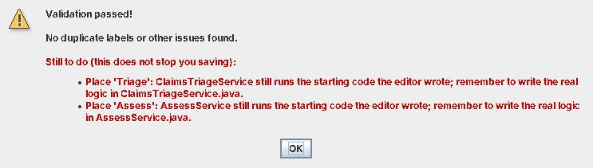

The starting-code reminders do not stop you running. Validate also checks the routes and names
before anything runs, and these do stop Deploy, Build and **Run on hosts**:

| Validate reports | Because at run time |
|---|---|
| A guard tests a value the service never returns (e.g. `false` when it returns `true`) | No token would take that arc |
| The service returns a value no arc from its T_out tests | Those tokens would be dropped |
| A transition leads nowhere and is not a Terminate node | Tokens reaching it would stop there |
| A place takes an input the place before it does not publish | The token would stop at that place |
| A service is still a draft | It has no code to run |
| A transition both feeds a place and is fed by one | It cannot be both a T_in and a T_out |

Save with **File → Save Process Definition As...**. The editor offers
`ProcessDefinitionFolder/claims/Workflow`, beside the domain's catalogue; save as
`Claims_Workflow.json`.

### Step 6: Deploy, build and run

These are the same steps as for any process; [Each step in detail](#2-deploy-the-process) explains each one.

1. **Deploy**: click **Deploy** and choose a Host node for each place: **Triage** on `P1`,
   **Assess** on `P2`. Click **Save deployment...** (it suggests
   `ServiceDeploymentFolder/claims/Claims_Workflow.json`), then save the process.
2. **Build**: keep the defaults (ten tokens from `CLAIMS`, one a second) and click
   **Create**. The editor writes `Claims_Workflow_BuildAndRun.xml`.
3. **Run on hosts**: the editor packages the two services, starts P1, P2 and Monitor, runs the
   ten claims, then analyses the run.

On starting code each place takes its routes in turn:

| Claims | Triage returns | Then |
|---|---|---|
| 1, 3, 5, 7, 9 | `simple` | **Paid** |
| 2, 4, 6, 8, 10 | `complex` | Assess returns `accept`, `reject`, `accept`, ...: 3 **Accepted**, 2 **Rejected** |

The run summary begins `v001: 10 generated, 10 completed`. Press **Replay the recorded run**
to watch the claims move through the design.

### Step 7: Write the real triage logic

Open `ClaimsTriageService.java` and replace the body of `triage`: a claim of up to 2,500 is
simple. The claim's amount comes from the token when it carries one; otherwise claim *n* is
for *n* × 500, so the ten claims of a run divide evenly.

```java
public String triage(String token) {
    int claim = claimNumber(sequenceId);
    double amount = numberValue(token, "amount", claim * 500.0);

    JSONObject result = new JSONObject();
    result.put("claim", "CLM-" + claim);
    result.put("amount", amount);
    result.put("threshold", THRESHOLD);
    result.put("routing_decision", routingDecision(amount <= THRESHOLD ? "simple" : "complex"));
    return businessResult("token", result);
}
```

`THRESHOLD` (2,500) and `claimNumber` are in the
[finished class](btsn.common/src/org/btsn/business/claims/ClaimsTriageService.java);
`numberValue`, `routingDecision` and `businessResult` come from `BaseBusinessService`.
Delete the `RPSO-STARTING-CODE` line with the rest of the starting code: that line is how the
editor knows the class is still starting code, and once it is gone the editor never rewrites
the class.

Click **Validate**: only Assess is still to do. Click **Run on hosts** again; the run
packages the new class.

| Claims | Amount | Triage returns | Then |
|---|---|---|---|
| 1–5 | 500–2,500 | `simple` | **Paid** |
| 6–10 | 3,000–5,000 | `complex` | Assess (still starting code): 3 **Accepted**, 2 **Rejected** |

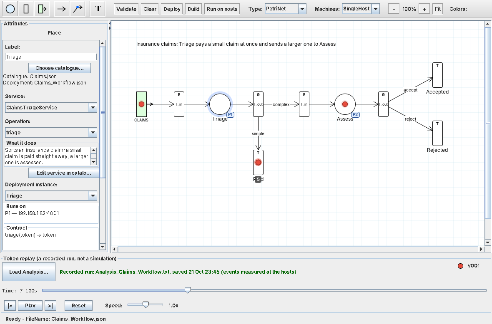

*The replay of the recorded run: claims 1–5 have been paid and claim 7 is at Assess.*

### Where next

- **Assess** still runs its starting code. Write it the same way, or let a service written in
  any language answer it over REST ([Call it over REST](ServiceTutorial.md#8-call-it-over-rest)).
  The supplied example does the second: [Tutorial.md, Example 2](Tutorial.md#example-2-a-claims-process-with-a-remote-service)
  calls Assess on the internet, so `AssessService` has no Java class in the catalogue.
- **If a service fails** at run time, the analysis says why, for example
  `5 failed at P1_Place: REST service ... could not be reached`, and the replay removes each
  failed token at its place. **Run on hosts** checks that every REST service answers before it starts.
- **Run on several machines**: [step 7](#7-run-on-several-machines).
- **Change the process while it runs**: [step 8](#8-change-a-running-process).
- **Write a service from the start**, with its catalogue entry by hand: [ServiceTutorial.md](ServiceTutorial.md).

## Each step in detail

This section takes one process from an empty canvas to a replayed run, all
from ProcessEditor, explaining each step:

- **Design**: a single place P2 calls `StochasticService.processToken`, which
  returns `true` or `false` at random.
- **Routing**: `true` terminates the workflow and `false` sends the same token
  back to P2.
- **Observation**: Monitor records every step from outside the token path.


*The P2 tutorial process. P2 is selected. The badge on the place and the **Runs
on** box show the node it is deployed to.*

| Step | What you do | Where |
|---|---|---|
| **1. Design the process** | Draw the net, choose the service and operation for P2, set the guards, then save | [Design](#1-design-the-process) |
| **2. Deploy the process** | Choose the node P2 runs on, then save the service deployment | [Deploy](#2-deploy-the-process) |
| **3. Create Build and Run** | Choose the event generators and the number of tokens; the editor writes the Ant launcher | [Build and Run](#3-create-build-and-run) |
| **4. Run it** | Click **Run on hosts**: the editor runs the launcher on real hosts, analyses the run and loads the replay | [Run](#4-run-it) |
| **5. Show the results** | Analyse the run, view the charts and replay the tokens on the design | [Results](#5-show-the-results) |
| **6. Add your own service** | Write a service, describe it in a catalogue, and use it like StochasticService (worked example: an inventory and a supplier) | [Your own service](#6-add-your-own-service) |
| **7. Run on several machines** | Describe the machines, package each host for its machine, start them, then run the launcher | [Several machines](#7-run-on-several-machines) |

Finished copies of every file are included as `P2_Tutorial_*` ([list](#repository-artefacts)):

- To follow along, save your own files as `My_P2_Workflow`. That keeps the
  supplied files for comparison.
- Every path below starts at the repository root.

## 1. Design the process

Choose **File → New → Process Definition**. The toolbar's **Type** starts at
**PetriNet**, which is what this tutorial uses; hover over it to see when to choose
**SOA** instead.

### Place the elements

Select a palette tool, click the canvas, then fill in the **Attributes** panel.
**Node Value** follows the **Node Type** automatically. The **Transition Type** of a transition
attached to a place follows its arcs: `T_in` once it has an arc into the place, `T_out` once the
place has an arc into it.

| Palette tool | Label | Attributes |
|---|---|---|
| Event Generator | `EG11` | Rate (ms): `1000`; Version: `v001` |
| Transition | `T_in_P2` | Transition Type: `T_in`; Node Type: `EdgeNode`; Buffer: `10` |
| Place | `P2` | Service: `StochasticService`; Operation: `processToken` (see below) |
| Transition | `T_out_P2` | Transition Type: `T_out`; Node Type: `GatewayNode` |
| Transition | `Terminate` | Transition Type: `Other`; Node Type: `TerminateNode` |

- Labels must be unique. Otherwise a label is just a name: `T1` works as well as `T_in_P2`.
- If you do name a transition `T_in_<name>` or `T_out_<name>`, Validate checks that `<name>` is
  its place's label or the node the place is deployed to, the same on the T_in and the T_out.
  Here both are `P2`; business models use the label, for example `T_in_Validation`.
- The generator's **Rate** and **Version** become the defaults in
  [Build and Run](#3-create-build-and-run).
- The supplied `P2_Tutorial_Workflow.json` stores `T_out_P2` as a `DecisionNode`. The runtime accepts it too, and both route on the guards below.

### Choose the service and operation

Select P2. Its Attributes panel works from the **service catalogue**: the list
of services and their operations that the hosts can run.

1. **Catalogue**: the panel names the catalogue in use. A new process starts with the standard
   services every process shares,
   [`BusinessServiceDefinitions/petrinet/PetriNetModels.json`](btsn.common/BusinessServiceDefinitions/petrinet/PetriNetModels.json),
   which is all this model needs. A process that needs services of its own uses its domain's
   catalogue instead ([Adding services while designing](#step-2-add-the-first-service)).
2. **Service**: hover over each entry in the list to see what it does. Choose `StochasticService`. Its only operation, `processToken`, is
   selected for you.
3. **What it does**: the box under the Operation says what the service does and what it returns, so you know how to route its result:

   > Decides at random: returns true or false with equal chance. Use it to model a step that sometimes has to be repeated, such as a check that can fail.<br>
   > Returns: true or false. Route on it from the T_out with guards true and false.

4. **Contract**: the box shows `processToken(token) → token`. The catalogue
   supplies the arguments; you do not type them.
5. **Runs on**: the box reads **Not deployed yet**. Where P2 runs is decided in [step 2](#2-deploy-the-process).

The Petri-net catalogue also offers `AlwaysTrueService`, which always returns
`true`. Use it in place of `StochasticService` when every run must take the same
route, for example to compare timings on different machines.

Choosing a service does not create one. `StochasticService` is already packaged
([source](btsn.common/src/org/btsn/services/StochasticService.java)) and runs
inside the generic host on whichever node you deploy P2 to.

The descriptions come from the catalogue, where each service has a
`description` and a `returns` entry. The Deploy panel shows the same text when you hover over a Service or Operation cell. When you add a service to a catalogue, describe it there as well; the editor checks require both entries.

### Connect the elements and set the guards

Use **Arrow (drag)**, or **Arrow (click waypoints)** to bend the return route.

| Source | Target | Arrow label | Guard Condition | Decision Value |
|---|---|---|---|---|
| `EG11` | `T_in_P2` | | | |
| `T_in_P2` | `P2` | | | |
| `P2` | `T_out_P2` | | | |
| `T_out_P2` | `Terminate` | `true` | `DECISION_EQUAL_TO` | `true` |
| `T_out_P2` | `T_in_P2` | `false` | `DECISION_EQUAL_TO` | `false` |

- **The label is only a caption.** Guard Condition and Decision Value define the route.
- **Otherwise:** set an arc's Guard Condition to `OTHERWISE` to have the T_out take it when no other guard matches, e.g. "anything else ends here". It takes no decision value, and a T_out has at most one.
- **A GatewayNode follows only guarded arcs.** An arc leaving a gateway with no guard is never taken, and Validate says so: guard it, make it Otherwise, or make the T_out an EdgeNode if every token goes there.
- Leave **Endpoint** blank.
- How a token moves:
  - T_in receives and buffers the token.
  - P2 invokes `processToken`.
  - T_out routes on the result: `false` repeats the visit with the same token, and `true` completes the workflow.
- `StochasticService` returns `true` with probability 0.5, so on average each workflow visits P2 twice.

### Forks and joins

- **An event generator feeds one place.** It issues one version's tokens, shaped for the service it feeds; it is not a step of the process.
  - Validate reports a generator with more than one arc. The runtime's own initialisers and collectors (`ProcessDefinitionFolder/common`) are the exception.
- **A generator has one of two roles, set by where its arc goes:**
  - **Arrivals** (an open process): its arc enters an ordinary T_in, and it sends one token per arrival into that place, at its rate.
  - **Initial marking** (a closed net, such as `TrafficLight_Workflow`): its arc enters a JoinNode T_in. It sends one token per input of the join's place, once, so the cycle can start. Rate and token count do not apply.
  - The editor shows which: a **M₀ ×2** badge on the diagram, a **Role** box in the generator's Attributes (with Rate greyed out), a Validate reminder, and the generator's row in Build.
  - A join's initial marking comes from one generator. Each generator runs under its own version, so two would start two copies of the net; Validate reports it.
- **A fork is a place's T_out.** Lead the generator to a first place, set that place's T_out **Node Type** to `ForkNode`, and draw an arc from it to each branch's T_in.
  - Each token's children are numbered N01, N02, ..., one per branch.
- **A join is the T_in of a place.** Set the T_in's **Node Type** to `JoinNode`; the place's host waits for one child from each arc.
  - A join with no place after it has nothing to host it, and Validate says so.
  - To end after a join, give it a place, then lead that place's T_out to a terminate node.
- **The join's place takes one input per arc.** Validate tells you what is missing; the editor changes nothing itself.
  - For a standard service, type them in the place's **Inputs** field, e.g. `token_branch1, token_branch2`.
  - Each place feeding the join returns the input its arc fills (first arc drawn, first input). Type it in that place's **Returns** field, e.g. `token_branch1`.
  - A service from your own catalogue declares its inputs and return name there: use **Edit Service in** *your catalogue*. **Create New Service** on a join place suggests one input per arc.
- After changing a fork or join, **Deploy** again so the deployment carries the new inputs.

### Validate and save

1. Click **Validate**. Fix any missing labels, incomplete operations or invalid connections.
   Validate also checks the guards against the values each service returns
   ([what it checks](#step-5-validate-and-save)).
2. Choose **File → Save Process Definition As...** and save to
   `btsn.common/ProcessDefinitionFolder/petrinet/Workflow/My_P2_Workflow.json`.

The process must be saved under `ProcessDefinitionFolder/<domain>/`:

- The domain folder (`petrinet`) selects the catalogue, the deployment folder
  and the launcher folder used in the next steps.
- Until it is deployed, the saved file records only its catalogue (`"catalog"`).

## 2. Deploy the process

Deploying decides which **node** (physical host) each place runs on. Each node is one numbered generic host, P1 to P6.

Save the process first: its folder decides its catalogue and where the deployment is saved.
If it is unsaved or has changes, **Deploy** asks you to save it before the panel opens.

### Choose the node

Use either route:

- **Right-click P2 → Deploy to → P2**: the quick route for a single place.
  - The place shows a dashed **P2** badge, and **Runs on** says *(not saved; use Deploy)*.
  - Use **Deploy panel...** on the same menu to open the panel described next.
- **Click Deploy** in the toolbar: opens the Deploy panel beside the editor, already filled from the process.


*The Deploy panel. It lists the places of your process, one row each, and you choose each place's Host node. The other columns are filled for you.*

| Column | Filled with | You change it when |
|---|---|---|
| **Place** | The place label on the canvas | Never; it ties the row to the canvas. Add or remove places in the diagram, not here. |
| **Host node** | Your right-click choice, or the first free node | You want the place on another host. Pick from the list, which gives each node's address and ports and marks nodes other places use; the canvas badge follows. |
| **Address** | The host node's address and the port of the row's slot | Never; it follows the Host node |
| **Service / Operation / Return Attribute** | The place's contract from the catalogue | Never; change the design instead |
| **Port Slot** | `0`, the node's first fixed port | A node has a second port (P4, P6) and you need it |
| **Instance** | The place label (`P2`) | You want another name. The supplied file uses `StochasticInstance1`. |
| **Invocation Adapter** | `boolean-token` for a Boolean service | Never for this tutorial |
| **Service endpoint** | Blank | You set the adapter to `rest`, so the host calls the service over HTTP ([Call it over REST](ServiceTutorial.md#8-call-it-over-rest)). The place's host still runs on its Host node; only the service runs at the endpoint. |

The nodes you can choose come from
[`SingleHost.json`](btsn.common/InfrastructureDefinitionFolder/SingleHost.json)
(**Choose infrastructure...** picks another):

| Node | Channel | Address | Fixed Base Ports |
|---|---|---|---|
| `P1` | `ip0` | `192.168.1.82` | `4001` |
| `P2` | `ip0` | `192.168.1.82` | `4002` |
| `P3` | `ip0` | `192.168.1.82` | `4003` |
| `P4` | `ip0` | `192.168.1.82` | `4004, 4007` |
| `P5` | `ip0` | `192.168.1.82` | `4005` |
| `P6` | `ip0` | `192.168.1.82` | `4006, 4008` |

- To change the nodes themselves, choose **File → Open → Infrastructure Definition...**.
- For a run on one computer you do not need to edit the address; [step 4](#4-run-it) overrides it.

### Save the deployment, then the process

1. In the panel, click **Save deployment...**. It suggests
   `btsn.common/ServiceDeploymentFolder/petrinet/My_P2_Workflow.json`; accept it.
2. The process now links to that deployment (`"serviceDeployment"`) and P2 takes its instance.
   - The badge turns solid.
   - **Runs on** reads `P2 — 192.168.1.82:4002`.
3. Save the process again with **File → Save Process Definition**.

The saved files link to one another:

- process → service deployment (`serviceDeployment`)
- service deployment → catalogue (`catalog`)

To see where any place runs, open the process and select the place. Bindings and
network rules are generated by the launcher when it runs; there is nothing else
to generate here.

## 3. Create Build and Run

Click **Build and Run** in the toolbar. The editor first checks that:

- the process and its deployment are both saved;
- every place is deployed on one of P1–P6;
- an event generator feeds a deployed place through a `T_in` transition.

It lists anything missing. When the deployment profile names a token generator
(the healthcare profile names `GenericHealthcareTokenGenerator`), the launcher uses it,
and each generator's tokens are filled from the token format of the service at its target place.


*Create Build and Run, shown for the P2 tutorial with a second generator, EG6, at v002. The summary marks each file as Write, Reuse or Replace before anything is written.*

| Choice | Default | Meaning |
|---|---|---|
| **Tokens per generator** | `10` | Root workflows each generator starts |
| **Wait after last token (s)** | `10` | Time for the last workflows to finish before collection |
| **Launcher name** | `<process>_BuildAndRun.xml` | File name of the launcher |
| **Folder** | `btsn.<domain>.ProjectLoader` | Where the launcher is written |

The **Event generators** table has one row per generator in the process:

| Column | Default | Meaning |
|---|---|---|
| **Run** | Ticked | Untick a generator to leave it out of this launcher |
| **Feeds** | From the design | The runtime place and operation the generator's tokens go to |
| **Version** | The generator's Version | Rule version for its tokens (`v001`–`v003`) |
| **Interval (ms)** | The generator's Rate | Spacing of its token schedule |

With more than one generator:

- **They all fire together.** Their workflows share the places and compete for them.
- **Each needs its own version.** The version keeps their tokens apart, so Create stays disabled until no two ticked generators share one.
- **The analysis separates them.** It reports each version on its own, and the replay shows all of them.

Click **Create**. For `My_P2_Workflow` the editor writes:

| File | Role |
|---|---|
| `btsn.petrinet.ProjectLoader/My_P2_Workflow_BuildAndRun.xml` | The launcher: your choices as properties, plus an import of the shared run phases |
| `btsn.services/deployments/models/My_P2_WorkflowDeployment.json` | Deployment profile: catalogue, infrastructure and your service deployment. An existing profile for the same deployment is reused. |
| `btsn.common.eventgenerators/EventTriggeringFile/My_P2_Workflow_BuildAndRun.csv` | Token schedule, one `time_ms,0,1` row per token. With several generators, each gets its own file, named after it (for example `..._BuildAndRun_EG6.csv`). |
| `ProcessDefinitionFolder/common/Initializers/P2_Initialization.json` | Resets the hosts and Monitor. Reused when it exists; written for a new set of nodes (for example `P3_P5_Initialization`). |
| `ProcessDefinitionFolder/common/Collectors/P2_Collector.json` | Collects the observations into Monitor. Reused or written the same way. |

- The launcher is about 25 lines; the supplied [`P2_Tutorial_Workflow_BuildAndRun.xml`](btsn.petrinet.ProjectLoader/P2_Tutorial_Workflow_BuildAndRun.xml) is an example.
- The run phases live in
  [`btsn.services/process-runtime.xml`](btsn.services/process-runtime.xml).
- To change a choice, run **Build and Run** again rather than editing the
  launcher. A command-line override also works for a single run ([step 4](#4-run-it)).

## 4. Run it

### Run from the editor

Click **Run on hosts** in the toolbar. The Run window finds the process's launcher and does the whole run:

1. **Builds and starts** the hosts, then follows the launcher step by step:

   **Initialise → Deploy rules → Commitments received → Fire tokens → Collect**

   - **Rules before tokens.** No token is fired until every host has committed to its rules. Each host confirms each version of the rules it is sent, and the launcher waits for those confirmations.
   - **Hosts table.** It shows each host process as it runs: its endpoint, its process number and machine, its state, the rule versions it has committed (for example `v999, v001, v002`) and how many service calls it has completed.
2. **Settles and stops.** When collection is done, it waits for Monitor to finish writing, then stops the launcher and every host it started.
3. **Analyses.** It runs `analyse` and saves the report to `btsn.common/AnalysisFolder/PetriNet/Analysis_My_P2_Workflow.txt`, replacing any earlier analysis of the process.
4. **Loads the replay.** It loads the analysis into the editor and highlights **Play** ([step 5](#replay-the-tokens-on-the-design)).

The output ends with a summary of the run:

- **Per version**, measured: for example `v001: 10 generated, 10 completed, structure OK, latency 275 to 1220 ms (median 663 ms)`. It flags any version whose workflows did not all complete.
- **Where and when it ran**: for example `Ran 17:51:00 to 17:52:15 (75 s) on P2_Place at 127.0.0.1:4002 (process 1084 on my-pc, 41 service calls); Monitor (...)`.

Below it, **Next steps** offers:

| Button | Opens |
|---|---|
| **Replay the recorded run** | The editor, replaying the recorded tokens on the design |
| **Elapsed time and queue wait chart** | Monitor's per-workflow timing chart, for each version |
| **Token spatial view** | Monitor's view of activity at each place over time |
| **Open analysis report** | The full analyzer report |

> **This is a real run, not a simulation.**
>
> - **Real hosts.** Each place runs as its own host process, a generic RPSO host carrying that place's rules. Tokens travel between hosts as network messages on the endpoints shown in the Hosts table.
> - **Real records.** Every host records what it did, with its own timestamps. After the run, Monitor collects those records from the hosts.
> - **A replay, not a model.** The analysis, the charts and the replay are all built from those collected records: the replay shows what happened, in the order and at the times the hosts recorded it.
> - **Across machines.** Untick **Run every host on this computer**, and the same launcher drives hosts on the machines named in `SingleHost.json`.

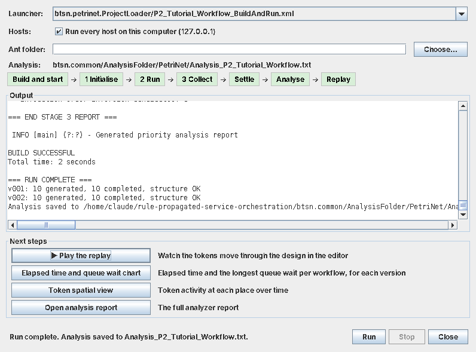

*A finished run of the P2 tutorial (here with its two generators). Each step turns green as the run reaches it.*

- **Hosts**: **Run every host on this computer** (ticked) adds `-Dhost.address=127.0.0.1`.
- **Ant folder**: leave it empty. The editor finds Apache Ant by itself, trying in order:
  - `ANT_HOME`;
  - `ant` on the PATH;
  - the Ant inside the Eclipse that started the editor (`plugins/org.apache.ant_*`).

  If none is found, choose Ant's folder (the one holding `bin` and `lib`), not a launcher. Ant runs on the editor's own Java, so the editor must run on a JDK (Eclipse's default).
- **Stop**: stops the run, and its hosts, at any point.
- **Close**: closing the window during a run stops it too.
- **Save first**: Run uses the saved process and the launcher from [step 3](#3-create-build-and-run).

### Or run the launcher yourself

- **In Eclipse**: refresh `btsn.petrinet.ProjectLoader`, right-click
  **My_P2_Workflow_BuildAndRun.xml**, then choose **Run As → Ant Build**.
- **From a terminal**:

  ```sh
  ant -f btsn.petrinet.ProjectLoader/My_P2_Workflow_BuildAndRun.xml -Dhost.address=127.0.0.1
  ```

- **On one computer**: `-Dhost.address=127.0.0.1` runs every host on this machine. In Eclipse, put it under
  **Run As → Ant Build... → Main → Arguments**. Without it, a host starts locally only when its `SingleHost.json` address belongs to this computer.

The default target `run-complete-workflow` does everything:

- builds the JARs;
- prepares an isolated runtime under `btsn.services/target/launchers/My_P2_Workflow_BuildAndRun`;
- starts P2 and Monitor;
- runs the three phases.

| Phase | What happens | Definition used |
|---|---|---|
| 1 — Database initialization | Reset P2 and Monitor (administrative version `v999`) | `common/Initializers/P2_Initialization` |
| 2 — Workflow execution | Generate the rules for P2 and send them as `v001`. P2 commits to them (a confirmation per version), and only then are the tokens fired from EG11 | `petrinet/Workflow/My_P2_Workflow` |
| 3 — Data collection | Request P2's observations and write them to Monitor | `common/Collectors/P2_Collector` |

### Stop it when collection finishes

The console ends with `... COMPLETED SUCCESSFULLY` and
`Services are still running. Press Ctrl+C to stop.`

1. Allow Monitor a few seconds to finish writing.
2. Stop the run with Eclipse's red **Terminate** button, or **Ctrl+C** in the terminal. This releases the Monitor database for the analyser and viewers.

Host logs go to `P2_Place.out.txt` and `MonitorService.out.txt` beside the
launcher. The collected data is in `btsn.common.Monitor/ServiceAnalysisDataBase`.

### Change a run without regenerating

| Override | Effect |
|---|---|
| `-Dtoken.count=5` | Fire only the first 5 tokens of the schedule. To fire more than it holds, recreate the launcher with a larger number. |
| `-Dworkflow.completion.seconds=30` | Wait longer after the last token before collecting |
| `-Dhost.address=127.0.0.1` | Run every host on this machine |
| `-Dp2.mode=local` or `remote` | Force a host to start here, or expect it elsewhere |

`ant -f <launcher> help` lists these.

## 5. Show the results

### Analyse the run

After stopping the run:

```sh
ant -emacs -f btsn.petrinet.ProjectLoader/My_P2_Workflow_BuildAndRun.xml analyse > btsn.common/AnalysisFolder/PetriNet/Analysis_My_P2_Workflow.txt
```

- **In Eclipse**: run the launcher's **analyse** target and copy the console
  into that file.
- **Ant's `[java]` prefixes**: they are fine. The editor's replay accepts them.
- **Several analyses in one file**: if you append analyses to the same file, replay uses the last one.

Check the report's first section, **CANONICAL WORKFLOW RECONSTRUCTION**:

- `Generated workflows` and `Completed workflows` should both equal the number
  of tokens.
- `Structural result: [OK]`.
- There should be no forks or joins.

Count workflows separately from place visits:

- Each `false` result makes the same workflow visit P2 again.
- So there are usually more visits than workflows.
- Administrative `v999` activity is reported separately.

The supplied run ([analysis](btsn.common/AnalysisFolder/PetriNet/Analysis_P2_Tutorial_Workflow.txt)) gives:

| Measure | Value |
|---|---|
| Generated / completed workflows | 10 / 10 |
| P2 visits (5 repeats after `false`) | 15 |
| End-to-end latency | 152 to 885 ms, median 260 ms |
| Token inter-arrival | 1,000 ms (from the schedule) |

Boolean outcomes, repeat counts and timings vary from run to run.

### Replay the tokens on the design

1. Open `My_P2_Workflow.json` in ProcessEditor.
2. Click **Load Analysis...** and choose `Analysis_My_P2_Workflow.txt`.
3. Use **Play**, the step buttons and **Speed**.
   - Each token enters at EG11 and is held at P2 while the service runs.
   - It returns along `false`, or leaves along `true` to **Terminate**.

Use the process that produced the run: the replay matches log entries to the places on the canvas. Replaying does not deploy or rerun anything.

### Timing chart and spatial view

After a run from the editor, open these from **Next steps**. Otherwise, run them from the launcher once its hosts have stopped:

```sh
ant -f btsn.petrinet.ProjectLoader/My_P2_Workflow_BuildAndRun.xml chart-timing
ant -f btsn.petrinet.ProjectLoader/My_P2_Workflow_BuildAndRun.xml chart-spatial
```

You can also run them as Java applications from `btsn.common.Monitor`, with that project as the working directory:

| Viewer | What it shows |
|---|---|
| `org.btsn.derby.Analysis.SwingGanttChart_WithLatency` | Elapsed time per workflow, with the longest queue wait observed on a service visit |
| `org.btsn.derby.Analysis.WorkflowSpatialView` | Activity at each place over time, including repeat visits |

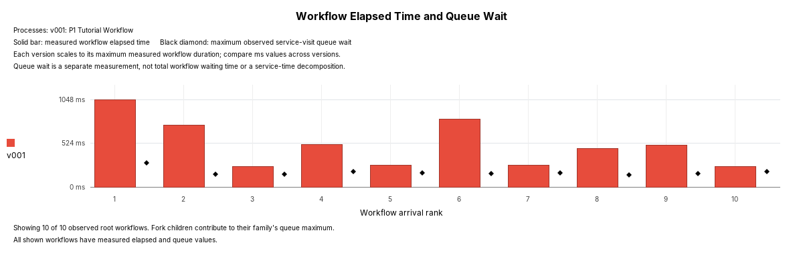

*Elapsed time per workflow from the [captured P1 reference run](docs/tutorials/p1/results/README.md), the same loop on node P1:*

- *Bars run from generation to completion.*
- *Black diamonds mark the longest queue wait on a single service visit, not the total across the loop.*

That reference run has its own launcher and export target. It writes the
analysis, per-workflow CSV and charts to `btsn.services/target/tutorial-results/P1`:

```sh
ant -f btsn.petrinet.ProjectLoader/P1_Tutorial_Local_BuildAndRun.xml
ant -f btsn.petrinet.ProjectLoader/P1_Tutorial_Local_BuildAndRun.xml export-tutorial-results
```

### If your results differ

| Observation | Check |
|---|---|
| Build and Run lists problems | Save the process and the deployment; deploy every place on P1–P6, each on its own node; connect the generator to a `T_in` |
| The Deploy panel's node table is empty | Start ProcessEditor with `btsn.workflowEditor` as its working directory |
| A host or Monitor was skipped at startup | Add `-Dhost.address=127.0.0.1`, or start that host on its configured machine |
| Derby reports another active instance | Stop the previous run, and any viewer holding the database, before analysing |
| Fewer completed workflows than generated | Wait longer before collecting: `-Dworkflow.completion.seconds=30`, or raise **Wait after last token** and recreate the launcher |
| Replay shows no tokens, or tokens skip a place | Load the analysis with the process that produced it, and check it is that run's file |
| A design change did not run | Save the process. If you changed places, redeploy and save the deployment first. |

## 6. Add your own service

New to writing services? [ServiceTutorial.md](ServiceTutorial.md) builds one from scratch, step by step: a credit check that routes to `approve` or `refer`. The inventory example below goes further.

StochasticService only tosses a coin. Any Java class can be a place's service, and the rest of the flow (design, Deploy, Build and Run, Run on hosts, replay) stays the same. The supplied **inventory example** shows how, in a deliberately small process: it is an example of extending RPSO, not a full business process.


*The inventory example. Inventory runs on P1 and Supplier on P2. The **What it does** box comes from the new catalogue.*

### What it shows

| | Inventory (P1) `InventoryService.reserve` | Supplier (P2) `SupplierService.restock` |
|---|---|---|
| **State** | Stock count, 5 at start | Deliveries left, 1 at start (3 units each) |
| **Routes** | `reserved` to **Shipped**; `out_of_stock` to Supplier | `restocked` back to Inventory, carrying the units; `unavailable` to **Cancelled** |

- **State in a service.** The host keeps the stock between orders, so early orders behave differently from later ones.
- **Routing on any value.** The T_out guards test string results (`reserved`, `out_of_stock`, ...), not just `true` and `false`.
- **Hosts working together.** An order can go from P1 to P2 and back. The hosts share no memory, so the supplier's delivery travels back to the inventory inside the order itself.
- **Real concurrency.** Ten orders always give 8 shipped and 2 cancelled, but which orders are cancelled depends on timing between the hosts. In our runs, order 7 reached the inventory while order 6 was still returning from the supplier with the only delivery; it found no stock, and was cancelled. On a faster machine it could be orders 9 and 10. The replay shows it happening.

### Run it

1. Open [`inventory/Workflow/Inventory_Workflow.json`](btsn.common/ProcessDefinitionFolder/inventory/Workflow/Inventory_Workflow.json).
2. Click **Run on hosts**. The supplied launcher runs P1, P2 and Monitor.

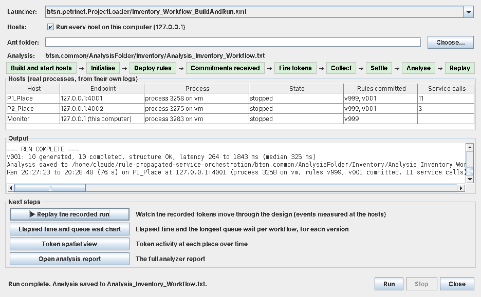

*P1 made 11 service calls: 10 orders, plus order 6 back from the supplier. P2 made 3: order 6 restocked, and two orders it could not restock.*

### The files for a new service

| File | What to put in it |
|---|---|
| [`InventoryService.java`](btsn.common/src/org/btsn/business/inventory/InventoryService.java), [`SupplierService.java`](btsn.common/src/org/btsn/business/inventory/SupplierService.java) | The services, in a package under `org.btsn.business` |
| [`BusinessServiceDefinitions/inventory/Inventory.json`](btsn.common/BusinessServiceDefinitions/inventory/Inventory.json) | The catalogue: class, operation, inputs, result, `description` and `returns` |
| [`btsn.services/packaging.json`](btsn.services/packaging.json) | Add the catalogue to `catalogues`, and its domain to `catalogueDomains` |
| [`ServiceDeploymentFolder/inventory/Inventory.json`](btsn.common/ServiceDeploymentFolder/inventory/Inventory.json) | Written by **Deploy**: the node each service runs on |
| [`ProcessDefinitionFolder/inventory/Workflow/Inventory_Workflow.json`](btsn.common/ProcessDefinitionFolder/inventory/Workflow/Inventory_Workflow.json) | The process, drawn in the editor |
| [`Inventory_Workflow_BuildAndRun.xml`](btsn.petrinet.ProjectLoader/Inventory_Workflow_BuildAndRun.xml) | Written by **Build and Run** |

### Writing a service

```java
public class InventoryService extends BaseBusinessService {
    public InventoryService(String sequenceId) { ... }          // the host passes the order's token id
    public String reserve(String token) {                        // one String (JSON) per catalogue input
        int delivered = (int)numberValue(token, "delivered_units", 0);
        ...
        result.put("routing_decision", routingDecision(reserved ? "reserved" : "out_of_stock"));
        return businessResult("inventoryResults", result);      // the catalogue's returnAttribute
    }
}
```

- **Its own catalogue and domain.** Use a new folder under `BusinessServiceDefinitions` (here `inventory`). Save the process under a matching `ProcessDefinitionFolder/inventory`, so the editor selects the catalogue, and **Deploy** saves to `ServiceDeploymentFolder/inventory`.
- **Inputs and results.** Each catalogue input arrives as a JSON string. The method's result is `{returnAttribute: {...}}`, and its `routing_decision.routing_path` is the value the guards test.
- **GatewayNode on the T_out.** It routes on the value and passes the whole result on. (A DecisionNode passes on only the route.)
- **State lives in one host.** Use `static` fields, made thread-safe, as the examples do; they start again whenever the host starts. Hosts never share memory: send anything another host needs inside the result.
- **Going back to an earlier place.** Return your result under the name that place takes as input. The supplier returns `token`, which is the inventory's input.
- **Describe it.** The editor checks require `description` and `returns` for every catalogue entry.

## 7. Run on several machines

Hosts talk to each other only by UDP messages, so the same process runs unchanged when its hosts are on different machines. The machine you run the launcher on also runs Monitor and the event generators. Each other machine runs a **host package**: a folder holding everything its host needs.

The worked example spreads the four-place fork/join over three machines. P1 forks to P2 and P3, which run on two other machines, and their results join at P4, back on the first machine. Each branch reaches the join over its own network path.

### Choose the machines

An infrastructure definition gives each node its machine. Three are supplied:

| Definition | Machines |
|---|---|
| [`TwoHost.json`](btsn.common/InfrastructureDefinitionFolder/TwoHost.json) | P1, P3, P5 on 192.168.1.82; P2, P4, P6 on 192.168.1.152. Use it for the inventory example (Supplier on the second machine). |
| [`ThreeHost.json`](btsn.common/InfrastructureDefinitionFolder/ThreeHost.json) | P1, P4 on 192.168.1.82; P2, P5 on 192.168.1.152; P3, P6 on 192.168.1.90. Use it for the fork/join. |
| [`MultiHost.json`](btsn.common/InfrastructureDefinitionFolder/MultiHost.json) | A template for three machines, two nodes on each. |

1. Choose **File → Open → Infrastructure Definition** and open `ThreeHost.json`. Opening it makes it the editor's **Machines** (shown on the toolbar).
2. Change the addresses to your machines and save. The rules:
   - **One channel per machine**, each with that machine's address. Nodes on the same machine share its channel.
   - **`ip0` is the machine you run the launcher on.** Monitor runs there.
   - **Use `ip0` to `ip4`.** The channel number also shifts the ports (`ip1` adds 1000).
3. Open [`P1_P2_P3_P4_Fork_Join_Workflow.json`](btsn.common/ProcessDefinitionFolder/petrinet/Workflow/P1_P2_P3_P4_Fork_Join_Workflow.json) and select P2. **Runs on** shows `P2 — 192.168.1.152:4002 (ThreeHost)`.

Keep [`SingleHost.json`](btsn.common/InfrastructureDefinitionFolder/SingleHost.json) for runs on one machine: choose it under **Machines** to go back.

### Build the host packages

Click **Build**. The dialog shows the machines, and its summary lists one package for each other machine, named after the hosts it starts:

```
Package  P2 for 192.168.1.152 (Build host packages; start it on its machine)
Package  P3 for 192.168.1.90 (Build host packages; start it on its machine)
```

Click **Build host packages**. It writes the launcher, builds one ZIP per listed machine in `btsn.services/target/host-packages/P1_P2_P3_P4_Fork_Join_Workflow_BuildAndRun/`, and opens that folder. Each package holds:

- **Its hosts**: each host's JAR and the shared infrastructure JAR, with no business classes inside.
- **Their services**: only the business service JARs the deployment places on those hosts, kept as separate JARs.
- **The master ruleset**: the rules and bindings the launcher generated, the same files the hosts on the `ip0` machine read. `README.txt` gives its digest.
- **Launch scripts and a README**: the machine's address, its hosts, their ports and how to start them. A machine with two hosts gets one package, for example `…_P3P6.zip`.

Build the packages again whenever the process, its deployment or the machines change.

From the command line, on the `ip0` machine:

```sh
cd btsn.petrinet.ProjectLoader
ant -f P1_P2_P3_P4_Fork_Join_Workflow_BuildAndRun.xml host-packages -Dinfrastructure=ThreeHost
```

### Start the hosts, then run

1. Copy each ZIP to its machine and extract it. Those machines need Java 15 or later; they do not need Ant or this repository.
2. Start the package's hosts in one of two ways. When Windows asks, let Java use private networks. Wait for `Service Handler is listening` from each host.
   - `launch.bat` (or `sh launch.sh`) starts every host in the package, each in its own window.
   - `launch-to-file.bat` (or `sh launch-to-file.sh`) starts them too, but each writes its output to `Pn_Place.out.txt` in the package folder, the same file a local host writes. Open it in Notepad to follow the run.
   - `launch-Pn.bat` and `launch-to-file-Pn.bat` start a single host.

   Nothing stops a remote host on a timer: it runs until you press Ctrl+C. Keep the machine from sleeping.
3. On the `ip0` machine, click **Run on hosts**, then **Run**. From the command line:

   ```sh
   ant -f P1_P2_P3_P4_Fork_Join_Workflow_BuildAndRun.xml -Dinfrastructure=ThreeHost
   ```

   The launcher starts P1, P4 and Monitor, and skips P2 and P3 (`[p2] Skipping - running on remote host`). It prints `Master ruleset …`, which must match each package's README. It then:
   - deploys the rules to every host and waits for each one to commit;
   - fires the tokens;
   - collects every host's records into Monitor.
4. The editor analyses the run and loads the replay as usual.

**What to look for in the analysis.** The structural results are the same as on one machine:
- **Forks and joins:** `Fork families` equals `Observed join sites`, and `Orphan fork children` is 0.
- **Branch executions:** P2 and P3 each execute once per fork.

The join measures (time from first arrival to ENTER, and the skew between branch arrivals) now include each branch's network path.

### Timing across machines

- **Per-place times are on one clock.** Queue, service and residence times, and the join measures, are differences between timestamps taken by one host, so the clocks of different machines don't affect them.
- **Measures that cross machines also carry the clocks' offset.** The analysis bounds that offset under **Temporal data quality**, for example `clock(P2_Place) - clock(P1_Place) between -291 and -12 ms`, using the rule that a token cannot arrive before it was sent. No setup is needed beyond the operating system's time service.
- **The replay and spatial view use the `ip0` clock.** Places on one channel share a machine's clock. When tokens go to another machine and come back (P1 → P2 → P4 above), its offset is bounded from both sides. The analysis then reports an estimate such as `ip1 [P2_Place]: -22487 ms (bounds -22680..-22294 ms)`, and shifts that machine's times by it for the animation and the spatial view. The database keeps each machine's own timestamps.
- **A machine whose clock is more than 2 minutes ahead of `ip0` drops every token.** Tokens expire 120 s after the event generator creates them, by each receiving machine's own clock. The host's output shows `EVENT REJECTED BY SCHEDULER`. Check the date as well as the time.
- **Coarse clocks on some Windows machines.** On some Windows machines (Windows 7, for example) the clock advances in 15.6 ms steps, so times measured there are resolved to about ±16 ms.

### Network and firewalls

- **Network.** Use a local network or a VPN. Tokens and rules travel as plain UDP, without authentication or encryption.
- **Firewalls.** Each package's README lists the ports its host listens on. The `ip0` machine must accept UDP from the others for Monitor and for rule commitments (ports 35000 and up). If ping between the machines fails, allow ICMP echo in the firewall to check the path.

## 8. Change a running process

A running process changes when a new rule version is published to its hosts. No host is restarted and no code changes. Tokens already in flight finish under the version they started with.

The example is in [`ProcessDefinitionFolder/petrinet/LiveChange`](btsn.common/ProcessDefinitionFolder/petrinet/LiveChange). Every place runs `AlwaysTrueService`, so only the rules decide the route:

| File | What it is |
|---|---|
| `P1_P2_P3_P4_ForkRebalance_Workflow_LiveChange.json` | The combined process, named after its launcher: an amalgam of the two processes below, with EG1, EG2 and P6 drawn as a standby service. Open it in the editor. **Build** says it is a combined process, shows what its launcher runs, and builds the host packages; you copy them to their machines and start them; then **Run on hosts** runs the launcher of the same name. |
| `P1_P2_P3_P4_ForkRebalance_Workflow.json` | `v001`: P1 forks to P2 and P3, which join at P4 |
| `P1_P3_P4_P6_ForkRebalance_Workflow.json` | `v002`: the same, but the second branch runs on P6 |

One launch runs both, [`P1_P2_P3_P4_ForkRebalance_Workflow_LiveChange.xml`](btsn.petrinet.ProjectLoader/P1_P2_P3_P4_ForkRebalance_Workflow_LiveChange.xml), like the healthcare launchers that run several workflows together:
1. Every host is started and initialised, P6 included. P6 gets no `v001` rules, so it does nothing.
2. EG1 fires 90 `v001` tokens, one a second.
3. At 10 s, `v002` is compiled and published to the running hosts, which commit it while `v001` tokens are in flight. P6 is now prepared: it holds rules nothing uses yet. Nothing about `v002` exists before this: it is compiled here, not at the start.
4. 30 s after every host has committed, about halfway through `v001`, the need for P6 is assumed and EG2 fires 30 `v002` tokens while `v001` is still firing.

The `[LIVE]` lines give the times the publish started, every host had committed, and the first `v002` token was fired.

A standby node's contract comes from the service deployment: the first build writes a canonical binding for every node the deployment lists, so P6's package carries its contract before `v002` exists.

On `ThreeHost`:
- **192.168.1.152**: unzip `…_LiveChange_P2.zip` and run `launch-to-file.bat` (P2).
- **192.168.1.90**: unzip `…_LiveChange_P3P6.zip` and run `launch-to-file.bat` (P3 and P6).
- **192.168.1.82**: run the launcher, and nothing else on this machine at the same time; then run its `analyse` target.

```sh
cd btsn.petrinet.ProjectLoader
ant -f P1_P2_P3_P4_ForkRebalance_Workflow_LiveChange.xml host-packages     # the packages for .152 and .90
ant -f P1_P2_P3_P4_ForkRebalance_Workflow_LiveChange.xml                   # the run, on 192.168.1.82
ant -f P1_P2_P3_P4_ForkRebalance_Workflow_LiveChange.xml analyse
```

To run everything on one machine, add `-Dinfrastructure=SingleHost -Dhost.address=127.0.0.1` to the run.

**What to look for:**
- **Both versions:** the analysis has a section for `v001` (workflow base 1000000) and one for `v002` (2000000).
- **Routes:** under `LOGICAL PLACE EXECUTIONS`, there is no P6 in `v001` and no P2 in `v002`.
- **Nothing lost:** generated and completed workflows are equal for each version.
- **Forks and joins:** each version has as many forks and joins as workflows, and `Join-family violations: 0`.
- **Overlap:** both versions run on P1, P3 and P4 at the same time (`CROSS-VERSION PRIORITY ANALYSIS` lists them as shared services).

**What travels by message.** A version's routing rules reach the hosts as rule messages. Its service contracts are read from each host's `btsn.common`. The two versions share their contracts (P6 has P2's), so `v002` needs nothing new on the hosts.

## Quick start: run, observe and replay

You need a JDK (15 or later; tested with 21) and Apache Ant 1.10.2 or later.
Ant comes with Eclipse, which runs every launcher as an **Ant Build**, and the editor
finds it there by itself; install Ant separately only to run launchers from a command
line. Eclipse itself is optional: every launcher is an ordinary Ant build file. The repository supplies the runtime libraries,
including OOjDREW and embedded Derby, so no Maven or Python is needed.

### From the editor

1. **Start the editor.** In Eclipse, run `com.editor.ProcessEditor` (`btsn.workflowEditor`) as a Java application, or run
   `ant -f btsn.workflowEditor/build.xml clean jar run`.
2. **Open a process** that has a launcher, for example:
   - `btsn.common/ProcessDefinitionFolder/claims/Workflow/Claims_Workflow.json`, the insurance-claims process of [Adding services while designing](#adding-services-while-designing), on two hosts;
   - `btsn.common/ProcessDefinitionFolder/inventory/Workflow/Inventory_Workflow.json`, an inventory and a supplier on two hosts;
   - `btsn.common/ProcessDefinitionFolder/petrinet/Workflow/P2_Tutorial_Workflow.json`, the tutorial's single place.

   For another process, click **Build and Run** first to create its launcher.
3. **Click Run on hosts.** The Run window starts every host on this computer and shows each one: its process, the rules it has committed and the service calls it makes. When collection is done, it stops the hosts, analyses the run and summarises it.
4. **Choose a next step:**
   - **Replay the recorded run** on the design;
   - open the **Elapsed time and queue wait chart** or the **Token spatial view**;
   - read the analysis report.

The editor finds Apache Ant by itself (`ANT_HOME`, the PATH, or the Ant inside Eclipse).

### From the command line

**1. Run a distributed workflow on one computer.** All launchers read node
addresses from
[`SingleHost.json`](btsn.common/InfrastructureDefinitionFolder/README.md), which
defaults to `192.168.1.82`. On any other machine, every place resolves as remote
and nothing starts, so pass the loopback address:

```sh
cd btsn.petrinet.ProjectLoader
ant -f P1_P2_P3_P4_Concurrent_BuildAndRun.xml -Dhost.address=127.0.0.1
```

This starts four place hosts and Monitor as separate processes, installs each
host's rules, fires two concurrent workflows (twenty tokens) through the
fork-and-join model below, and collects the measurements. The first lines of the
output should report each place as `local`. The hosts keep running after
collection; stop the launcher before starting another one.

**2. Analyse the run.** Save the analyzer's output so the editor can replay it.
`-emacs` keeps the saved output free of Ant's `[java]` line prefixes.

```sh
ant -emacs -f P1_P2_P3_P4_Concurrent_BuildAndRun.xml analyse > analysis.txt
```

**3. View the measurements.** Every launcher opens Monitor's two charts,
`SwingGanttChart_WithLatency` (workflow elapsed time and queue waits) and
`WorkflowSpatialView` (each token's visits, one lane per place):

```sh
ant -f P1_P2_P3_P4_Concurrent_BuildAndRun.xml chart-timing
ant -f P1_P2_P3_P4_Concurrent_BuildAndRun.xml chart-spatial
```

**4. Replay it on the model.** Start the editor, open
`btsn.common/ProcessDefinitionFolder/petrinet/Workflow/P1_P2_P3_P4_Fork_Join_Workflow.json`,
click **Load Analysis...**, choose `analysis.txt` and press **Play**.

**5. Spread it across machines.** Give each machine its own channel and address
in an infrastructure definition such as
[`MultiHost.json`](btsn.common/InfrastructureDefinitionFolder/MultiHost.json).
`ant -f <launcher> host-packages -Dinfrastructure=MultiHost` then builds a
self-contained package for each host on another machine. Each package holds the
host, its business services and the master ruleset this deployment generated.
Start each package on its machine, then run the launcher with the same
`-Dinfrastructure`. It sends rules and tokens to those hosts over UDP and collects
their records into Monitor. See
[Run on several machines](#7-run-on-several-machines).

The sections below explain what you have just run, starting from a single place
([Tutorial.md](Tutorial.md) walks through editing and running it).

## Run an example

Every launcher runs the same way:

- right-click it, then choose **Run As → Ant Build** (default target `run-complete-workflow`);
- add `-Dhost.address=127.0.0.1` to run on one computer;
- afterwards, run its `analyse` target.

| Example | Ant entry point |
|---|---|
| From an idea: insurance claims ([Adding services while designing](#adding-services-while-designing)) | [Claims_Workflow_BuildAndRun.xml](btsn.petrinet.ProjectLoader/Claims_Workflow_BuildAndRun.xml) |
| Single place ([Each step in detail](#each-step-in-detail)) | [P2_Tutorial_Workflow_BuildAndRun.xml](btsn.petrinet.ProjectLoader/P2_Tutorial_Workflow_BuildAndRun.xml) |
| Single place, P1 reference | [P1_Tutorial_Local_BuildAndRun.xml](btsn.petrinet.ProjectLoader/P1_Tutorial_Local_BuildAndRun.xml) |
| Your first service: credit check ([ServiceTutorial.md](ServiceTutorial.md)) | [Credit_Check_Workflow_BuildAndRun.xml](btsn.petrinet.ProjectLoader/Credit_Check_Workflow_BuildAndRun.xml) |
| Your own service: inventory and supplier | [Inventory_Workflow_BuildAndRun.xml](btsn.petrinet.ProjectLoader/Inventory_Workflow_BuildAndRun.xml) |
| P1–P4 fork/join model | [P1_P2_P3_P4_Fork_Join_Workflow_BuildAndRun.xml](btsn.petrinet.ProjectLoader/P1_P2_P3_P4_Fork_Join_Workflow_BuildAndRun.xml) |
| Six-place double-join model | [P1_to_P6_Double_Join_Workflow.xml](btsn.petrinet.ProjectLoader/P1_to_P6_Double_Join_Workflow.xml) |
| Emergency department | [Emergency_Department_BuildAndRun.xml](btsn.healthcare.ProjectLoader/Emergency_Department_BuildAndRun.xml) |
| Full Financial application | [FinancialSystem_P1_P5_BuildAndRun.xml](btsn.financial.ProjectLoader/FinancialSystem_P1_P5_BuildAndRun.xml) |
| Concurrent healthcare versions | [Triple_Workflow_Emergencey_Department_Concurrent.xml](btsn.healthcare.ProjectLoader/Triple_Workflow_Emergencey_Department_Concurrent.xml) |

- **File name**: the concurrent launcher's name contains the typo `Emergencey`; use it as named.
- **More scenarios**: the loader guides list further scenarios:
  [healthcare](btsn.healthcare.ProjectLoader/README.md),
  [Financial](btsn.financial.ProjectLoader/README.md) and
  [Petri-net models](btsn.petrinet.ProjectLoader/README.md).
- **Remote hosts**: start them from host packages built for the same deployment; see
  [Run on several machines](#7-run-on-several-machines).
- **One run at a time**: stop one run before starting another on the same ports.

## Observe and interpret a run

The captures provide a visual overview. To assess a run, connect those pictures
back to the recorded roots, service visits and completion events. The tools below
let us check whether the workflows completed, trace where they spent time and
replay their observed paths on the model.

Monitor is an **observation service outside the active business-token path**.
An explicit business `TerminateNode` defines completion in the migrated workflows;
collector arrival at Monitor is a separate observation boundary. Initializer and
collector commands are administration traffic, normally using v999.

The tools in `btsn.common.Monitor/src/org/btsn/derby/Analysis` include:

| Tool | Use |
|---|---|
| `PetriNetAnalyzer` | Generated roots, fork genealogy, join consumption, canonical place visits, completion and structural/temporal checks |
| `SwingGanttChart_WithLatency` | Workflow elapsed/queue figure, measured timeline, service queue comparisons, and publication exports |
| `WorkflowSpatialView` | Each token's visits over time, one lane per place, labelled with its service and node |

The combined chart offers **Diamonds** and **Lower Queue Shading** from
**View → Queue Display**. The bar shows measured workflow elapsed time; the marker
or lighter lower portion shows the **maximum observed service-visit queue wait**
across that workflow family. This is an independent measurement, not total
workflow waiting or an additive decomposition into waiting and service time.

**View → Y-Axis Scale → Scale Each Version** is the default: each version lane
scales to its maximum measured workflow duration. Select **Shared Milliseconds**
to compare absolute durations by bar height across versions. **Workflow arrival
rank** on the x-axis counts roots in generation order across all versions;
equal spacing does not mean equal time between arrivals. Time is measured on
the y-axis, in milliseconds; bar width does not encode duration. Missing
observations remain unavailable rather than being plotted as measured zero.

**View → Bar Width → Wide (Publication)** is the default for a fuller figure,
closer to the earlier presentation. Select **Narrow** for the thinner bars.
Both choices preserve arrival positions, measured heights, lane scales and
lower queue shading, and apply to PNG, PDF and TikZ exports. The footer reports
how many observed roots the selected **Display Range** shows. This count describes
the plotted data; a narrow viewport may still require horizontal scrolling.
A dashed queue outline means the wait is known but the elapsed interval is
unavailable; the chart retains that root without inventing a completion time.
For a full figure rather than a viewport screenshot, select **Display Range →
Show All**, then use **File → Export Chart to PNG** or the PDF/TikZ export.

New runs capture their process definitions in
`btsn.common.Monitor/WorkflowRunMetadata`; charts and exports display that context.
Keep this metadata with `ServiceAnalysisDataBase` when archiving results. Older
runs without matching metadata show `Process not captured`.

After **Run on hosts**, the editor
([ProcessEditor source](btsn.workflowEditor/src/com/editor/ProcessEditor.java)) loads
the run's analysis itself and highlights **Play**. To replay an earlier run,
open the matching workflow JSON, click **Load Analysis...** and choose the
analyzer output: the files under `btsn.common/AnalysisFolder`, or one saved with
`ant -emacs … analyse > analysis.txt`. Replaying shows recorded observations; it
does not run the workflow again. Every launcher also opens the two charts with
its `chart-timing` and `chart-spatial` targets. The editor saves each run's whole
console to `btsn.services/target/run-logs/Run_<launcher>.txt`.
A process that never terminates (the traffic light's loop) is still running while
its hosts are collected one after another, so their records end at different times;
the replay stops where the first host stopped recording and says so.
Open the workflow from its place under `btsn.common/ProcessDefinitionFolder` so
that its service deployment loads. The analyzer names places and transitions
after their hosting node (`P1_Place`, `T_in_P1`), and the deployment maps those
nodes to the labels on the canvas, such as `NS_Green` in the traffic-light model.

## Inside each host

Every host runs the same pattern, whatever service its place is bound to: **T_in** receives a token and waits until the inputs it needs have arrived, **P** does the work, and **T_out** sends the result on to the next host or ends the workflow.

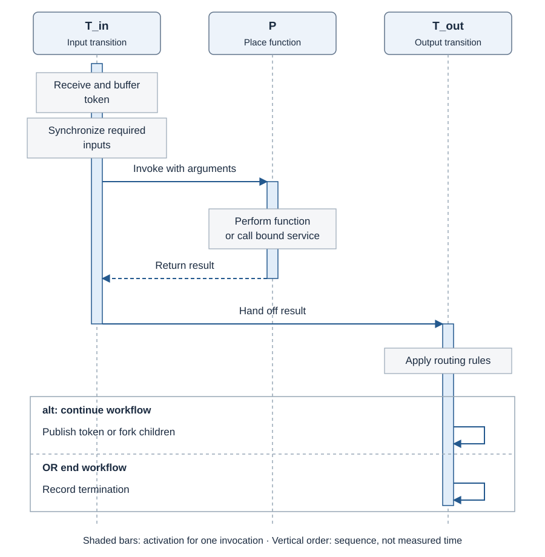

*The execution pattern within a generic host. Shaded activation bars show responsibility for one invocation; their lengths do not represent measured time. More under [Architecture](#architecture-coordination-and-business-meaning).*

## From the architecture pattern to a running service

Here is an example of how the components of the architecture pattern come
together to implement a live service workflow. A token arrives at an input
transition, the place invokes its bound service function, and an output
transition uses the result to continue or complete the process. The hosts in the
overview now become a running example.

We present the workflow as a **Petri net**: circular places identify the bound
functions, transition bars coordinate their execution, and arrows show the
possible routes taken by tokens. We begin with a single Boolean-returning
service, extend it into a parallel fork-and-join workflow, then give the same
architecture financial and healthcare functionality.

### One place: a function and its execution structure

We begin with one service so we can follow a token through a complete execution
unit. A decision to repeat or finish makes the relationship between input
receipt, function invocation and output routing visible in one small model.

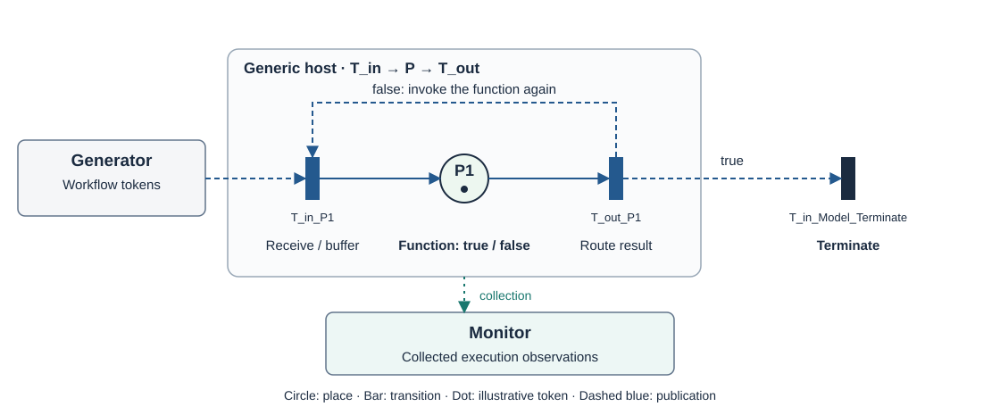

In the [single-place tutorial](Tutorial.md)
([process definition](btsn.common/ProcessDefinitionFolder/petrinet/Workflow/P1_Tutorial_Workflow.json)),
**P1 performs a function whose result is `true` or `false`**. The function produces
its own result; it does not simply copy the arriving token's logical state.
The transitions supply the execution behavior around that function:

| Model role | Execution responsibility | Tutorial behavior |
|---|---|---|
| **T_in** — input transition | Receive and buffer tokens; synchronize required inputs where a join is declared | Accept the initial token or a returning token |
| **P** — place with bound functionality | Invoke the selected operation with its declared inputs | P1 returns `true` or `false` |
| **T_out** — output transition | Apply routing rules; publish, fork or terminate | `true` ends the workflow; `false` returns to T_in_P1 |

Thus **T_in → P → T_out** maps to **receive/synchronize → invoke function →
route/publish**. A generic orchestration host implements the whole unit. The
place's function and the transitions' coordination responsibilities are separate.
Run [P1_Tutorial_BuildAndRun.xml](btsn.petrinet.ProjectLoader/P1_Tutorial_BuildAndRun.xml)
as an Ant Build; [Tutorial.md](Tutorial.md) explains editing and running it.

### Four places: Boolean functionality with a fork and join

With the pattern for one service established, we can connect several execution
units. This example introduces parallel branches and a join: the fabric must
deliver work to two functions and bring their results together before the next
function can run.

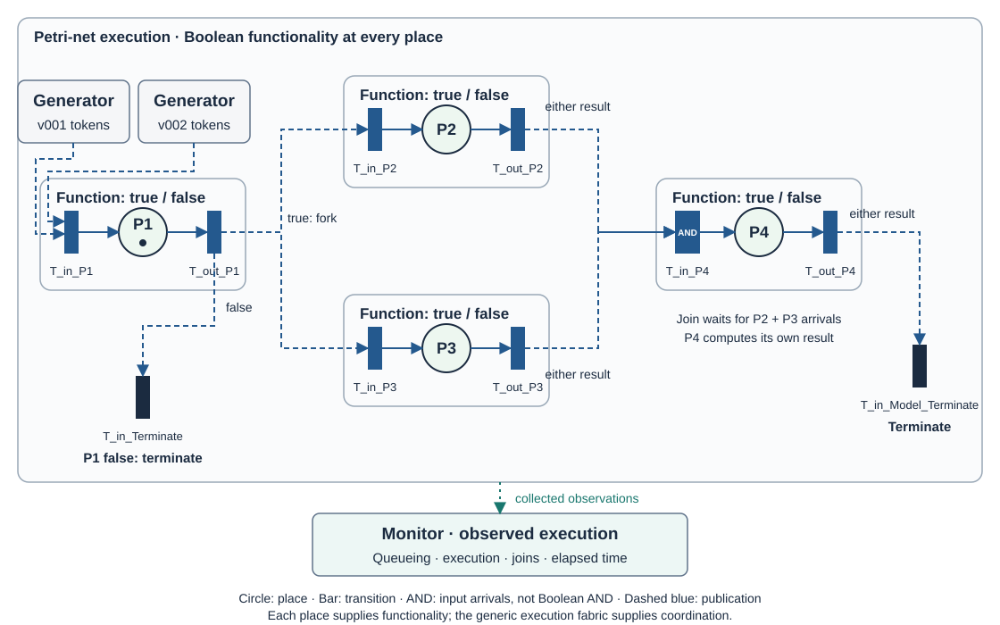

The P1–P4 model ([process definition](btsn.common/ProcessDefinitionFolder/petrinet/Workflow/P1_P2_P3_P4_Fork_Join_Workflow.json))
uses the same simple Boolean-returning functionality at **all four places**.
Each completed invocation produces its own `true` or `false` result, irrespective
of the arriving Boolean value. The model's routing rules determine whether that
result affects the next path:

| Place | Function result | What its surrounding transitions do |
|---|---|---|
| P1 | A fresh `true` or `false` | T_out forks to P2/P3 on `true`, or terminates on `false` |
| P2 | A fresh `true` or `false`, independent of P1's value | Forward either result to P4 through an unguarded publication |
| P3 | A fresh `true` or `false`, independent of P1's value | Forward either result to P4 through an unguarded publication |
| P4 | A fresh `true` or `false`, independent of the two input values | T_in waits for both P2/P3 arrivals; T_out forwards either result to final termination |

**The join synchronizes arrivals, not Boolean truth.** P4 does not require both
incoming values to be `true` and does not compute their Boolean AND. `AND` on the
input-transition bar denotes the required input arrivals. A result can be `false`
without preventing an unguarded onward publication.

Implementation detail: every place binds a separate deployment instance of the
same reusable function,
[`StochasticService.processToken`](btsn.common/src/org/btsn/services/StochasticService.java),
which returns a fresh random Boolean (probability of `true`: 0.5). The
[`boolean-token` adapter](btsn.common/src/org/btsn/invocation/BooleanTokenAdapter.java)
carries the incoming data and exposes that result to the process guards; it
never chooses a destination. The transitions receive inputs and route the
result according to the model.

Run [P1_P2_P3_P4_Fork_Join_Workflow_BuildAndRun.xml](btsn.petrinet.ProjectLoader/P1_P2_P3_P4_Fork_Join_Workflow_BuildAndRun.xml)
to execute this model. Its captured results appear under
[Petri-net fork/join execution](#petri-net-forkjoin-execution) below.

Circles are places; bars are transitions. Solid local arcs connect each
transition–place–transition unit. Dashed blue links represent publication between
units in executable RPSO notation; these transition-to-transition links are
separate from the arcs of an ordinary bipartite P/T net. Token dots are illustrative
markings, not measured execution snapshots. Monitor observes outside the token path.

### Give the same positions domain functionality

The first two models make coordination easy to follow by using simple Boolean
functions. We can now give the same positions a business purpose: bind functions
that accept domain data and return domain results, then declare their contracts
and routes. The following examples show what changes when those functions
perform financial or clinical work. Their business activity boxes abbreviate
the same **T_in → P → T_out** unit.

| Example | Functionality supplied at places | Coordination supplied by the fabric |
|---|---|---|
| Boolean Petri-net model | Produce `true` or `false` | Conditional routing, fork, buffering and input join |
| Financial application | Validate, check credit/fraud, underwrite and decide | Fork checks, synchronize their results and route declared outcomes |
| Emergency department | Triage, perform diagnostic operations, diagnose and treat | Select direct/diagnostic paths, fork diagnostics and synchronize results |
| Inventory example | Reserve stock (stateful), restock with a lead time | Route on string results, loop between two hosts, carry state changes as messages |
| Credit check | Approve or refer an application, in Java or as a Node.js service over REST | Route one decision to one of two terminate nodes; the same process whether the service is in-process, local or on the internet |

To write your own service, start with [ServiceTutorial.md](ServiceTutorial.md), then see the inventory example in [Tutorial.md](#6-add-your-own-service).

P1–Pn denotes the general model positions. This repository currently packages
six numbered host projects; deployment determines which functions they run.

### Financial loan application

A loan application gives the fork and join pattern a concrete business purpose.
Credit and fraud checks supply different information about the same application;
underwriting needs both results to decide how processing should continue.

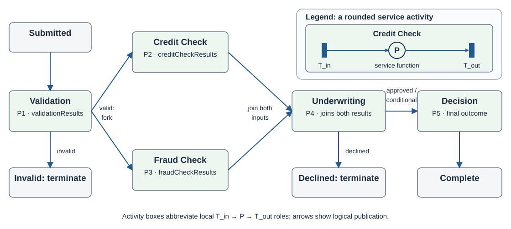

Validation rejects invalid applications or forks into Credit Check and Fraud
Check. Underwriting joins their named results. `approved` and `conditional`
proceed to Decision; `declined` terminates early. See
[the Financial application guide](btsn.common/FinancialApplication.md) for contracts.

### Emergency department

A patient workflow adds a choice of paths and a larger set of required inputs.
This example shows how the same execution pattern supports a route selected by
triage and synchronizes several diagnostic results before the next function
runs.

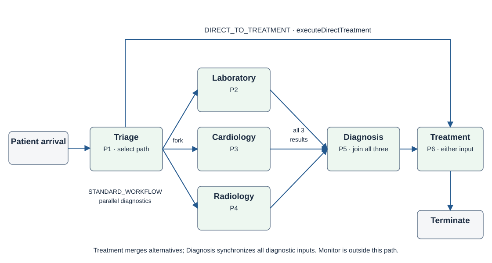

Triage either publishes directly to Treatment or forks to Laboratory, Cardiology
and Radiology. Diagnosis waits for all three named results. Treatment accepts the
diagnosis path or the direct triage path through distinct operations, then ends
the patient workflow. See [the healthcare mapping](btsn.services/docs/HEALTHCARE.md)
for contracts and host assignments.

### Further topology: six places and two joins

The domain examples give the places business meaning. We can also extend the
coordination structure itself: this six-place model connects two joins, so the
result of one synchronized activity becomes an input to another.

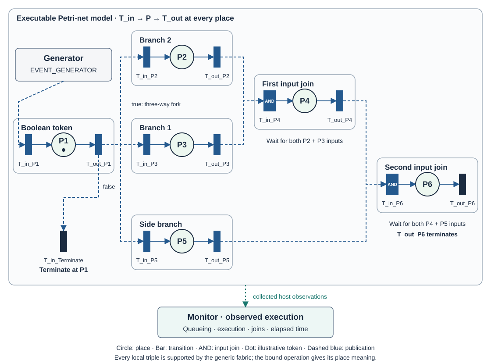

The six-place double-join model
([process definition](btsn.common/ProcessDefinitionFolder/petrinet/Workflow/P1_to_P6_Double_Join_Workflow.json))
binds every place to its own deployment instance of the same Boolean function,
`StochasticService.processToken`. The adapter carries the incoming data, so the
branch data is preserved through both joins:

| Place | Input attributes | Output attribute | What its surrounding transitions do |
|---|---|---|---|
| P1 | `token` | `token` | T_out forks to P2/P3/P5 on `true`, or terminates on `false` |
| P2 | `token` | `token_branch2` | Publish either result to P4 |
| P3 | `token` | `token_branch1` | Publish either result to P4 |
| P4 | `token_branch1`, `token_branch2` | `token_branch2` | T_in waits for both P2/P3 arrivals; T_out publishes either result to P6 |
| P5 | `token` | `token_branch1` | Publish either result to P6 |
| P6 | `token_branch1`, `token_branch2` | `token` | T_in waits for both P4/P5 arrivals; T_out records workflow termination |

Only P1's result changes the route; the other places publish unconditionally.
The generic fabric performs the forks, input synchronization and publication.
P4 becomes eligible after both P2/P3 inputs are available, while P6 requires
P4/P5. The topology constrains causal order; the running hosts determine when
those steps actually execute.

Run
[P1_to_P6_Double_Join_Workflow.xml](btsn.petrinet.ProjectLoader/P1_to_P6_Double_Join_Workflow.xml)
as an Ant Build with its default target. It builds the JARs, prepares the selected
deployment, initializes, deploys, sends ten tokens and collects observations.
The launcher's `eg1.data` value (`outcome=true`) is input data only; it does not force
P1's result. A smaller two-place example is
[P1_P2_BuildAndRun.xml](btsn.petrinet.ProjectLoader/P1_P2_BuildAndRun.xml).
See [the model guide](btsn.services/docs/PETRINET_MODELS.md) for profiles and contracts.

This is live token execution with measured queueing, local execution, join
waiting and workflow elapsed time. The services introduce no simulated
processing delays; launcher waits support startup and collection. Monitor
reconstructs the generated workflow families and the same analyzer, timing
chart and spatial view can inspect their observations. ProcessEditor can then
replay that captured execution on the topology.

These examples execute on the same generic host machinery. Their diagrams show
configured paths; the captured runs show measured execution.

## Architecture: coordination and business meaning

The examples have shown one execution pattern supporting different functions
and process structures. We can now look behind those models to see how the
platform assembles them. The diagram and table below locate the process
definition, service contract, deployment, execution machinery and observation
tools, and explain how their responsibilities fit together.

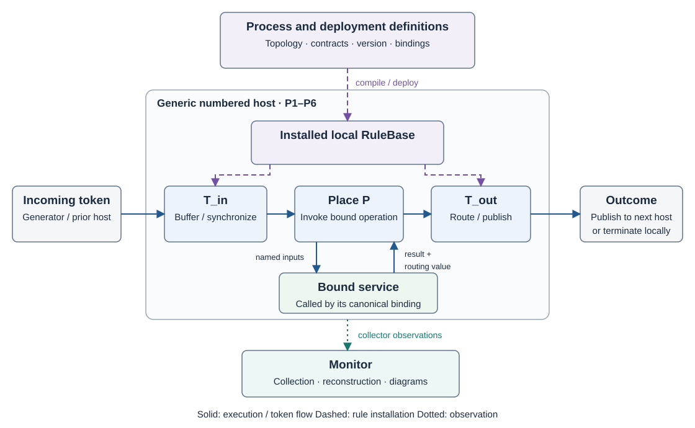

*Responsibility boundaries. The host calls a bound service through its canonical
binding; in this Java implementation the service is a class invoked in-process.
The dashed path configures local rules; the dotted path carries collected
observations outside the business workflow.*

**What binds a service is its contract, not its code.** The fabric knows a service
only through its canonical binding (the operation's name, its named inputs and the
attribute it returns) and through the routing value in that result, which the guards
test. Nothing in the
coordination layer depends on how the operation is implemented or reached. By
default the host looks up the class named in the catalogue and calls it by Java
reflection, inside the host. A placement can name an **invocation adapter** instead:
with `rest`, the host POSTs each call to the placement's endpoint, so the service can
be written in any language and run anywhere it can be reached over HTTP. It returns
the same result a Java service would, and the transitions, rules and tokens do not
change. [ServiceTutorial.md](ServiceTutorial.md#8-call-it-over-rest) serves the credit
check from Node.js this way, on the same machine or [hosted on the internet](ServiceTutorial.md#host-it-on-the-internet)
(the code is in [`examples/rest`](examples/rest)).

| Layer | Responsibility | Repository artefacts |
|---|---|---|
| Process model | Places, transitions, fork/join structure, guards and termination | `btsn.common/ProcessDefinitionFolder` |
| Service contract | Logical service identity, operations, named inputs and returned attribute; each domain's catalogue plus the standard services every process may use | `BusinessServiceDefinitions`, `ServiceAttributeBindings` in `btsn.common` |
| Deployment | Map capabilities to implementation classes or REST endpoints, hosts and channels | [Physical infrastructure](btsn.common/InfrastructureDefinitionFolder/README.md), [service deployments](btsn.common/ServiceDeploymentFolder/README.md) and `btsn.services/deployments/{healthcare,financial,models}` |
| Generic execution fabric | Transport, buffering, synchronization, version selection, invocation and publication | `btsn.rpso.places.p1`–`p6`, shared infrastructure |
| Business computation | Domain objects, calculations and routing values | Here `btsn.common/src/org/btsn/business`, packaged as independent service JARs and called by reflection; any implementation that honours the binding would do |
| Observation | Collect records, reconstruct workflow families and display measurements | `btsn.common.Monitor` |

**Synchronize required inputs** means waiting for any remaining inputs after
the first token has been received and buffered. At a join, all declared inputs
must be available before P is invoked; for a single-input operation, that
requirement is immediately satisfied. T_in's activation ends after P's result
has returned and been handed to T_out. T_out's activation ends after routing
and publication, or after termination has been recorded. These are logical roles
within the host, which remains available for subsequent tokens.

A business service consumes its named inputs and returns a result. Where routing
is conditional, the result includes a routing value such as `approved` or `declined`.
The service interprets business meaning; the fabric matches the value against
declared routes and resolves the destination. Logical service identity is
separate from physical placement: P1 can host a clinical, financial or model
capability according to the selected deployment.

The execution pattern, shown in the [sequence diagram](#inside-each-host) at the top of this page, is **T_in → P → T_out**:

- **T_in** receives and buffers inputs, accumulating the required named values
  for joins. Readiness also depends on version, validity and available capacity.
- **P** invokes the bound business operation under the local execution capacity.
- **T_out** applies the installed routing rules, publishes fork children or
  records a business termination.

These are semantic roles within the local execution machinery. The business
activity boxes abbreviate a complete **T_in → P → T_out** execution unit; the
Petri-net examples above expand their transition and place nodes explicitly.
The host implements the whole unit, with its bound operation giving P its
computational meaning.

There is no central engine making every runtime routing decision. Hosts use
local rule fragments and communicate through tokens. This does not imply absence
of distributed coordination, unlimited scalability, or a proven workflow
soundness property. Shared-host queues, transport and deployment remain relevant.

## Rule deployment and token execution

Those architectural responsibilities become operational when a model is
deployed to its hosts. Follow the path from the workflow definition and service
bindings to installed local rules, then to the tokens that activate the bound
functions. This connects the diagrams above to the steps performed by a
build-and-run launcher.

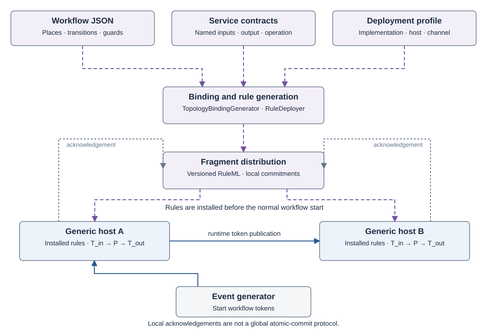

*Rule installation and runtime token flow are separate paths. Local installation
acknowledgements are not a global atomic-commit protocol.*

`TopologyBindingGenerator` derives operation bindings from the workflow.
`RuleDeployer` compiles/distributes versioned RuleML fragments to the participating
host operations and waits for local acknowledgements with retries in the normal
deployment path. Launchers that explicitly skip deployment require previously
installed matching rules. RuleBase version selection does not by itself pin the
business implementation binary; deploy the matching JARs and configuration too.

Runtime XML payloads carry token identity, workflow version, target operation,
named business attributes, validity and instrumentation fields. A fork creates
physical child tokens within one logical workflow family. Joins accumulate the
required inputs for that family; the analyzer uses recorded generated roots and
parent/child genealogy rather than treating every child as a new workflow.

| Component | Current role |
|---|---|
| `EventReactor` / `Scheduler` | Receive packets and maintain the local eligible-work ordering |
| `ServiceThread` | Validate the selected contract/version, coordinate inputs, invoke and publish |
| `RuleHandler` / OOjDREW | Install local RuleML and evaluate rule queries |
| `ServiceHelper` | Resolve and invoke the installed business implementation |
| `EventPublisher` | Send the resulting payload to the declared channel |

Priority applies to **waiting eligible work**. It does not interrupt a running
business operation. Different path lengths or different host operations can have
different queue waits without demonstrating priority overtaking. For controlled
same-queue evidence, run
[Queue_Priority_BuildAndRun.xml](btsn.healthcare.ProjectLoader/Queue_Priority_BuildAndRun.xml);
[its guide](btsn.healthcare.ProjectLoader/README.md#controlled-queue-priority-experiment)
explains the observed-backlog probe and its separate output files.

## Execution examples

Once the bindings and rules are installed, we can run the services and observe
how the configured paths execute. The following captures connect the earlier
models to measured workflow durations and queue waits on the Java execution
fabric. They retain the chart settings and measurements used when captured;
timing depends on the machine and run.

### Petri-net fork/join execution

Return to the four-place example and follow its ten generated workflow roots.
The chart groups each root with its fork children, letting us examine the
elapsed time of the complete workflow family and its largest observed visit
queue wait.

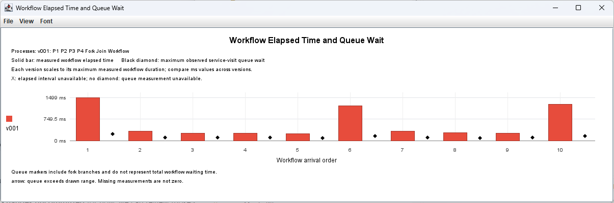

*A run of the earlier [P1_P2_P3_P4_BuildAndRun.xml](btsn.petrinet.ProjectLoader/deprecated/P1_P2_P3_P4_BuildAndRun.xml) launcher.
Ten root workflows are shown in arrival order. Bars measure elapsed time from
generation to business completion; diamonds show the maximum observed
service-visit queue wait across each root's family, including fork children.
Children are reconstructed through genealogy, rather than drawn as extra root
workflows. The lane maximum in this run is 1,499 ms.*

### Financial service execution

This financial capture isolates the Validation function at P1. It lets us
inspect a domain service using the same measurements as the Boolean model,
before adding the remaining checks and decisions of the full loan workflow.

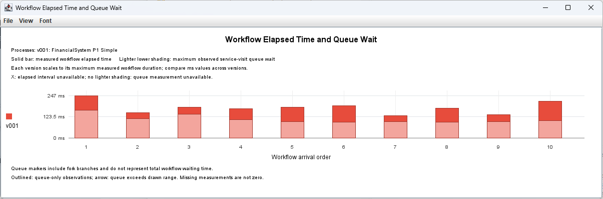

*A run of [FinancialSystem_P1_Simple_BuildAndRun.xml](btsn.financial.ProjectLoader/FinancialSystem_P1_Simple_BuildAndRun.xml),
the single-place Financial example. Ten application workflows are shown; lighter
lower shading marks the maximum observed visit queue wait. The lane maximum is
247 ms. This is the P1 example, not the full P1–P5 loan-application workflow.*

### Concurrent healthcare execution

The previous captures each show one workflow version. Here, several healthcare
processes run concurrently, bringing different routes and service demands into
the same observation view. Read the process labels and lane scales together to
understand which measurements can be compared directly.

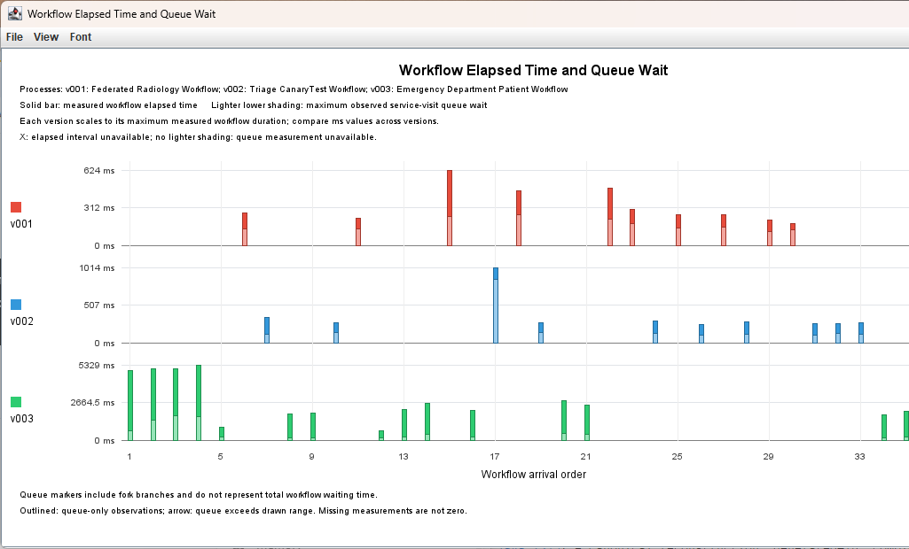

*A captured viewport of the concurrent healthcare run. The three versions share
global arrival ranks, so a blank position in one lane can belong to another
version. Each lane uses its own measured maximum: 624, 1,014 and 5,329 ms.
The screenshot is clipped at the right edge; it is an excerpt, not a full-run
token count. Different routes and service loads also affect queue waits, so this
image alone does not establish priority overtaking at a shared queue.*

These captures precede the wider-bar menu and clearer measurement notes described
below. Their generic “queue-only observations” legend describes the glyph used
when queue wait is known but workflow elapsed time is unavailable; it does not
state that tokens have been excluded. New charts show this note only when such
observations are present. The Petri-net and Financial captures each visibly show
ten measured elapsed-time bars; run completeness should be checked against the
analyzer's generated-root and completion counts.

## Project layout and build support

We have followed a model from its service bindings through execution and
analysis. The project map below shows where to find each part when working with
the repository: the definitions to edit, the implementations to package, the
launchers to run and the tools to inspect the results. The build commands then
provide entry points for preparing the packaged runtime.

| Project | Purpose |
|---|---|
| `btsn.common` | Shared source, business implementations, contracts, physical infrastructure, service deployments, process definitions and rules |
| `btsn.services` | Service packaging, shared Ant builds, deployment profiles and checks |
| `btsn.rpso.places.p1`–`p6` | Generic numbered orchestration hosts |
| `btsn.common.Monitor` | Collection, reconstruction and visualization |
| `btsn.common.eventgenerators` | Shared workflow and administration generators |
| `btsn.healthcare.ProjectLoader` | Healthcare launchers and process tests |
| `btsn.financial.ProjectLoader` | Financial launchers |
| `btsn.petrinet.ProjectLoader` | Petri-net model launchers and utility phases; launchers that Build and Run writes for domains without their own loader (such as the inventory example) |
| `btsn.workflowEditor` | ProcessEditor: design, deploy, Build and Run, Run on hosts, and replay of recorded runs |
| `examples/rest` | The credit-check service in Node.js, called over REST: a local server and the same function for Vercel |

Every process launcher, in all three loader folders, runs on the shared process runtime
([`btsn.services/build/workflows/process-runtime.xml`](btsn.services/build/workflows/process-runtime.xml),
imported through `btsn.services/process-runtime.xml`).
A launcher only sets its process, its event generators (`eg1`–`eg3`, each with its own
version, target place and schedule) and the hosts it uses; the runtime supplies the
three phases. A deployment profile may name the token generator its services expect:
the healthcare profile names the one that fills tokens from each service's token format.
Build and Run writes launchers of the same form. The exceptions are the controlled
queue experiment (`Queue_Priority_BuildAndRun.xml`) and the triage process tests,
which run single phases.

Each domain describes its services in a catalogue under
[`BusinessServiceDefinitions`](btsn.common/BusinessServiceDefinitions).
All domains share the physical network and fixed ports in
[`InfrastructureDefinitionFolder`](btsn.common/InfrastructureDefinitionFolder/README.md).
Business operations are assigned to those nodes in
[`ServiceDeploymentFolder`](btsn.common/ServiceDeploymentFolder/README.md).
Their routing and guards belong in
[`ProcessDefinitionFolder`](btsn.common/ProcessDefinitionFolder); the analysis
folders hold observations from executing those models.

`btsn.services` contains build support, not business implementation or execution
handlers. Service JARs are grouped under
`btsn.services/target/deployment/services/{healthcare,financial,models}`; support
libraries accompany them under `target/deployment/lib`. Host placement is selected
separately by deployment metadata. Eclipse `bin` outputs are not inputs to the
packaged workflow runtime. Runtime databases, installed rule copies, run metadata
and chart exports are local outputs excluded from Git.

For packaging/checks without starting a workflow:

```sh
ant -f btsn.services/build.xml check
```

For a portable numbered-host JAR and ZIP:

```sh
ant -f btsn.rpso.places.p1/build.xml
```

See [shared build support](btsn.services/README.md),
[portable releases](btsn.services/docs/PLACE_RELEASES.md), and
[Petri-net model profiles](btsn.services/docs/PETRINET_MODELS.md).

The current diagrams are editable SVGs. Their source models, conventions and
regeneration command are documented in [images/README.md](images/README.md).

## Repository artefacts

The supplied claims process of [Tutorial.md, Example 2](Tutorial.md#example-2-a-claims-process-with-a-remote-service), first made with the steps of [Adding services while designing](#adding-services-while-designing):

| Artefact | Role |
|---|---|
| [Claims_Workflow.json](btsn.common/ProcessDefinitionFolder/claims/Workflow/Claims_Workflow.json) | Process design, linked to its deployment |
| [Claims.json](btsn.common/BusinessServiceDefinitions/claims/Claims.json) | The claims catalogue the editor created, with `ClaimsTriageService` and `AssessService` |
| [ClaimsTriageService.java](btsn.common/src/org/btsn/business/claims/ClaimsTriageService.java) | Triage, with the real logic of step 7 |
| [claims.js](examples/rest/claims.js) | Assess, called over REST: the Node server (`credit-service.js`) and the Vercel function (`api/claims/assess.js`) share it |
| [Claims_Workflow.json](btsn.common/ServiceDeploymentFolder/claims/Claims_Workflow.json) (deployment) | Triage on node P1; Assess on P2, calling `https://rule-propagated-service-orchestrati.vercel.app/api/claims/assess` |
| [Claims_WorkflowDeployment.json](btsn.services/deployments/claims/Claims_WorkflowDeployment.json) | Deployment profile written by Build and Run |
| [Claims_Workflow_BuildAndRun.xml](btsn.petrinet.ProjectLoader/Claims_Workflow_BuildAndRun.xml) | Launcher written by Build and Run |
| [Analysis_Claims_Workflow.txt](btsn.common/AnalysisFolder/Claims/Analysis_Claims_Workflow.txt) | Analysis of a run of Example 2, ready to replay |
| [packaging.json](btsn.services/packaging.json) | Lists `Claims.json`, as the editor did when it created the catalogue |

The supplied P2 example of [Each step in detail](#each-step-in-detail), built with exactly these steps:

| Artefact | Role |
|---|---|
| [P2_Tutorial_Workflow.json](btsn.common/ProcessDefinitionFolder/petrinet/Workflow/P2_Tutorial_Workflow.json) | Process design, linked to its deployment |
| [P2_Tutorial.json](btsn.common/ServiceDeploymentFolder/petrinet/P2_Tutorial.json) | Service deployment: P2 on node P2, linked to its catalogue |
| [PetriNetModels.json](btsn.common/BusinessServiceDefinitions/petrinet/PetriNetModels.json) | Petri-net service catalogue (`StochasticService`) |
| [SingleHost.json](btsn.common/InfrastructureDefinitionFolder/SingleHost.json) | Shared nodes P1–P6, addresses and fixed ports |
| [P2_Tutorial_WorkflowDeployment.json](btsn.services/deployments/models/P2_Tutorial_WorkflowDeployment.json) | Deployment profile written by Build and Run |
| [P2_Tutorial_Workflow_BuildAndRun.xml](btsn.petrinet.ProjectLoader/P2_Tutorial_Workflow_BuildAndRun.xml) | Launcher written by Build and Run |
| [`P2_Tutorial_Workflow_BuildAndRun*.csv`](btsn.common.eventgenerators/EventTriggeringFile) | Token schedules, one per event generator |
| [P2_Initialization.json](btsn.common/ProcessDefinitionFolder/common/Initializers/P2_Initialization.json) / [P2_Collector.json](btsn.common/ProcessDefinitionFolder/common/Collectors/P2_Collector.json) | Administrative processes for node P2 |
| [Analysis_P2_Tutorial_Workflow.txt](btsn.common/AnalysisFolder/PetriNet/Analysis_P2_Tutorial_Workflow.txt) | Analysis of a ten-token run, ready to replay |
| [process-runtime.xml](btsn.services/process-runtime.xml) | Shared phases imported by every generated launcher |

The P1 reference run:

| Artefact | Role |
|---|---|
| [P1_Tutorial_Workflow.json](btsn.common/ProcessDefinitionFolder/petrinet/Workflow/P1_Tutorial_Workflow.json) | The same loop on node P1 |
| [P1_Tutorial_Local_BuildAndRun.xml](btsn.petrinet.ProjectLoader/P1_Tutorial_Local_BuildAndRun.xml) | Local launcher with the `export-tutorial-results` target |
| [P1_Tutorial_Generated_BuildAndRun.xml](btsn.services/tests/launchers/P1_Tutorial_Generated_BuildAndRun.xml) | The same process as Build and Run writes it (used by the launcher checks) |
| [Captured results](docs/tutorials/p1/results/README.md) | Analyzer output, per-workflow CSV, charts and capture details |
