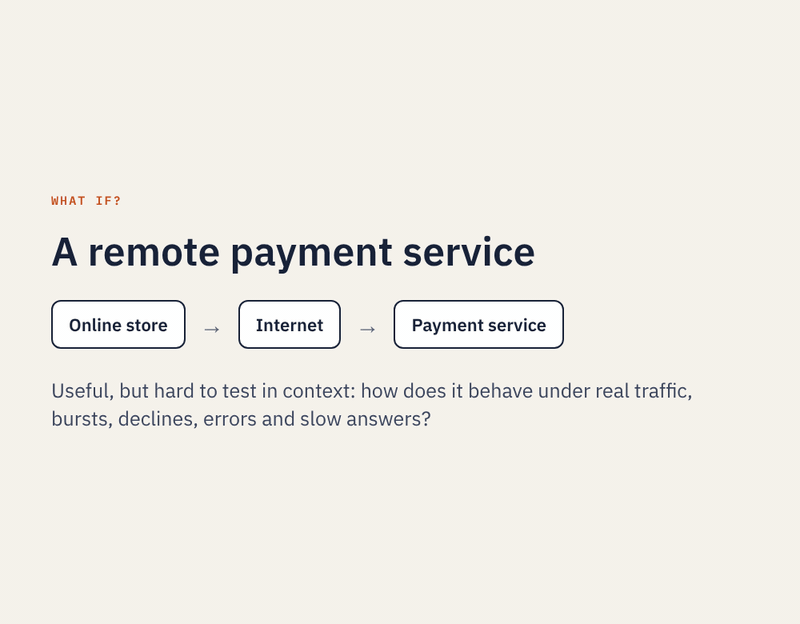

# Tutorial: write your own service

This tutorial writes one service from scratch and runs it in a process: a credit
check that approves an application up to a limit and refers the rest. It is
deliberately small. The service keeps no state and runs on one host, so the
steps show only what every service needs.


*The finished process. The **What it does** box and the contract come from the catalogue you write in step 2.*

[▶ Watch a recorded run of this process](https://alexanderadelau.github.io/Rule-Propagated-Service-Orchestration/docs/replay/?model=../../btsn.common/ProcessDefinitionFolder/credit/Workflow/Credit_Check_Workflow.json&run=../../btsn.common/AnalysisFolder/Credit/Analysis_Credit_Check_Workflow.txt)

The finished files are supplied, so you can compare yours with them. To build
your own alongside them, use another name throughout, for example `loan`
instead of `credit`.

**Before you start:** work through Example 1 of [Tutorial.md](Tutorial.md) once. This
tutorial uses the same editor steps (design, Deploy, Build, Run on hosts) and does not repeat
them in detail.

Here you write the service first, catalogue entry and all, then draw the process. To start
from the process instead, and let the editor write the catalogue entry and starting code as
you go, see [Adding services while designing](Reference.md#adding-services-while-designing);
its step 7 replaces the starting code with real logic the way section 1 here writes it.

## What RPSO needs from a service

The fabric knows a service only through its **canonical binding**: the operation's
name, its named inputs and the attribute it returns. The **routing value** in that
result is what the transition guards test. Nothing else about the service matters
to the transitions, the rules or the tokens. By default a service is a Java class,
which the host finds through the catalogue and calls by reflection; steps 1 to 7
write one. [Step 8](#8-call-it-over-rest) serves the same service from Node.js over
REST instead.

| File | Step |
|---|---|
| [`CreditLimitService.java`](btsn.common/src/org/btsn/business/credit/CreditLimitService.java) | 1. Write the service |
| [`BusinessServiceDefinitions/credit/Credit.json`](btsn.common/BusinessServiceDefinitions/credit/Credit.json) | 2. Describe it in a catalogue |
| [`btsn.services/packaging.json`](btsn.services/packaging.json) | 3. Package it |
| [`ProcessDefinitionFolder/credit/Workflow/Credit_Check_Workflow.json`](btsn.common/ProcessDefinitionFolder/credit/Workflow/Credit_Check_Workflow.json) | 4. Draw the process (editor) |
| [`ServiceDeploymentFolder/credit/Credit_Check_Workflow.json`](btsn.common/ServiceDeploymentFolder/credit/Credit_Check_Workflow.json) | 5. Deploy (editor) |
| [`Credit_Check_Workflow_BuildAndRun.xml`](btsn.petrinet.ProjectLoader/Credit_Check_Workflow_BuildAndRun.xml), its schedule and deployment profile | 6. Build (editor) |

## Follow one payment: what a service receives and returns

What does a service actually receive, and why is its input so often called `token`? This example follows one
order through two services: a payment gateway called over REST, then a Java service that issues the receipt.
Every JSON below is from a real run, shortened only where marked `…`.

| What | File |
|---|---|
| The process: `PAYMENTS` → Payment (P1, REST) → paid: Receipt (P2, Java) → Receipt sent; declined: Declined | [`payments/Workflow/Payment_Receipt_Workflow.json`](btsn.common/ProcessDefinitionFolder/payments/Workflow/Payment_Receipt_Workflow.json) |
| The orders: what each token carries | [`TokenFormats/PaymentService.json`](btsn.common.eventgenerators/TokenFormats/PaymentService.json) |
| The two services' contracts | [`payments/Payments.json`](btsn.common/BusinessServiceDefinitions/payments/Payments.json) |
| The receipt service | [`ReceiptService.java`](btsn.common/src/org/btsn/business/payments/ReceiptService.java) |
| The launcher | [`Payment_Receipt_Workflow_BuildAndRun.xml`](btsn.petrinet.ProjectLoader/Payment_Receipt_Workflow_BuildAndRun.xml) |

[▶ Watch a recorded run](https://alexanderadelau.github.io/Rule-Propagated-Service-Orchestration/docs/replay/?model=../../btsn.common/ProcessDefinitionFolder/payments/Workflow/Payment_Receipt_Workflow.json&run=../../btsn.common/AnalysisFolder/Payments/Analysis_Payment_Receipt_Workflow.txt): ten orders, nine paid and receipted, one declined.

**1. The event generator makes the token.** A token is a JSON object. Its `data` is the business content; the rest
is the host's bookkeeping. Here the data comes from a *token format*, chosen in the launcher:

```xml
<property name="eg1.format.service" value="PaymentService"/>
```

The format gives every order an `orderId`, a `customer` and a `currency`, and a basket from its case mix, so order 1
is groceries:

```json
{"tokenId": "1000000", "version": "v001",
 "data": {"orderId": "ORD-1", "customer": "C-1", "currency": "AUD", "items": 6, "amount": 84.5, "card": "visa-4242"},
 "notAfter": 1794115780099, "workflow_start_time": 1794115720099, "currentPlace": "P1_Place"}
```

The generator sends it **under the name `token`**. That is the whole reason a first place's input is called `token`:
an input is named after what arrives.

**2. Payment receives it.** Payment's catalogue entry has one input, `token`, so the host's REST call carries the
token under that name:

```json
{"service": "PaymentService", "operation": "authorise", "sequenceId": "1000000", "version": "v001",
 "inputs": {"token": {"tokenId": "1000000", "data": {"orderId": "ORD-1", "amount": 84.5, …}, …}}}
```

The service ([`payment.js`](examples/rest/payment.js)) reads the `amount` from the token's data.

**3. Payment answers under its return attribute.** Payment's `returnAttribute` is `paymentResult`:

```json
{"paymentResult": {"payment": "PAY-1", "amount": 84.5, "status": "authorised", "reason": "",
                   "latency_ms": 193, "served_by": "vercel", "routing_decision": {"routing_path": "paid"}}}
```

`routing_path` is what the guards on T_out_Payment test: `paid` goes on to Receipt, `declined` ends at Declined.

**4. Receipt receives `paymentResult`.** What travels on from Payment is named `paymentResult`, so Receipt's input
must be named `paymentResult` too. The editor's **Validate** reports a mismatch, which would otherwise stop the token.
The Java method `issue(String paymentResult)` receives:

```json
{"paymentResult": {"payment": "PAY-1", "amount": 84.5, "status": "authorised", …,
                   "routing_decision": {"routing_path": "paid"},
                   "service_start_time": 1794115720466, "service_end_time": 1794115720777, "service_processing_time_ms": 311,
                   "original_token": "{\"tokenId\":\"1000000\",\"data\":{\"orderId\":\"ORD-1\",\"customer\":\"C-1\",…},…}"}}
```

The host adds its timing fields and, as `original_token`, the token the generator sent, so any later service can
still read the order.

**5. Receipt answers.** It quotes the order from the original token and the payment from `paymentResult`:

```java
public String issue(String paymentResult) {
    String order = originalToken(paymentResult);   // the order, as the event generator sent it
    JSONObject receipt = new JSONObject();
    receipt.put("orderId", textValue(order, "orderId", "unknown order"));
    receipt.put("customer", textValue(order, "customer", ""));
    receipt.put("payment", textValue(paymentResult, "payment", ""));
    receipt.put("amount", numberValue(paymentResult, "amount", 0));
    receipt.put("currency", textValue(order, "currency", ""));
    receipt.put("routing_decision", routingDecision("issued"));
    return businessResult("receipt", receipt);
}
```

```json
{"receipt": {"orderId": "ORD-1", "customer": "C-1", "payment": "PAY-1", "amount": 84.5, "currency": "AUD",
             "routing_decision": {"routing_path": "issued"}}}
```

**The rules, in short**

- **Name an input after what arrives:** `token` from an event generator, otherwise the `returnAttribute` of the place
  before it. A join has one input per arc.
- **Publish under your `returnAttribute`.** That name is what the next place takes. A service that passes the token on
  for others can publish under `token` itself, as the claims services do.
- **Put the route in `routing_decision.routing_path`.** The T_out guards test it.
- **Read with `textValue` and `numberValue`.** They find a field anywhere in an input. `originalToken(input)` gives the
  token the generator sent, for its data. A REST service finds each input under `inputs.<name>`.
- **Give tokens data** with a token format (`egN.format.service`, a file in `btsn.common.eventgenerators/TokenFormats`;
  `${n}` is the token's number), or with `egN.data` name=value pairs, the same for every token
  ([7. Give it data](#7-give-it-data)).

## 1. Write the service

Create `btsn.common/src/org/btsn/business/credit/CreditLimitService.java`:

```java
package org.btsn.business.credit;

import org.btsn.business.BaseBusinessService;
import org.json.simple.JSONObject;

public class CreditLimitService extends BaseBusinessService {

    static final double LIMIT = 5000;

    private final String sequenceId;

    public CreditLimitService() { this(""); }

    /** The host passes the token's sequence id. */
    public CreditLimitService(String sequenceId) { this.sequenceId = sequenceId == null ? "" : sequenceId; }

    /** token -> creditDecision */
    @SuppressWarnings("unchecked")
    public String assess(String token) {
        int application = applicationNumber(sequenceId);
        double amount = numberValue(token, "amount", application * 1000.0);
        boolean approve = amount <= LIMIT;

        JSONObject result = new JSONObject();
        result.put("application", "APP-" + application);
        result.put("amount", amount);
        result.put("limit", LIMIT);
        result.put("routing_decision", routingDecision(approve ? "approve" : "refer"));
        return businessResult("creditDecision", result);
    }

    /** 1 for the first token of a version, 2 for the second, ... (token ids are base + n x 10000). */
    static int applicationNumber(String sequenceId) {
        try {
            return (int)((Long.parseLong(sequenceId.trim()) % 1_000_000L) / 10_000L) + 1;
        } catch (NumberFormatException e) {
            return 1;
        }
    }
}
```

- **Package.** Put services in a package under `org.btsn.business`, one folder per domain.
- **Constructor.** The host creates the service with the token's sequence id. Keep a no-argument constructor as well.
- **One `String` parameter per input.** Each catalogue input arrives as a JSON string. `assess` has one input, `token`.
- **Reading values.** `BaseBusinessService` provides `textValue` and `numberValue`. They find a field anywhere in the JSON, with a default when it is missing. Here the amount comes from the token's `amount` field if it has one; otherwise application *n* asks for *n* × 1,000.
- **The result.** Return `businessResult(returnAttribute, result)`, which produces `{"creditDecision": {...}}`. The name must match the catalogue's `returnAttribute`.
- **The routing value.** Put `routingDecision("approve")` or `routingDecision("refer")` in the result. Its `routing_path` is the value the T_out guards test. Any string works, not just `true` and `false`.

## 2. Describe it in a catalogue

Create `btsn.common/BusinessServiceDefinitions/credit/Credit.json`:

```json
{
  "domain": "Credit",
  "purpose": "The service written in ServiceTutorial.md: one stateless check, routed on a string result.",
  "services": [
    {
      "service": "CreditLimitService",
      "implementationClass": "org.btsn.business.credit.CreditLimitService",
      "operation": "assess",
      "description": "Approves a credit application up to a limit of 5,000 and refers the rest. Application n asks for n x 1,000 unless the token carries an amount.",
      "returns": "A credit decision with the application, amount and limit. Routes on \"approve\" (within the limit) or \"refer\" (over it).",
      "inputs": ["token"],
      "returnAttribute": "creditDecision",
      "status": "active"
    }
  ]
}
```

| Field | Meaning |
|---|---|
| `service`, `operation` | The names the editor offers and the process records |
| `implementationClass` | The class the host calls |
| `inputs` | The named inputs, in the order of the method's parameters. Each is named after what arrives: `token` from an event generator, otherwise the return attribute of the place before ([Follow one payment](#follow-one-payment-what-a-service-receives-and-returns)) |
| `returnAttribute` | The name the result is published under; the next place takes it as input |
| `description`, `returns` | Shown in the editor's **What it does** box. The editor checks require both. |

The folder name (`credit`) is the domain. Saving the process under
`ProcessDefinitionFolder/credit` in step 4 makes the editor select this catalogue.

Design the catalogue before the process: it is the list of contracts the process is
drawn from. Every process can also use the **standard services** in
[`petrinet/PetriNetModels.json`](btsn.common/BusinessServiceDefinitions/petrinet/PetriNetModels.json)
without copying them into its own catalogue. They are `AlwaysTrueService`, a routing-only place
that passes the token on unchanged, and `StochasticService`, a random `true`/`false`. The
editor lists them after the domain's own services, marked *(standard)*. A domain catalogue
may not reuse a standard service's name.

The **Catalogue Status** panel in the upper-right of the workflow canvas identifies each place
by its visible label and shows whether its selected service comes from the **Standard Service**
catalogue or the process's own catalogue (for example, `P1 → Standard Service` and
`P2 → Claims`). An incomplete or unknown service assignment reads **Unresolved**, while a
service still being defined shows **(draft)**. Hover over a row to see its service name.
The panel stays in the visible corner while the workflow scrolls, keeps a readable size at
different zoom levels, scrolls when there are many places, and collapses when you click its heading.
It is an indicator only: it does not modify the services or their catalogue membership.

### Add a service while designing

Designing the catalogue first is best, but a design often shows that a service is missing.
You do not need to leave the editor ([Adding services while designing](Reference.md#adding-services-while-designing)
works through it for a whole process):

1. Draw the place, then right-click it and choose **Create New Service in** *your catalogue*
   (the same button is under the place's Service). On a new process, choose
   **Choose/Create catalogue...** first: the standard catalogue is never changed, so this waits
   until the process has a catalogue of its own.
2. Give the service and its operation a name. Everything else can follow: what it does, what it
   returns, its inputs and return attribute (suggested to match the places around it), and the
   values it routes on.
3. Choose how it runs:
   - **A Java class**, with starting code (the default). The editor writes
     `btsn.common/src/org/btsn/business/<domain>/<Service>.java`. The code keeps the contract and returns
     `true`, or each routing value in turn, so the process can be deployed and run straight away.
     Validate reminds you that it is still starting code until you replace the body with the real logic.
   - **A service called over REST**, written in any language; set its endpoint in Deploy
     ([Call it over REST](#8-call-it-over-rest)).
   - **Not decided yet**: the entry stays a **draft**.

The entry goes into the domain catalogue at once. A draft can be designed with and saved with the
process, but Validate, Deploy and Build and Run say exactly what it still needs, and it is never
deployed or packaged. **Edit Service in** *your catalogue* on the place shows its service filled in, draft or
finished, and saves your changes. While the class is still the editor's starting code, the code is rewritten
to match, for example to return the routing values you add. Code you have written yourself is never changed.
If other processes use the service, its name, operation, inputs, return attribute and how it runs are fixed
in the form, and only its description and routes can change.

Validate also checks that each place takes, as its input, the name the place before it publishes.
If the names differ, the token would stop at that place when the process runs. It checks the routes too:
a guard testing a value the service never returns, a value the service returns that no arc tests, and a
transition that leads nowhere because it is not a terminate transition. Each of these stops Deploy, Build and Run on hosts.

**An example.** [`Credit_Fraud_Rest_Workflow.json`](btsn.common/ProcessDefinitionFolder/credit/Workflow/Credit_Fraud_Rest_Workflow.json)
puts a fraud screen in front of the credit check. `FraudService` was added this way and still runs its
starting code, which routes `clear` and `review` in turn: `clear` goes on to Credit, called over REST
([Call it over REST](#8-call-it-over-rest)), and `review` ends at Review. Its launcher is
`Credit_Fraud_Rest_Workflow_BuildAndRun.xml`; a run completes all ten workflows, five ending at Review.

## 3. Package it

Add the catalogue to [`btsn.services/packaging.json`](btsn.services/packaging.json),
in `catalogues` and in `catalogueDomains`:

```json
"catalogues": [
  ...
  "../btsn.common/BusinessServiceDefinitions/credit/Credit.json"
],
...
"catalogueDomains": {
  ...
  "Credit.json": "credit"
}
```

Every launcher builds the service packages before it starts the hosts, so the
service becomes `btsn.services/target/deployment/services/credit/CreditLimitService.jar`
on the next run. There is no separate build step.

## 4. Draw the process

Start (or restart) the editor so that it reads the new catalogue. Then choose **File → New → Process Definition**; **Type** stays **PetriNet**.

| Palette tool | Label | Attributes |
|---|---|---|
| Event Generator | `APPLICATIONS` | Rate (ms): `1000`; Version: `v001` |
| Transition | `T_in_Credit` | Transition Type: `T_in`; Node Type: `EdgeNode`; Buffer: `10` |
| Place | `Credit` | Service: `CreditLimitService`; Operation: `assess` |
| Transition | `T_out_Credit` | Transition Type: `T_out`; Node Type: `GatewayNode` |
| Transition | `Approved` | Transition Type: `Other`; Node Type: `TerminateNode` |
| Transition | `Referred` | Transition Type: `Other`; Node Type: `TerminateNode` |

If the **Service** list is empty, click **Choose/Create catalogue...** and select the
credit catalogue, `Credit.json`. Selecting the place shows the
description from your catalogue and the contract `assess(token) → creditDecision`.

| Source | Target | Guard Condition | Decision Value |
|---|---|---|---|
| `APPLICATIONS` | `T_in_Credit` | | |
| `T_in_Credit` | `Credit` | | |
| `Credit` | `T_out_Credit` | | |
| `T_out_Credit` | `Approved` | `DECISION_EQUAL_TO` | `approve` |
| `T_out_Credit` | `Referred` | `DECISION_EQUAL_TO` | `refer` |

Click **Validate**, then save to
`btsn.common/ProcessDefinitionFolder/credit/Workflow/Credit_Check_Workflow.json`.

## 5. Deploy

Click **Deploy**, set `Credit`'s **Host node** (its host target) to `P1`, and click **Save deployment...**.
Accept the suggested `btsn.common/ServiceDeploymentFolder/credit/Credit_Check_Workflow.json`, then save the
process again. **Runs on** now reads `P1 — 192.168.1.82:4001`.

## 6. Build and run

1. Click **Build**. It writes three files:
   - the launcher, `btsn.petrinet.ProjectLoader/Credit_Check_Workflow_BuildAndRun.xml` (a domain without its own loader folder uses the Petri-net one);
   - the deployment profile, `btsn.services/deployments/credit/Credit_Check_WorkflowDeployment.json`;
   - the token schedule, `btsn.common.eventgenerators/EventTriggeringFile/Credit_Check_Workflow_BuildAndRun.csv`, one application a second.
2. Click **Run on hosts** and run the launcher. It starts P1 and Monitor, sends ten applications and collects the records.

Expect ten workflows generated and ten completed. Applications 1 to 5 ask for 1,000
to 5,000 and are approved; applications 6 to 10 ask for 6,000 to 10,000 and are
referred. The replay shows each token leaving the Credit place by its route.

## 7. Give it data

A token can carry data to the service. In the editor, select the event generator (`APPLICATIONS`), click **New...**
beside **Token Data File Name** and name the file `Credit4500`. It opens, started from `ExampleTokenDataFile.json`.
Set `tokenStructure.data` to `{"amount": 4500}` and delete `dataVariants` and `caseMix`; the preview under the file
shows every token carrying `"amount":4500`. Click **Save**, save the process, click **Build**, then **Create**, and
**Run on hosts**. **Open...** shows the chosen file again.

<details><summary>From the command line</summary>

The launcher's `eg1.data` property adds fixed fields to every token, on top of the file's, which you can also pass to the launcher:

```sh
ant -f btsn.petrinet.ProjectLoader/Credit_Check_Workflow_BuildAndRun.xml -Dhost.address=127.0.0.1 -Deg1.data=amount=4500
```

</details>

Every application now asks for 4,500, so all ten are approved. The service reads the fields with `numberValue`
or `textValue`. For data that differs from token to token, give the file `dataVariants` and a `caseMix`, as
`PaymentService.json` does for [Follow one payment](#follow-one-payment-what-a-service-receives-and-returns).

## 8. Call it over REST

The host can call a service over HTTP instead of in-process. The service can then
be written in any language and run anywhere the host can reach. The catalogue
contract stays the same: only the placement changes, in the Deploy panel.

The same credit check, in Node.js, is supplied in [`examples/rest`](examples/rest). It
needs no packages. [`credit.js`](examples/rest/credit.js) holds the logic,
[`credit-service.js`](examples/rest/credit-service.js) serves it, and
[`api/credit/assess.js`](examples/rest/api/credit/assess.js) is the same service as a
Vercel function:

```js
function assess(call, servedBy) {
  const application = applicationNumber(call.sequenceId);
  const given = Number(find(call.inputs.token, 'amount'));
  const amount = Number.isFinite(given) ? given : application * 1000;
  const decision = amount <= LIMIT ? 'approve' : 'refer';
  return {
    creditDecision: {
      application: 'APP-' + application, amount: amount, limit: LIMIT, served_by: servedBy,
      routing_decision: { routing_path: decision }
    }
  };
}
```

**What the host sends and expects.** For each call the host POSTs a JSON body to the endpoint:

```json
{"service": "CreditLimitService", "operation": "assess", "sequenceId": "1060000", "version": "v001",
 "inputs": {"token": {"tokenId": "1060000", "data": {}}}}
```

and expects, with HTTP 200, the body a Java service would return: the result under
the catalogue's `returnAttribute`, with its `routing_decision.routing_path`:

```json
{"creditDecision": {"application": "APP-7", "amount": 7000, "limit": 5000, "routing_decision": {"routing_path": "refer"}}}
```

`inputs` holds one entry per catalogue input, by name. `sequenceId` is what a Java
service receives in its constructor.

**Try it.** The supplied
[`Credit_Check_Rest_Workflow.json`](btsn.common/ProcessDefinitionFolder/credit/Workflow/Credit_Check_Rest_Workflow.json)
is the same process, deployed this way. Its supplied deployment calls this project's own
copy of the service on Vercel, `https://rule-propagated-service-orchestrati.vercel.app/api/credit/assess`
(see [Serve it from the internet](#serve-it-from-the-internet)), so it runs with nothing to start;
the hosts need outbound internet access. To run the service on your own machine instead:

1. Start the service: `node examples/rest/credit-service.js`. It listens on `http://127.0.0.1:8080/credit/assess`.
2. Open `credit/Workflow/Credit_Check_Rest_Workflow.json` and click **Deploy**. In `Credit`'s row:
   - **Invocation Adapter**: `rest`;
   - **Service endpoint**: `http://127.0.0.1:8080/credit/assess`.

   The place's orchestration host still runs on its host target (P1); only the place service runs at the endpoint.

   Save the deployment (the editor suggests `ServiceDeploymentFolder/credit/Credit_Check_Rest_Workflow.json`), then the process. Selecting the place now shows **Runs on** `P1 — ...`, calling the endpoint (REST).
3. Click **Build**, then **Run on hosts**.

Run locally, the Node console prints each application and its decision. Either way the
run gives the same result as before: ten workflows completed, five approved and five referred.

- **Where the endpoint is called from.** The host (P1 here) makes the call, so the
  address must be reachable from P1's machine. `127.0.0.1` works when the service runs
  on that machine.
- **Before a run.** **Run on hosts** first asks each REST endpoint for an answer. If one
  does not answer, it names the service and the reason (for example *connection refused*)
  and lets you cancel. An address on `127.0.0.1` is checked only when the hosts run on this
  computer, since from another machine it would name that machine. A launcher that starts a
  service itself names it in `launcher.starts.services` (address prefixes, separated by commas),
  and that service is not checked; the stroke code's launcher does this for the stroke centre.
- **When it fails.** If the endpoint cannot be reached, answers an error, or returns a
  body without the return attribute, the call fails as a Java service that throws
  would. The token stops at that place, and the analysis says why:

  ```
  Failed workflows:          10
    10 failed at P1_Place: REST service CreditLimitService.assess at http://127.0.0.1:8080/credit/assess could not be reached: java.net.ConnectException
  ```

  The same report lists a token whose service returned a value that no arc from its
  T_out tests ("no arc from its T_out tests 'review'"). The run summary in the editor
  repeats these lines, and the replay removes each failed token at its place.
- **Timeout.** A call waits up to 10 seconds. To change it, enter the milliseconds in **Wait up to**,
  beside the Service endpoint box in the Deploy panel. It is saved as `"timeoutMs"` in the placement.
- **No Java class at all.** A service that only exists behind an endpoint can leave
  `implementationClass` out of its catalogue entry. It must then be deployed with the
  `rest` adapter, and its catalogue left out of `packaging.json`, since there is nothing
  to package.
- **Boolean services** keep the `boolean-token` adapter.

### A Java service over REST

A Java service can also be served over REST, for example by another organisation that runs it in its own system.
[`RestServiceServer`](btsn.common/src/org/btsn/invocation/RestServiceServer.java) serves any catalogue service with
an `implementationClass`, under the same contract, using the JDK's HTTP server:

```sh
java -cp <the service's JAR, btsn-infrastructure.jar and btsn.common/lib/*> org.btsn.invocation.RestServiceServer \
     port=8090 catalogue=btsn.common/BusinessServiceDefinitions/healthcare/Healthcare.json services=AngioSuiteService
```

- **Which service and operation.** It finds them in the catalogue from the call, and calls the operation with the inputs in the catalogue's order.
- **A plain GET** answers what it serves, which is what the editor's check before a run asks for.
- **GET `.../stop`** from the same machine stops it.

The [stroke code example](StrokeCode.md#a-rest-call-into-the-stroke-centres-own-system) uses it as the stroke
centre's booking system, and its launcher starts it.

### Serve it from the internet

To call the service across a real network, deploy it to a public platform and use its
`https://` address as the Service endpoint. You need your own account; the hosts need outbound
internet access. Both of these have free plans:

| | Render (a Node server) | Vercel (a function) |
|---|---|---|
| **Create** | New **Web Service** from your GitHub repository | New **Project** from your GitHub repository |
| **Root directory** | `examples/rest` | `examples/rest` |
| **Start** | Build command: `npm install`; start command: `npm start` | Nothing to set; Vercel finds `api/` |
| **Endpoint** | `https://<your-service>.onrender.com/credit/assess` | `https://<your-project>.vercel.app/api/credit/assess`; this project's is `https://rule-propagated-service-orchestrati.vercel.app/api/credit/assess` |
| **Check it** | Open the address without `/credit/assess`: it answers *Credit service* | Open the endpoint in a browser: it answers *POST a call to this address* |

The same project also serves the claims assessment of [Tutorial.md, Example 2](Tutorial.md#example-2-a-claims-process-with-a-remote-service),
at `/claims/assess` (Render) or `/api/claims/assess` (Vercel).

Then set the place's **Service endpoint** to that address in the Deploy panel, save,
**Build** and **Run on hosts**. The result shows which platform answered: `served_by`
is `node` or `vercel` in each credit decision.

- **Accounts.** Render asks for a credit card when you create a service, even on the free
  plan. Vercel's free Hobby plan does not.
- **Cold starts.** A free Render service sleeps after 15 minutes without calls, and
  its first call can take longer than the 10-second timeout. Open the check address
  just before a run, or set **Wait up to** to `60000` in the Deploy panel.
- **Network time counts.** Monitor measures the call from the host, so service times
  now include the round trip to the platform.

### Test a remote service in context

You may have a remote service to try out, such as a payment gateway, before you build a whole process around it.
One event generator and one place are enough. RPSO calls the service as the process will, supplies the traffic and
measures each call from the caller's side. The service itself doesn't change.

This is not a load test: tools such as k6 send far more traffic. What RPSO shows is the service's effect on the
process: where work queues, which route each answer takes, and where a failure or a slow answer stops a token. As
the model grows into the whole process, the same measurements cover every step around the service.



The supplied example tests a mock payment gateway,
[`payment.js`](examples/rest/payment.js), on this project's Vercel deployment at
`https://rule-propagated-service-orchestrati.vercel.app/api/payment/authorise`. It behaves the same way every run:

- each call takes 120 to 520 ms;
- every 8th payment is declined and routes `declined`; the rest route `paid`;
- every 13th finds the gateway unavailable: HTTP 503;
- every 17th takes 4 seconds, longer than the place waits.

| What | File |
|---|---|
| The process: `PAYMENTS` → Payment (P1) → Paid or Declined | [`payments/Workflow/Remote_Payment_Test.json`](btsn.common/ProcessDefinitionFolder/payments/Workflow/Remote_Payment_Test.json) |
| The placement: `rest` adapter, the endpoint, `"timeoutMs": 2500` | [`ServiceDeploymentFolder/payments/Remote_Payment_Test.json`](btsn.common/ServiceDeploymentFolder/payments/Remote_Payment_Test.json) |
| The catalogue: `PaymentService.authorise`, with no Java class | [`payments/Payments.json`](btsn.common/BusinessServiceDefinitions/payments/Payments.json) |
| The traffic: one a second for 10 s, a burst of 12 at once, then one a second again | [`Remote_Payment_Test_BuildAndRun.csv`](btsn.common.eventgenerators/EventTriggeringFile/Remote_Payment_Test_BuildAndRun.csv) |
| The launcher | [`Remote_Payment_Test_BuildAndRun.xml`](btsn.petrinet.ProjectLoader/Remote_Payment_Test_BuildAndRun.xml) |

**What one run against Vercel told us** ([watch it](https://alexanderadelau.github.io/Rule-Propagated-Service-Orchestration/docs/replay/?model=../../btsn.common/ProcessDefinitionFolder/payments/Workflow/Remote_Payment_Test.json&run=../../btsn.common/AnalysisFolder/Payments/Analysis_Remote_Payment_Test.txt)):

- 30 payments: 24 paid and 3 declined, each routed on the service's own answer.
- 3 failed at the place, and the analysis says why:

  ```
  Failed workflows:          3
    1 failed at PaymentService (P1_Place): REST service PaymentService.authorise at ... answered HTTP 503: Payment gateway unavailable, payment PAY-13
    1 failed at PaymentService (P1_Place): REST service PaymentService.authorise at ... answered HTTP 503: Payment gateway unavailable, payment PAY-26
    1 failed at PaymentService (P1_Place): REST service PaymentService.authorise at ... did not answer within 2500 ms (timeoutMs)
  ```

- The burst queued at the T_in for up to 10.8 s; steady traffic hardly queued.

**Test your own service.** Its answer needs the shape described in [What the host sends and expects](#8-call-it-over-rest).

1. Put its address in the placement's `endpoint`, or in the editor's Deploy panel.
2. Set **Wait up to** (`timeoutMs`) to the longest wait you will accept.
3. Shape the traffic in the CSV: one row per payment, `time_ms,0,1`, where `time_ms` is when to send it.
   Run the launcher itself (or **Run on hosts**), not **Build → Create**, which would replace the schedule with a steady one.
4. Run it: open the process in the editor and click **Run on hosts**, then **Run**; the Run window analyses the run and
   offers **▶ Replay the recorded run**. Or run the launcher, then its `analyse` target.

When the service behaves as you need, add the places around it. Each new place is another Node in the same model.

### Call an API that was not written for RPSO

The services above answer in RPSO's own format. A payment provider's API does not: it has its own address, its own
request, its own answer, and usually an API key. A **call mapping** in the deployment tells the host how to call such
an API as it is, so nothing is written or changed on the service's side.

| What | File |
|---|---|
| The API: `POST /v1/payments`, knowing nothing about RPSO | [`examples/rest/card-payments.js`](examples/rest/card-payments.js) |
| The process: `PAYMENTS` → Payment (P1) → Paid or Declined | [`payments/Workflow/Plain_Payment_Test.json`](btsn.common/ProcessDefinitionFolder/payments/Workflow/Plain_Payment_Test.json) |
| The placement, with its call mapping | [`ServiceDeploymentFolder/payments/Plain_Payment_Test.json`](btsn.common/ServiceDeploymentFolder/payments/Plain_Payment_Test.json) |
| The launcher | [`Plain_Payment_Test_BuildAndRun.xml`](btsn.petrinet.ProjectLoader/Plain_Payment_Test_BuildAndRun.xml) |

The API expects, and answers:

```
POST /v1/payments      Authorization: Bearer <key>
{"amount": 84.5, "currency": "AUD", "card": "visa-4242", "reference": "ORD-1"}

201  {"id": "pay_1", "status": "succeeded", "amount": 84.5, …}
402  {"id": "pay_8", "status": "declined", "decline_code": "insufficient_funds", …}
```

The placement is an ordinary `rest` placement with a `call` added:

```json
"invocationAdapter": "rest",
"endpoint": "https://rule-propagated-service-orchestrati.vercel.app/api/v1/payments",
"call": {
  "method": "POST",
  "headers": {"Authorization": "Bearer demo_key_public", "Idempotency-Key": "${sequenceId}"},
  "body": {"amount": "${data.amount}", "currency": "${data.currency}", "card": "${data.card}", "reference": "${data.orderId}"},
  "route": {"field": "status", "values": {"succeeded": "paid"}},
  "statusRoutes": {"402": "declined"}
}
```

| Setting | Meaning |
|---|---|
| `method` | `POST` (the default), `PUT`, `PATCH`, `GET` or `DELETE` |
| `headers` | Sent with every call |
| `body` | `"data"` (the default) sends the token's data as it is; a template, as here, builds the request the API expects; `"rpso"` sends RPSO's own request. `GET` and `DELETE` send none |
| `result` | The part of the answer to publish, such as `"payment"`; left out, all of it |
| `route` | Where the answer says what happened (`field`), which route each value takes (`values`), and the route for any other value (`otherwise`). Without `otherwise`, an unlisted value fails the call |
| `statusRoutes` | An HTTP status that is an answer, not a failure. Card APIs commonly decline with 402 |

**Values in `${…}`** may appear in the endpoint, a header or the body, and are filled in for each call:

- `${data.amount}`: a field of the token's data. Design the [token format](#7-give-it-data) to carry what the API needs.
- `${paymentResult.status}`: a field of a named input, for a place later in the process. `${paymentResult.original_token.data.orderId}` reads the order the generator sent.
- `${sequenceId}` and `${version}`: the call's own.
- `${env:PAYMENT_KEY}`: an API key. **Use this for a real key**, so it is never written in the deployment; the demo key above is public on purpose. Enter the key with **API keys...** beside the call mapping: it is kept on that computer, in `~/.rpso/api-keys.properties`, and each computer that runs the place's host needs it too (enter it there, or set an environment variable of the same name, which takes precedence). A call whose key is missing fails, saying which.

A value that is the whole of a text, such as `"${data.amount}"`, keeps its type, so the API receives the number `84.5`.
A value the call does not have fails the call, saying which. End its name with a question mark, `"${data.reference?}"`,
to mark it optional: its field is then left out of the body.
In an address it is encoded: `https://api.example.com/orders/${data.orderId}`.

**What is published.** The answer, with `http_status` and the route added, under the catalogue's return attribute, so
T_out, the next place and the analysis see it as they see any other service's result:

```json
{"paymentResult": {"id": "pay_8", "status": "declined", "decline_code": "insufficient_funds", …,
                   "http_status": 402, "routing_decision": {"routing_path": "declined"}}}
```

**What one run told us** (16 orders, one a second): 13 paid; 2 declined, routed by the API's 402; 1 failed at the
place, with the API's own answer as the reason:

```
1 failed at PaymentService (P1_Place): REST service PaymentService.authorise at … answered HTTP 503: {"error":{"type":"unavailable", …}}
```

To run it, open `Plain_Payment_Test.json` in the editor and click **Run on hosts**.

**In the editor.** Click **Deploy** and select the place. The box **How <place> calls its service** holds everything
about the call: the **Service endpoint**, **Wait up to**, and the **Call mapping**, which holds the mapping above; leave it empty for a service that answers in RPSO's own format. The note under the box says
what is wrong with a mapping as you type, and a mapping is saved only once it is valid. **Start from an example**
fills the box with a mapping for the same mock card-payments API, which works as it stands; change it into yours.

**Fill in from OpenAPI...**, beside the endpoint, fills in the endpoint and the mapping from the API's published definition (OpenAPI 3 or
Swagger 2, as a JSON file; a YAML definition must be converted to JSON first). Choose the file, then the operation the
place calls. The mock API's definition is [`examples/rest/card-payments.openapi.json`](examples/rest/card-payments.openapi.json);
importing its one operation gives:

```json
{
  "method": "POST",
  "headers": {"Authorization": "Bearer ${env:API_KEY}", "Idempotency-Key": "${sequenceId}"},
  "body": {"amount": "${data.amount}", "currency": "${data.currency}", "card": "${data.card}", "reference": "${data.reference?}"},
  "route": {
    "field": "status",
    "values": {"succeeded": "succeeded", "declined": "declined"}
  },
  "statusRoutes": {"402": "declined"}
}
```

The definition says how the API is called, so the address, method, key and request fields are filled in, with fields
the API does not require marked optional. It cannot say what an answer means to your process, so the route is a
suggestion, and the import lists what is left to check:

- which fields the token's data must carry (here `amount`, `currency`, `card`): name them so in the token format, or change the names in the mapping;
- the environment variable that holds the key (`API_KEY`);
- the route: change each path name to the guard on the place's arc (here `succeeded` to `paid`);
- which HTTP statuses were made routes, and which will fail the call.

**Try a call** sends one call to the endpoint now, exactly as a host would, before you run anything. It starts from a
sample token (the service's [token format](#7-give-it-data) when it has one), which you can change, and shows the
request that was sent, the result the host would publish and the route T_out would take:

```
REQUEST SENT
POST https://rule-propagated-service-orchestrati.vercel.app/api/v1/payments
Content-Type: application/json
Authorization: Bearer demo_key_public
Idempotency-Key: 1000000

{"reference":"ORD-1","amount":84.5,"currency":"AUD","card":"visa-4242"}

RESULT PUBLISHED
{"paymentResult":{"id":"pay_1","status":"succeeded","amount":84.5, …,"http_status":201,"routing_decision":{"routing_path":"paid"}}}

ROUTE
paid
```

A call that fails says why, as the analysis of a run would. A key read from `${env:…}` is used but shown as
`(hidden)`; it is read from the environment of the editor, so set the variable before starting the editor to try a
call with it. Try a call makes a real call: use a test key, or a test copy of the service.

### Priority at a shared service

A service is often shared: in-store payments and online checkout may call the same gateway. When it slows down or a
sale brings a burst, which payments wait? In RPSO each kind of traffic is its own process version, and a place serves
the lower version first from its queue. Give the work that must not wait the lower version.

| What | File |
|---|---|
| The process: `INSTORE` (v001) and `ONLINE` (v002) → Payment (P1) → Paid or Declined | [`payments/Workflow/Payment_Priority_Test.json`](btsn.common/ProcessDefinitionFolder/payments/Workflow/Payment_Priority_Test.json) |
| The traffic: in-store, one payment every 2 s; online, the steady traffic and burst above | [`Payment_Priority_Test_BuildAndRun_INSTORE.csv`](btsn.common.eventgenerators/EventTriggeringFile/Payment_Priority_Test_BuildAndRun_INSTORE.csv), [`..._ONLINE.csv`](btsn.common.eventgenerators/EventTriggeringFile/Payment_Priority_Test_BuildAndRun_ONLINE.csv) |
| The launcher | [`Payment_Priority_Test_BuildAndRun.xml`](btsn.petrinet.ProjectLoader/Payment_Priority_Test_BuildAndRun.xml) |

The service and its placement are the same as above. To run it, open `Payment_Priority_Test.json` in the editor and
click **Run on hosts**, then **Run** (not **Build → Create**, which would replace both schedules). **What one run told us** ([watch it](https://alexanderadelau.github.io/Rule-Propagated-Service-Orchestration/docs/replay/?model=../../btsn.common/ProcessDefinitionFolder/payments/Workflow/Payment_Priority_Test.json&run=../../btsn.common/AnalysisFolder/Payments/Analysis_Payment_Priority_Test.txt)):

- In-store payments waited 0.6 s on average, at most 2.1 s; online payments waited 13.7 s on average, up to 24.6 s.
  Each call took about 0.8 s, so the place could clear about 1.25 payments a second, and the online queue took all the shortfall.
- The analysis checked every moment both kinds were queued together, 135 of them: the in-store payment was taken first each time.

  ```
  Priority respected: 135/135 (100.0%)
  [OK] No inversions: wherever two versions waited in the same queue, the higher priority was taken first
  ```

Priority decides which payment goes next; it does not interrupt a call already in progress. The longest in-store wait,
2.1 s, was behind an online call that took until its 2.5 s timeout. A slow service holds up even priority traffic for as
long as **Wait up to** allows.

The same holds across machines and organisations: the [stroke code](StrokeCode.md) gives stroke patients priority at
shared imaging and pathology providers in the same way.

## Going further

- **State, several hosts and loops:** the inventory example in
  [Add your own service](Reference.md#6-add-your-own-service) keeps a
  stock count in its host and sends orders between two hosts and back.
- **A second place:** give the next place an input named after this one's
  `returnAttribute` (here `creditDecision`), and it receives this result, as Receipt does in
  [Follow one payment](#follow-one-payment-what-a-service-receives-and-returns).
- **Several machines:** see [Run on several machines](Reference.md#7-run-on-several-machines).
