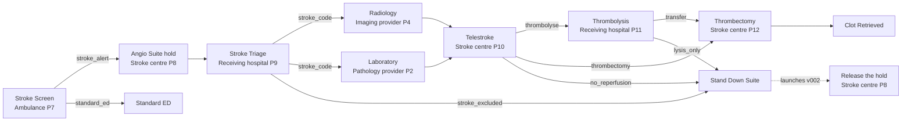

# Stroke code: a federated process with compensation

A suspected stroke, from the ambulance to clot retrieval, across four organisations, with no central engine. Each organisation runs its own hosts and holds only its own part of the process. When a step leaves a side effect in another organisation that later turns out not to be needed, a separate compensation process undoes it where it was made.

[Watch the recorded run](https://alexanderadelau.github.io/Rule-Propagated-Service-Orchestration/docs/replay/index.html?model=../../btsn.common/ProcessDefinitionFolder/healthcare/Workflow/Stroke_Code_With_Emergency_Department.json&run=../../btsn.common/AnalysisFolder/Healthcare/Stroke_Code_With_Emergency_Department.txt) · [All examples](https://alexanderadelau.github.io/Rule-Propagated-Service-Orchestration/docs/replay/examples.html)

The clinical rules are simplified from the hyper-acute stroke pathway for this demonstration. They are not clinical guidance.

## Key messages

- **No central orchestrator.** Twelve hosts in four organisations pass each patient from one to the next as a token. No server holds every patient's state or calls into every organisation's systems.
- **Each organisation owns its part.** The ambulance service, the receiving hospital, the stroke centre and the regional providers each run the services they are responsible for, on their own hosts, and see only the tokens that reach them. The stroke centre's angiography suite is booked in its own system, which the process calls over REST.
- **Compensation across organisations.** The ambulance's alert makes the stroke centre hold its angiography suite. Every route that ends without clot retrieval starts a stand-down process that releases the hold, at the stroke centre, where it was made. A check after the run proves every hold was used or released exactly once.
- **Priority where the queue is.** The regional imaging and pathology providers serve routine patients from another hospital too. Stroke codes are a higher-priority process, so the providers' own hosts serve them first. A central engine in one hospital could not reorder another organisation's queue.
- **A recorded run, not a simulation.** Every host records what it did. The replay shows each patient on the model at the times the hosts recorded, so the model doubles as the audit trail.

## The story

A paramedic suspects a stroke. Treatment is time-critical: clot-dissolving treatment (thrombolysis) must start within 4.5 hours of onset, and the hospital aims to give it within 60 minutes of arrival. A large clot in a major artery may also need clot retrieval (thrombectomy), which only the comprehensive stroke centre can do.



| Place | Organisation and host | What it decides |
|---|---|---|
| StrokeScreen | Ambulance service, P7 | FAST positive, blood glucose at least 4.0 mmol/L (low glucose mimics a stroke) and onset within 24 hours: a stroke alert. Otherwise the patient goes to the nearest emergency department as usual. |
| AngioSuite | Stroke centre, P8, calling the stroke centre's booking system over REST | Holds the angiography suite and its team for the stroke code, before the patient reaches hospital. The hold is recorded in the booking system, against the stroke code. |
| StrokeTriage | Receiving hospital, P9 | Symptoms resolved on arrival (a transient ischaemic attack): the stroke code is excluded. Otherwise CT and bloods are ordered together. |
| Radiology | Regional imaging provider, P4 | CT brain and CT angiography: haemorrhage, and whether a large vessel is blocked. |
| Laboratory | Regional pathology provider, P2 | INR (clotting), platelets and glucose. |
| Telestroke | Stroke centre, P10 | The neurologist decides once both results are in (a join). Thrombolysis within 4.5 hours unless contraindicated: haemorrhage, blood pressure above 185/110 after one dose of an antihypertensive, INR above 1.7, or platelets below 100. Clot retrieval for a large-vessel occlusion within 24 hours. |
| Thrombolysis | Receiving hospital, P11 | Tenecteplase 0.25 mg/kg, at most 25 mg. Then transfer for clot retrieval if a large vessel is blocked ("drip and ship"). |
| Thrombectomy | Stroke centre, P12 | Clot retrieval in the held suite, either straight from the neurologist's decision or after thrombolysis (two operations, shown as `/ 2`). |

## Three processes, highest priority first

- **v001, stroke code:** the pathway above.
- **v002, stand-down:** the compensation process. Started only by the stroke code's Signal transition `Stand Down Suite`.
- **v003, routine emergency department patients:** the existing [emergency department process](btsn.common/ProcessDefinitionFolder/healthcare/Workflow/Emergency_Department_Patient_Workflow.json) at a metro hospital (hosts P1 to P6). Its patients use the same imaging (P4) and pathology (P2) providers.

Where processes share a host, the lower version is served first.

## How the compensation works

1. **The side effect.** On a stroke alert, `AngioSuiteService.holdSuite` on P8 records a hold against the stroke code's workflow number (`SuiteHolds`).
2. **The decision that it is not needed.** Three routes end without clot retrieval, and each reaches the Signal transition `Stand Down Suite`:
   - `stroke_excluded`: the receiving hospital excludes the stroke on arrival.
   - `no_reperfusion`: the neurologist decides on no treatment, for example a haemorrhage.
   - `lysis_only`: thrombolysis is given and no large vessel is blocked.
3. **The compensation process.** Reaching the Signal ends the stroke code there and starts the stand-down process (v002) for the same patient (workflow 1030000 starts 2030000). Its token carries the stroke code's workflow number.
4. **Undoing it where it was made.** P8's host calls the stroke centre's booking system again, now `AngioSuiteService.releaseSuite`, which releases the hold in the system that recorded it. Releasing is safe to repeat: a second request finds nothing to release.
5. **Proving it.** After the run, `analyse` checks the balance across both processes: every hold opened (v001 leaving P8) must be used by a clot retrieval (v001 leaving P12) or released (v002 leaving P8 on `released`), exactly once.

No component coordinates this centrally. The stroke code's own rules decide when to signal, and the stroke centre's own host undoes its own record.

## A REST call into the stroke centre's own system

The angiography suite is booked in the stroke centre's own system, not on an orchestration host. Its place, AngioSuite, still has its orchestration host (P8), which receives the token, applies the rules and passes the token on. To hold or release the suite, though, the host makes a REST call to the booking system.

- **The placement, not the process, says so.** The [service deployment](btsn.common/ServiceDeploymentFolder/healthcare/StrokeCode.json) places both operations with the `rest` adapter:
  - `holdSuite` at `http://127.0.0.1:8090/stroke-centre/suite/hold`;
  - `releaseSuite` at `.../release`.

  The process, its rules and the catalogue contract are the same as when the service runs in-process.
- **The call.** P8's host POSTs the operation's inputs as JSON and gets back the result the Java service returns, including its route (`held`, `released`, `nothing_to_release`). The contract is the one in [Call it over REST](ServiceTutorial.md#8-call-it-over-rest).
- **The booking system.** [`RestServiceServer`](btsn.common/src/org/btsn/invocation/RestServiceServer.java) serves the same `AngioSuiteService` class over HTTP, using the JDK's own HTTP server. The holds live in that server's memory, the stroke centre's system, so the compensation has to reach into it to undo one. In a real deployment the stroke centre would run it on its own machine, and P8's endpoint would name that machine.
- **What it shows.** The process coordinates a side effect in another organisation's system, and undoes it there, through that organisation's own API, still with no central engine.

The booking system writes each call to `StrokeCentre.out.txt` beside the launcher. Nine holds and six releases appear there in a run of the case mix.

## Priority at the shared providers

- **One scanner, one analyser.** Stroke codes and routine patients call the same operation on each provider: `RadiologyService.processImagingRequest` on P4 and `LaboratoryService.processLabRequest` on P2. Each operation serves one token at a time, so the two hospitals really queue for the same scanner and analyser.
- **The stroke protocol.** The providers recognise a stroke code and run the stroke protocol (`StrokeImaging`, `StrokeBloods`) instead of their routine tests.
- **Ordered at the provider.** The priority travels with the token, and each provider's host orders its own queue by it. Neither hospital needs to know about the other's patients.

## Where a central orchestrator would struggle

A central engine could call each organisation's services in turn. The case against it is not that it cannot run this pathway:

- **Priority is lost where the queue is.** The engine can send requests, but cannot reorder a provider's queue that serves several hospitals.
- **No one is the right owner.** Whoever runs it holds every patient's state, and needs network access into four organisations' systems.
- **It adds a dependency.** If the engine, or the link to it, fails, every organisation stops, including steps that could have gone ahead.
- **Twice the network trips.** Each step goes out to the service and back to the engine, instead of straight to the next host.

To be fair to it: RPSO has no live global view of the run, which is only complete once the records are collected, and a stopped host holds up the tokens addressed to its place.

## The case mix

Ten suspected strokes arrive, one every 2.5 seconds ([token format](btsn.common.eventgenerators/TokenFormats/StrokeScreenService.json)):

| Patients | Case | Outcome | Suite hold |
|---|---|---|---|
| 1, 8 | Blocked large vessel, 70 min from onset | Thrombolysis, then clot retrieval | Used |
| 2, 10 | Small stroke, about 95 min | Thrombolysis only | Released |
| 3 | Low blood glucose | Not a stroke code: standard ED | None made |
| 4 | Haemorrhage on CT | No reperfusion | Released |
| 5 | Blood pressure 200/105, lowered to 175/95 | Thrombolysis only | Released |
| 6 | Woke with symptoms, 7 hours | Clot retrieval only | Used |
| 7 | On warfarin, INR 2.6, no blocked vessel | No reperfusion | Released |
| 9 | Symptoms resolved on arrival | Stroke excluded at the door | Released |

Nine holds: three used, six released. Twenty routine patients arrive alongside, in bursts of four every five seconds.

## What to look for in the replay

- **Colours:** red dots are stroke codes (v001), blue dots are stand-downs (v002), green dots are routine patients (v003).
- **Compensation:**
  - The count under `Stand Down Suite` rises as stroke codes end without retrieval.
  - Shortly after each, a blue dot appears at `STAND_DOWN`, passes through AngioSuite and ends at `Suite Released`.
  - Clot retrievals end at `Clot Retrieved`.
- **Shared providers:** red and green dots pass through the same Laboratory and Radiology places. A dot inside a T_in bar is waiting there.
- **The timeline under the replay:** one row per patient.
  - Solid: in service. Light: waiting at a T_in. Thin line: between hosts.
  - Point at a row to ring that patient's tokens on the model, and click to jump there.
  - The blue rows are the short stand-down processes, each starting where a red row ended.

In the recorded run, all ten stroke codes, six stand-downs and twenty routine patients completed in 27 seconds: a median of 4.5 seconds per stroke code and 6.4 seconds per routine patient.

The run on the site came from a fast machine, with little queueing at the providers. There, stroke codes waited a little less than routine patients: 0.65 s against 0.95 s for imaging, and 0.57 s against 0.63 s for pathology. On a slower machine, where queues formed, they waited about 3 seconds against 10 to 12.

Hosts record a token's arrival at a T_in when it joins the operation's queue, and its entry into the place when the host takes it from the queue. So in a run recorded this way, the timeline shows a queue wait as waiting at the T_in. The analysis also checks the queue's order directly. Wherever a stroke code and a routine patient waited in the same queue, it reports whether the stroke code was taken first. The run on the site was recorded before hosts did this, so its timeline shows queue waits as time between hosts.

## Run it yourself

```sh
cd btsn.healthcare.ProjectLoader
ant -f Stroke_Code_With_Emergency_Department.xml -Dhost.address=127.0.0.1   # every host on this machine, and the booking system
ant -f Stroke_Code_With_Emergency_Department.xml analyse                     # the report, then the suite-hold balance
```

The analysis ends with the balance:

```
=== COMPENSATION BALANCE: suite hold ===
   Workflows with a suite hold:        9
   Settled by the process:           3
   Undone by compensation:           6 (workflows 1010000 1030000 1040000 1060000 1080000 1090000)
   Left behind (neither):            0
   Balance:                          [OK] every suite hold opened was settled or undone, exactly once
```

The run starts the stroke centre's booking system on port 8090 if nothing answers there, and stops it at the end. To run from the editor, start the booking system first in a terminal of its own, because the editor checks each REST endpoint before a run:

```sh
ant -f Stroke_Code_With_Emergency_Department.xml stroke-centre   # until Ctrl+C
```

To run the stroke centre on a machine of its own (192.168.1.152 in [TwoHost_StrokeCentre.json](btsn.common/InfrastructureDefinitionFolder/TwoHost_StrokeCentre.json)), with tokens reaching its host P8 over UDP like any other host and its booking inside that host:

```sh
ant -f Stroke_Code_With_Emergency_Department.xml host-packages -Dstroke.centre=remote   # copy the P8 zip there and run launch.bat
ant -f Stroke_Code_With_Emergency_Department.xml -Dstroke.centre=remote                 # then the run, here
```

In the editor, open the combined model and choose **Machines: TwoHost_StrokeCentre** in the toolbar. **Build** then makes the P8 zip, and **Run on hosts** runs it the same way.

To replay your own run, open the replay page, choose **Replay another model and analysis**, and select the combined model below with your analysis file.

## Files

| File | What it is |
|---|---|
| [Stroke_Code_With_Emergency_Department.xml](btsn.healthcare.ProjectLoader/Stroke_Code_With_Emergency_Department.xml) | The launcher: the three processes, their generators and the balance check |
| [Stroke_Code_Workflow.json](btsn.common/ProcessDefinitionFolder/healthcare/Workflow/Stroke_Code_Workflow.json) | The stroke code process (v001) |
| [Stroke_StandDown_Workflow.json](btsn.common/ProcessDefinitionFolder/healthcare/Workflow/Stroke_StandDown_Workflow.json) | The stand-down process (v002) |
| [Stroke_Code_With_Emergency_Department.json](btsn.common/ProcessDefinitionFolder/healthcare/Workflow/Stroke_Code_With_Emergency_Department.json) | The combined drawing of all three, for the editor and the replay |
| [StrokeCode.json](btsn.common/ServiceDeploymentFolder/healthcare/StrokeCode.json) | The service deployment: which operation runs on which host |
| [SingleHost.json](btsn.common/InfrastructureDefinitionFolder/SingleHost.json) | The hosts' addresses and ports, P1 to P12 |
| [RestServiceServer.java](btsn.common/src/org/btsn/invocation/RestServiceServer.java) | Serves Java place services over REST: here, the stroke centre's booking system |
| [healthcare services](btsn.common/src/org/btsn/business/healthcare) | `StrokeScreenService`, `AngioSuiteService` and `SuiteHolds`, `StrokeTriageService`, `StrokeImaging`, `StrokeBloods`, `TelestrokeService`, `ThrombolysisService`, `ThrombectomyService` |
| [Recorded run](btsn.common/AnalysisFolder/Healthcare/Stroke_Code_With_Emergency_Department.txt) | The analysis of the run the site replays |
