# From an idea to a measured run

We will walk you through four examples. All are built graphically in the editor.

- **Example 1** runs a standard service that returns true or false.
- **Example 2** builds a simple claims process that calls a remote service over REST.
- **Example 3** adds a seventh host target, P7, and moves Example 1 onto it.
- **Example 4** tests a remote service of your own in context: you describe the service, point a place at it and run traffic through it.

**Before you start:** you need a JDK (15 or later) and the repository's projects imported into Eclipse.

## Example 1: a standard service

The process has one place, **P1**. Its service returns `true` or `false` at random.

- `true` ends the workflow.
- `false` sends the token back to P1 to try again.

The event generator sends 10 tokens, one a second.

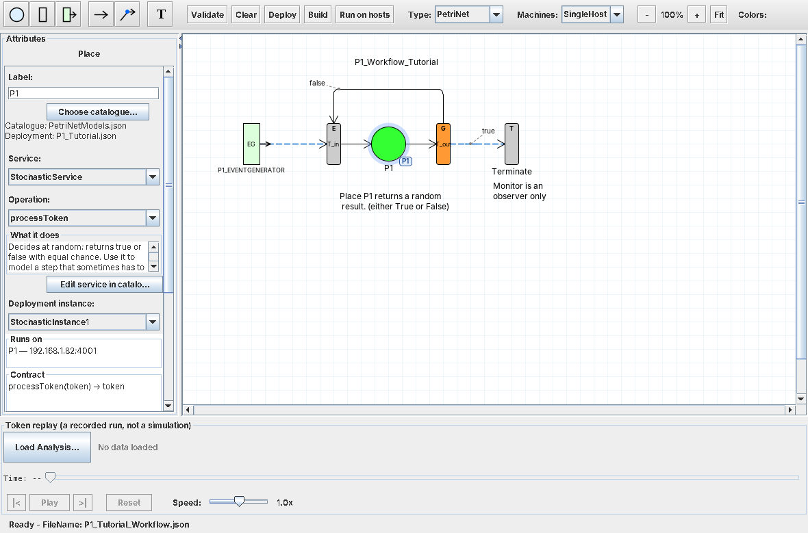

*What you will build.*

[▶ Watch a recorded run of this process](https://alexanderadelau.github.io/Rule-Propagated-Service-Orchestration/docs/replay/?model=../../btsn.common/ProcessDefinitionFolder/petrinet/Workflow/P1_Tutorial_Workflow.json&run=../../btsn.common/AnalysisFolder/PetriNet/Analysis_P1_Tutorial_Workflow.txt)

### Create the process

1. Start the editor: in Eclipse, run `com.editor.ProcessEditor` (project `btsn.workflowEditor`) as a Java application.
2. Choose **File → New → Process Definition**.
3. Choose **File → Save Process Definition As...** and save it as
   `btsn.common/ProcessDefinitionFolder/petrinet/Workflow/My_P1_Workflow.json`.

### Add the elements

For each element: click its tool in the palette (top left), click the canvas, then type
its **Label** in the Attributes panel.

4. **Event Generator**: label `P1_EVENTGENERATOR`.
5. **Transition**: label `T_in_P1`.
6. **Place** (the circle): label `P1`.
7. **Transition**: label `T_out_P1`.
8. **Transition**: label `Terminate`.

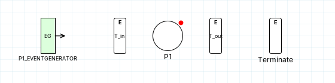

### Connect them

Click **Arrow (drag)**, then drag from one element to the next. Click the tool again for each arrow.

9. `P1_EVENTGENERATOR` → `T_in_P1`
10. `T_in_P1` → `P1`
11. `P1` → `T_out_P1`
12. `T_out_P1` → `Terminate`
13. `T_out_P1` → `T_in_P1`: use **Arrow (click waypoints)** so the arrow goes over P1.
    Click `T_out_P1`, click two points above the place, then click `T_in_P1`.

### Set the details

Select each element or arrow, then change it in the Attributes panel.

14. `P1`: **Service** `StochasticService`. Its operation, `processToken`, is chosen for you.
15. `T_out_P1`: **Node Type** `GatewayNode`.
16. `Terminate`: **Node Type** `TerminateNode`.
17. The arrow `T_out_P1` → `Terminate`: **Guard Condition** `DECISION_EQUAL_TO`,
    **Decision Value** `true`, **Label** `true`.
18. The arrow `T_out_P1` → `T_in_P1`: **Guard Condition** `DECISION_EQUAL_TO`,
    **Decision Value** `false`, **Label** `false`.
19. Click **Validate**. You should see **Validation passed!**
20. Choose **File → Save Process Definition**.

### Deploy it

21. Click **Deploy**. In P1's row, choose **Host node** (its host target) `P1`.
22. Click **Save deployment...** and accept the name it suggests.
23. Choose **File → Save Process Definition**.

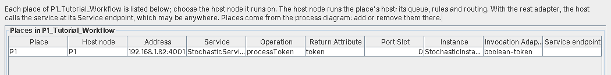

### Run it

24. Click **Build**. The summary lists `Hosts    P1 and Monitor`. Leave **Tokens** at 10 and click **Create**.
25. Click **Run on hosts**. Leave **Run every host on this computer** ticked, then click **Run**.
26. Wait for **Run complete**. You should see `v001: 10 generated, 10 completed`.

*The Run window when the run is complete.*

27. Click **Replay the recorded run**. Some tokens loop back through P1 before they reach **Terminate**.

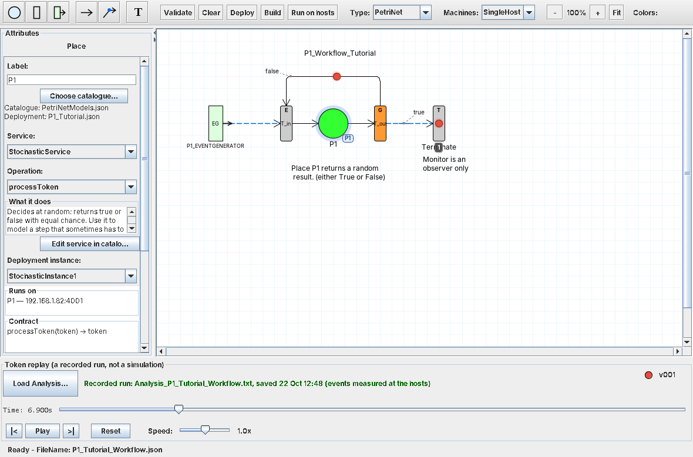

*A token going round again after P1 returned `false`.*

### Look behind the run

The run was real: P1 was a host process of its own, which recorded what it did.

- **The launcher** Build wrote, `btsn.petrinet.ProjectLoader/My_P1_Workflow_BuildAndRun.xml`, names the hosts it starts:
  `<property name="hosts" value="P1"/>`.
- **P1's log** is beside it, in `P1_Place.out.txt`. Near the top: `node P1 runs [P1_Place, P1_CollectorService, P1_InitializationService]`.
- **P1's folder**, `btsn.services/target/launchers/My_P1_Workflow_BuildAndRun/P1/`, holds the rules it was sent and the database it recorded into.

### Learn more

- [The Deploy panel, Build and Run, and the analysis, step by step](Reference.md#each-step-in-detail)
- [How each host runs its place](Reference.md#inside-each-host)
- The finished copy: `btsn.common/ProcessDefinitionFolder/petrinet/Workflow/P1_Tutorial_Workflow.json`

## Example 2: a claims process with a remote service

An insurer pays small claims at once and assesses the larger ones. The process has two places:

- **Triage** runs on host target P1. Its service, supplied with the repository, finds a claim of up
  to 2,500 simple and a larger one complex.
- **Assess** runs on host target P2, but its service does not: P2's orchestration host calls it on the internet,
  over REST. It accepts a claim of up to 4,000 and rejects the rest.

Claim *n* is for *n* × 500, so of the ten claims, 1–5 are paid, 6–8 accepted and 9–10 rejected.
Your computer needs internet access for this example.

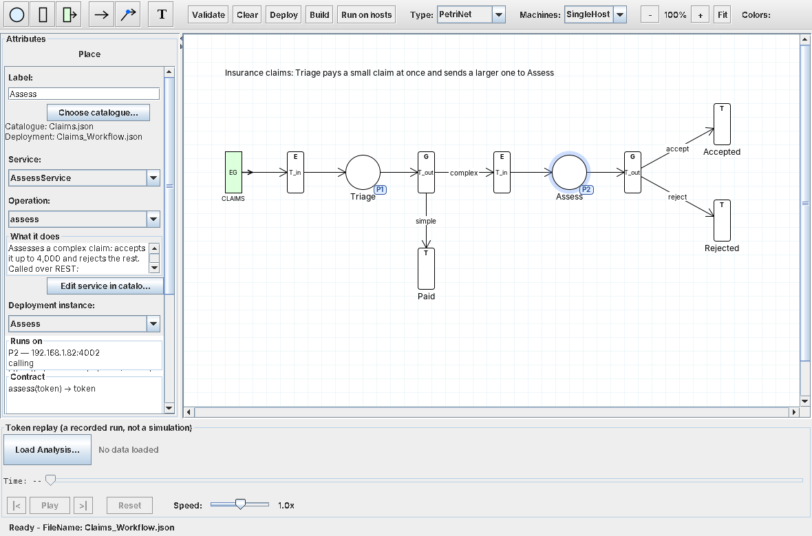

*What you will build.*

[▶ Watch a recorded run of this process](https://alexanderadelau.github.io/Rule-Propagated-Service-Orchestration/docs/replay/?model=../../btsn.common/ProcessDefinitionFolder/claims/Workflow/Claims_Workflow.json&run=../../btsn.common/AnalysisFolder/Claims/Analysis_Claims_Workflow.txt)

### Create the process

1. Choose **File → New → Process Definition**.
2. Choose **File → Save Process Definition As...** and save it as
   `btsn.common/ProcessDefinitionFolder/claims/Workflow/My_Claims_Workflow.json`.
   Saving it in the `claims` folder gives the process the claims services.

### Add the elements

As in Example 1: click the tool, click the canvas, type the **Label**.

3. **Event Generator**: `CLAIMS`.
4. **Transition** `T_in_Triage`, **Place** `Triage`, **Transition** `T_out_Triage`, in a row.
5. **Transition** `Paid`, below `T_out_Triage`.
6. **Transition** `T_in_Assess`, **Place** `Assess`, **Transition** `T_out_Assess`, continuing the row.
7. **Transition** `Accepted` and **Transition** `Rejected`, to the right of `T_out_Assess`.

### Connect them

Use **Arrow (drag)** for each arrow.

8. `CLAIMS` → `T_in_Triage` → `Triage` → `T_out_Triage`
9. `T_out_Triage` → `Paid`
10. `T_out_Triage` → `T_in_Assess` → `Assess` → `T_out_Assess`
11. `T_out_Assess` → `Accepted`
12. `T_out_Assess` → `Rejected`

### Set the details

13. `Triage`: **Service** `ClaimsTriageService`.
14. `Assess`: **Service** `AssessService`.
15. `T_out_Triage` and `T_out_Assess`: **Node Type** `GatewayNode`.
16. `Paid`, `Accepted` and `Rejected`: **Node Type** `TerminateNode`.
17. Set each arrow's **Guard Condition** to `DECISION_EQUAL_TO`, and its **Decision Value** and **Label** to:

    | Arrow | Value |
    |---|---|
    | `T_out_Triage` → `Paid` | `simple` |
    | `T_out_Triage` → `T_in_Assess` | `complex` |
    | `T_out_Assess` → `Accepted` | `accept` |
    | `T_out_Assess` → `Rejected` | `reject` |

18. Click **Validate**. You should see **Validation passed!**
19. Choose **File → Save Process Definition**.

### Deploy it

20. Click **Deploy**. Choose **Host node** `P1` for Triage and `P2` for Assess.
21. In Assess's row, set **Invocation Adapter** to `rest`. Then, in the **Service endpoint** box below the table, enter
    `https://rule-propagated-service-orchestrati.vercel.app/api/claims/assess`
22. Click **Save deployment...** and accept the name it suggests.
23. Choose **File → Save Process Definition**.

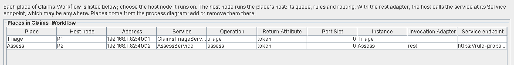

*The address in step 21 is a public copy of the service. You are free to use your own: its
code is `examples/rest/claims.js`, and any service that answers the same way will do.*

### Run it

24. Click **Build**, then **Create**.
25. Click **Run on hosts**, then **Run**. Before it starts, the editor checks that the claims service answers.
26. Wait for **Run complete**. You should see `v001: 10 generated, 10 completed`. P2 made 5 service
    calls: one for each complex claim.

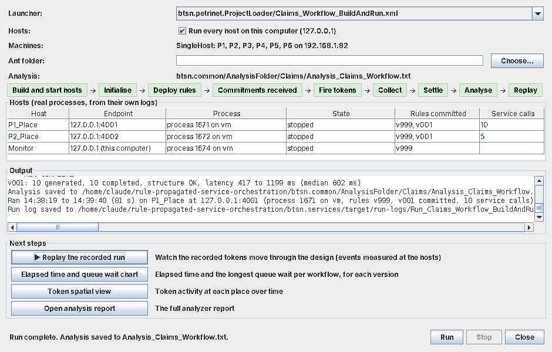

27. Click **Replay the recorded run**. Claims 1–5 go to **Paid**; claims 6–10 go on to Assess,
    where 6–8 are **Accepted** and 9–10 **Rejected**.

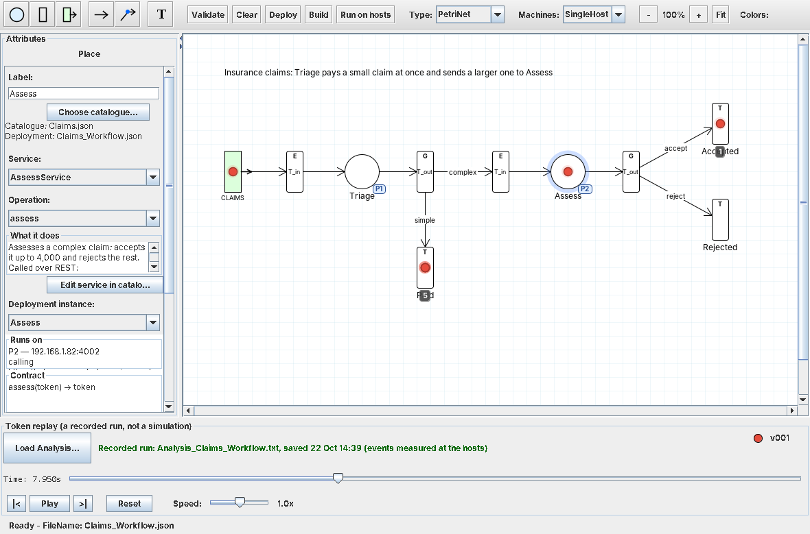

*Claim 7 at Assess, whose service answered from the internet.*

### Learn more

- [Calling a service over REST, and hosting your own](ServiceTutorial.md#8-call-it-over-rest)
- [Adding a new service while you design](Reference.md#adding-services-while-designing)
- [Writing a Java service](ServiceTutorial.md)
- The finished copy: `btsn.common/ProcessDefinitionFolder/claims/Workflow/Claims_Workflow.json`
- The ready-made examples, from Petri-net models to the financial and healthcare workflows: [Run an example](Reference.md#run-an-example)

## Example 3: add a host target

Every host target runs as the same orchestration host program. How many host targets there are is up to the
infrastructure definition, so a new one is a new row there: nothing is copied or registered. Here you add P7 and move
Example 1's place onto it.

### Add the host target

1. Choose **File → Open → Infrastructure Definition...** and open
   `btsn.common/InfrastructureDefinitionFolder/SingleHost.json`.
2. Click **Add host**. A new row appears: `P7`, channel `ip0`, address `192.168.1.82`, port `4009`.
   It gets 4009 because P4 and P6 already use 4007 and 4008.
3. Click **Save...** and keep `SingleHost.json`. The other examples are unchanged: none of them uses P7.

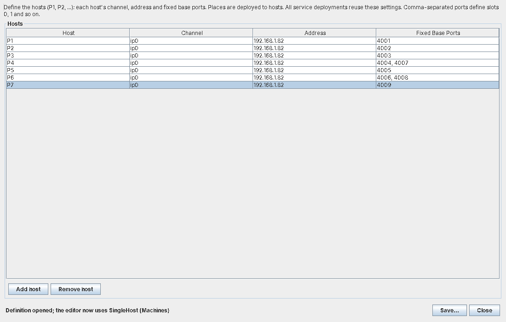

### Move P1 onto P7

4. Choose **File → Open → Process Definition...** and open `My_P1_Workflow.json` from Example 1.
5. Right-click the place **P1**, then **Deploy to → P7**. The menu shows P7's address, `192.168.1.82:4009`.
   If P7 is not listed, open the process again.
6. Click **Deploy**. P1's row now shows **Host node** `P7`. Click **Save deployment...** and keep the name it suggests.
7. Choose **File → Save Process Definition**.

The place keeps its label, P1; only the host target it runs on has changed.

### Run it

8. Click **Build**. The summary lists `Hosts    P7 and Monitor (each host is initialised and collected by the run)`.
   Click **Create**.
9. Click **Run on hosts**, then **Run**. The Hosts table shows `P7_Place` at `127.0.0.1:4009`.
10. Wait for **Run complete**. You should see `v001: 10 generated, 10 completed`.

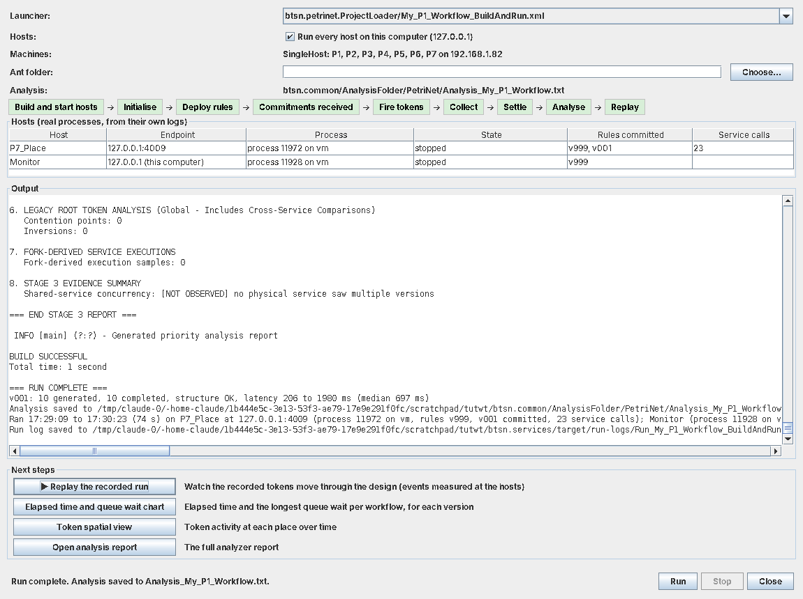

### Look behind the run

- **The launcher** now names the new host: `<property name="hosts" value="P7"/>`.
- **P7's log** is `btsn.petrinet.ProjectLoader/P7_Place.out.txt`: `node P7 runs [P7_Place, P7_CollectorService, P7_InitializationService]`.
- **P7's folder** is `btsn.services/target/launchers/My_P1_Workflow_BuildAndRun/P7/`.
- **What the run generated for P7**, in that run's own `btsn.common`:
  - its database and collection services, on ports 4306 and 4106: `RuleBase/Generated/HostAdministration.ruleml.xml`;
  - the processes that reset and collect this run's hosts: `ProcessDefinitionFolder/common/Initializers/Hosts_Initialization.json`
    and `ProcessDefinitionFolder/common/Collectors/Hosts_Collector.json`.

### Try next

- **Use both hosts.** In Example 2, deploy Assess to P7 instead of P2. The launcher then lists `P1,P7`.
- **Put P7 on another machine.** In step 2, give P7 channel `ip1` and that machine's address. Build then offers a
  host package for P7 to start there ([Run on several machines](Reference.md#7-run-on-several-machines)).
- **Move P1 back.** Deploy P1 to `P1` again and save; P7 stays available for later.

### Learn more

- [Add a host target](Reference.md#add-a-host): host target names (P1 to P99) and the ports kept for each one's initialisation and collection places
- [Choose the machines](Reference.md#choose-the-machines)

## Example 4: test your own remote service

You have a remote service, say a payment gateway, and want to see how it behaves in context: under steady traffic,
when it declines, fails or answers slowly. Here you build the one-place test from the README from nothing: an event
generator, a place that calls the service over REST, and two outcomes. You describe the service yourself, as you would
your own. It first calls this project's mock payment service on Vercel; at the end you point it at yours.

Your computer needs internet access for this example.

### Create the process

1. Choose **File → New → Process Definition**.
2. Choose **File → Save Process Definition As...** and save it as
   `btsn.common/ProcessDefinitionFolder/mypayments/Workflow/My_Payment_Test.json`.
   Use the dialog's **New Folder** button to make `mypayments` and, inside it, `Workflow`.

   The folder under `ProcessDefinitionFolder` is the process's **domain**, here `mypayments`. It decides the process's
   catalogue and where the editor puts every other file it makes ([Where your files go](#where-your-files-go)), so
   this is the only location you choose.

### Draw it

3. Add the elements (click the tool, click the canvas, type the **Label**):
   - **Event Generator** `PAYMENTS`;
   - **Transition** `T_in_Payment`, **Place** `Payment`, **Transition** `T_out_Payment`, in a row;
   - **Transition** `Paid` and **Transition** `Declined`, to the right of `T_out_Payment`.
4. Connect them with **Arrow (drag)**:
   - `PAYMENTS` → `T_in_Payment` → `Payment` → `T_out_Payment`
   - `T_out_Payment` → `Paid`
   - `T_out_Payment` → `Declined`
5. Set the details:
   - `T_in_Payment`: **Node Type** `EdgeNode`, **Buffer** `40` (room for payments to queue);
   - `T_out_Payment`: **Node Type** `GatewayNode`;
   - `Paid` and `Declined`: **Node Type** `TerminateNode`;
   - the arrow to `Paid`: **Guard Condition** `DECISION_EQUAL_TO`, **Decision Value** and **Label** `paid`;
   - the arrow to `Declined`: the same, with `declined`.

Your design should now look like this. The red dot on `Payment` means it has no service yet; you describe one next.

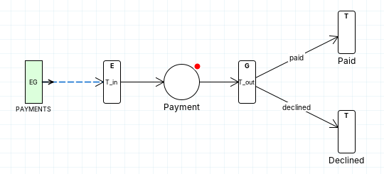

### Describe the service

The process needs a catalogue to hold your service: one per domain, shared by its processes.

6. Right-click `Payment` and choose **Choose/Create catalogue...**. Because the process is saved in the `mypayments`
   folder, **Create a catalogue for a new domain** is already chosen, with `mypayments` filled in. Click **OK**.
7. Right-click `Payment` again and choose **Create New Service in Mypayments.json...**. Fill in the form:

   | Field | Enter | Why |
   |---|---|---|
   | **Service** | `MyPaymentService` | Your name for it. (The suggestion, `MypaymentsPaymentService`, avoids the supplied `PaymentService`.) |
   | **Operation** | `authorise` | What the place asks the service to do |
   | **What it does** / **What it returns** | In words | Shown wherever the service is chosen |
   | **Inputs** | `token` (suggested) | The event generator sends each payment under the name `token`, and an input is named after what arrives |
   | **Return attribute** | `paymentResult` | The name the service's answer is published under |
   | **Routes on** | `paid, declined` | The values its answer routes on: the guards you set in step 5 |
   | **How it runs** | **A service called over REST, in any language** | There is no Java class: the service runs at its endpoint |

   Click **Add to Mypayments.json**.
8. Click **Validate**. You should see **Validation passed!**
9. Choose **File → Save Process Definition**.

**You don't write any code here.** The payment service is already written and running on Vercel
([`examples/rest/payment.js`](examples/rest/payment.js)); the form above only tells the editor how to call it. If you
want to see what it receives and sends back, [Follow one payment](ServiceTutorial.md#follow-one-payment-what-a-service-receives-and-returns)
shows it step by step.

### Deploy it

10. Click **Deploy**. In Payment's row, choose **Host node** `P1` and set **Invocation Adapter** to `rest`.
11. In the **Service endpoint** box below the table, enter
    `https://rule-propagated-service-orchestrati.vercel.app/api/payment/authorise`, and set **Wait up to** `2500` ms.
    A payment that takes longer fails at the place.
12. Click **Save deployment...** and accept the name it suggests. Then choose **File → Save Process Definition**.

*The parts of the Deploy panel you set: the row's **Host node** and **Invocation Adapter**, the **Service endpoint** and
**Wait up to** below it, then **Save deployment...***

### Run it

13. Click **Build**. Set **Tokens per generator** to `30`, then click **Create**.
14. Click **Run on hosts**, then **Run**. Before it starts, the editor checks that the payment service answers.
15. Wait for **Run complete**. Expect `v001: 30 generated, 27 completed`. The mock service declines every 8th
    payment, is unavailable for every 13th and too slow for every 17th, so the report lists:
    - 24 paid and 3 declined;
    - 3 failed at Payment, each with its reason: `answered HTTP 503` for payments 13 and 26, and
      `did not answer within 2500 ms (timeoutMs)` for payment 17.
16. Click **▶ Replay the recorded run**, then **Elapsed time and queue wait chart**: how long each payment waited,
    and how long the service took.

### Where your files go

You choose only the process's folder (step 2). The editor creates every other file in its place, named after the
domain (`mypayments`) and the process (`My_Payment_Test`):

| File | Created by | Where |
|---|---|---|
| The process | Step 2 | `btsn.common/ProcessDefinitionFolder/mypayments/Workflow/My_Payment_Test.json` |
| The catalogue | Step 6 | `btsn.common/BusinessServiceDefinitions/mypayments/Mypayments.json`, and listed in `btsn.services/packaging.json` |
| The deployment | Step 12 | `btsn.common/ServiceDeploymentFolder/mypayments/My_Payment_Test.json` |
| The launcher, its schedule and its deployment profile | Step 13 | `btsn.petrinet.ProjectLoader/My_Payment_Test_BuildAndRun.xml`, `btsn.common.eventgenerators/EventTriggeringFile/My_Payment_Test_BuildAndRun.csv` and `btsn.services/deployments/mypayments/My_Payment_TestDeployment.json` |
| The run's analysis | Step 15 | `btsn.common/AnalysisFolder/Mypayments/Analysis_My_Payment_Test.txt` |

To start again, delete these files; the catalogue's line in `packaging.json` goes with it (the editor offers to remove it
the next time you run).

### Now test your own service

- **What your service must do.** Answer an HTTP POST. It receives
  `{"service": "MyPaymentService", "operation": "authorise", "sequenceId": …, "version": "v001", "inputs": {"token": {…}}}`
  and answers HTTP 200 with `{"paymentResult": {…, "routing_decision": {"routing_path": "paid"}}}`, or `declined`.
  Any other status, or no answer within **Wait up to**, fails the payment at the place, with the reason in the report.
- **A starting point.** [`examples/rest/payment.js`](examples/rest/payment.js) is the mock, in a few lines of
  JavaScript. Run it on your machine with `node examples/rest/credit-service.js` (it answers at
  `http://127.0.0.1:8080/payment/authorise`), or host your own copy:
  [Serve it from the internet](ServiceTutorial.md#serve-it-from-the-internet).
- **Point the place at it.** Click **Deploy**, put your address in **Service endpoint**, set **Wait up to**, save the
  deployment, then **Run on hosts** again.
- **Shape the traffic.** Select `PAYMENTS`: **Rate (ms)** sets how often payments arrive, and **Token Data File Name** what
  each one carries (**Open...** shows it; **New...** starts your own). Then **Build → Create** and run. For bursts, see
  [Test a remote service in context](ServiceTutorial.md#test-a-remote-service-in-context).
- **Grow it.** Add the places around the service, such as a receipt after **Paid**: each is another Node in the same
  model ([Follow one payment](ServiceTutorial.md#follow-one-payment-what-a-service-receives-and-returns)).

### Learn more

- [Follow one payment: what a service receives and returns](ServiceTutorial.md#follow-one-payment-what-a-service-receives-and-returns)
- [Priority at a shared service](ServiceTutorial.md#priority-at-a-shared-service): two kinds of traffic, one service
- The supplied copy: `btsn.common/ProcessDefinitionFolder/payments/Workflow/Remote_Payment_Test.json`

[▶ Watch a recorded run of the finished test](https://alexanderadelau.github.io/Rule-Propagated-Service-Orchestration/docs/replay/?model=../../btsn.common/ProcessDefinitionFolder/payments/Workflow/Remote_Payment_Test.json&run=../../btsn.common/AnalysisFolder/Payments/Analysis_Remote_Payment_Test.txt)

## Author

Alexander Cameron
