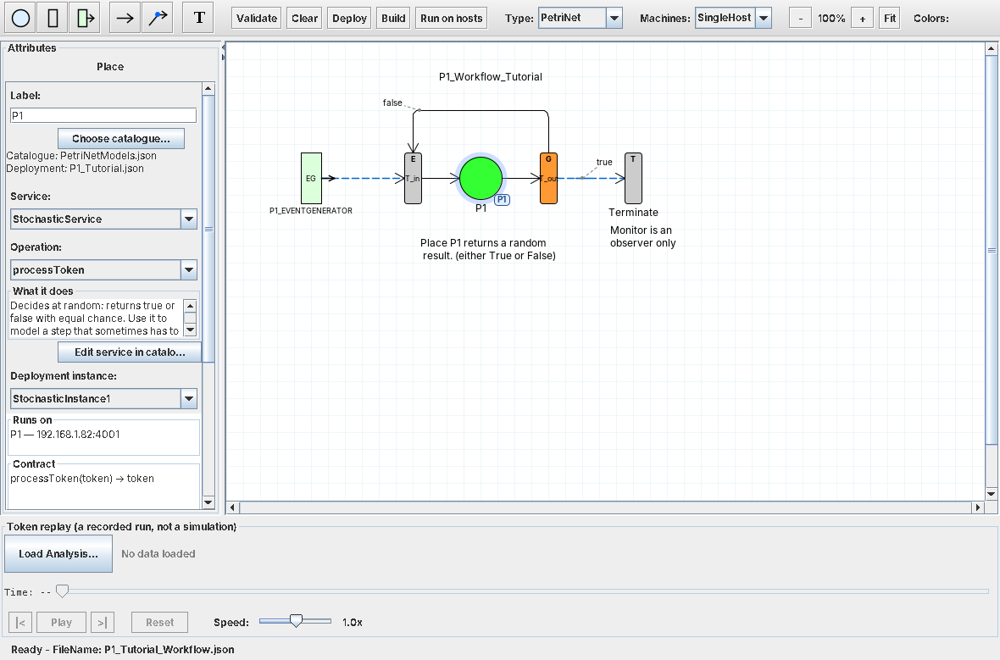
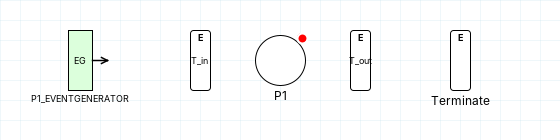
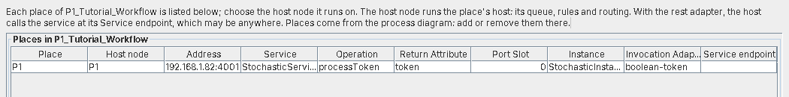
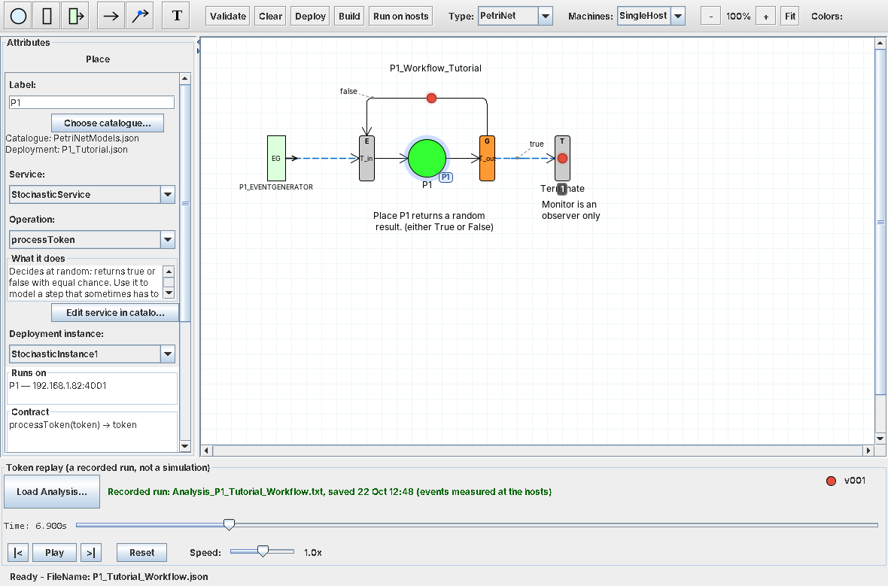
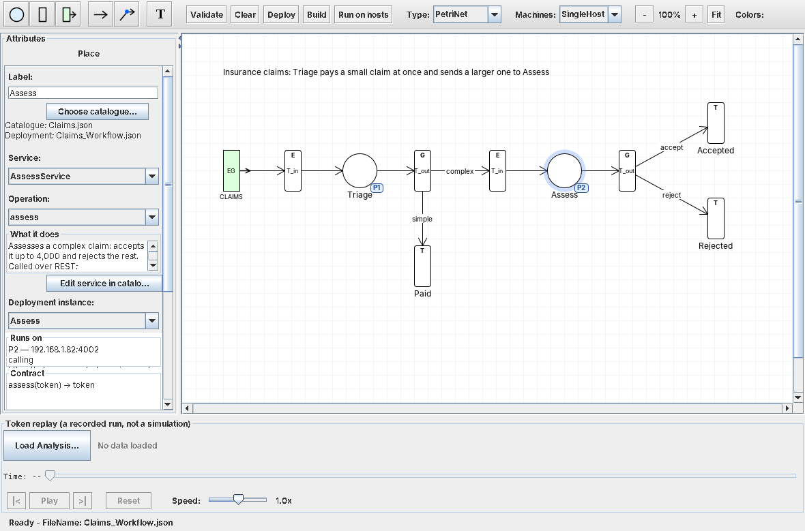
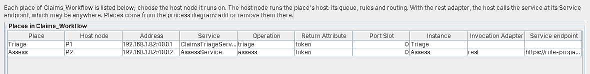
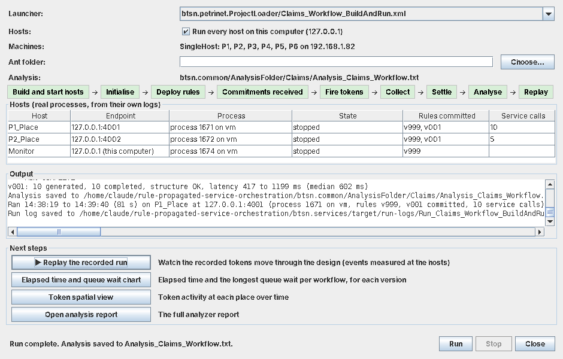
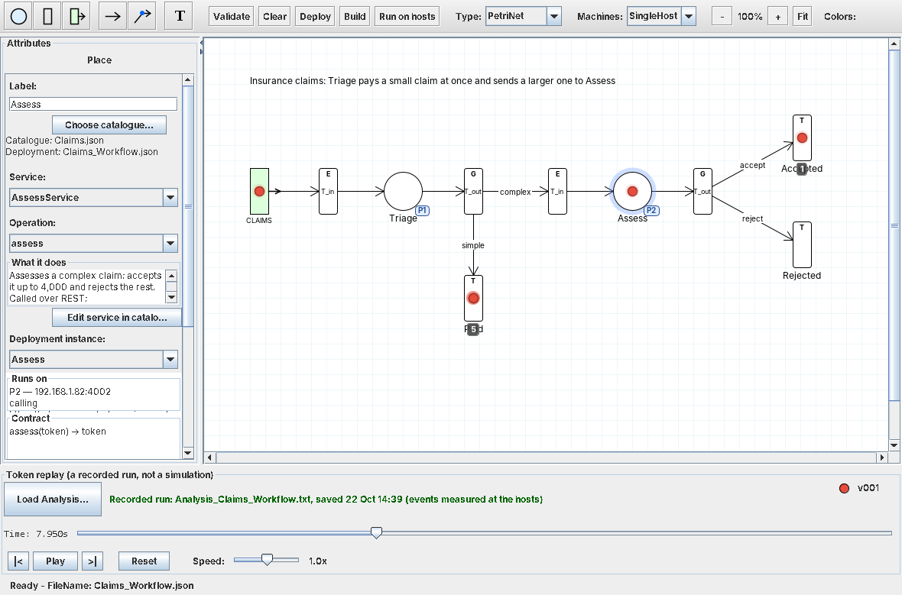

# From an idea to a measured run

We will walk you through two examples. Both are built graphically in the editor.

- **Example 1** runs a standard service that returns true or false.
- **Example 2** builds a simple claims process that calls a remote service over REST.

**Before you start:** you need a JDK (15 or later), Apache Ant (it comes with Eclipse), and
the repository's projects imported into Eclipse.

## Example 1: a standard service

The process has one place, **P1**. Its service returns `true` or `false` at random.

- `true` ends the workflow.
- `false` sends the token back to P1 to try again.

The event generator sends 10 tokens, one a second.

*What you will build.*

### Create the process

1. Start the editor: in Eclipse, run `com.editor.ProcessEditor` (project `btsn.workflowEditor`) as a Java application.
2. Choose **File → New → Process Definition**.
3. Choose **File → Save Process Definition As...** and save it as
   `btsn.common/ProcessDefinitionFolder/petrinet/Workflow/My_P1_Workflow.json`.

### Add the elements

For each element: click its tool in the palette (top left), click the canvas, then type
its **Label** in the Attributes panel.

4. **Event Generator**: label `P1_EVENTGENERATOR`.
5. **Transition**: label `T_in_P1`.
6. **Place** (the circle): label `P1`.
7. **Transition**: label `T_out_P1`.
8. **Transition**: label `Terminate`.

### Connect them

Click **Arrow (drag)**, then drag from one element to the next. Click the tool again for each arrow.

9. `P1_EVENTGENERATOR` → `T_in_P1`
10. `T_in_P1` → `P1`
11. `P1` → `T_out_P1`
12. `T_out_P1` → `Terminate`
13. `T_out_P1` → `T_in_P1`: use **Arrow (click waypoints)** so the arrow goes over P1.
    Click `T_out_P1`, click two points above the place, then click `T_in_P1`.

### Set the details

Select each element or arrow, then change it in the Attributes panel.

14. `P1`: **Service** `StochasticService`. Its operation, `processToken`, is chosen for you.
15. `T_out_P1`: **Node Type** `GatewayNode`.
16. `Terminate`: **Node Type** `TerminateNode`.
17. The arrow `T_out_P1` → `Terminate`: **Guard Condition** `DECISION_EQUAL_TO`,
    **Decision Value** `true`, **Label** `true`.
18. The arrow `T_out_P1` → `T_in_P1`: **Guard Condition** `DECISION_EQUAL_TO`,
    **Decision Value** `false`, **Label** `false`.
19. Click **Validate**. You should see **Validation passed!**
20. Choose **File → Save Process Definition**.

### Deploy it

21. Click **Deploy**. In P1's row, choose **Host node** `P1`.
22. Click **Save deployment...** and accept the name it suggests.
23. Choose **File → Save Process Definition**.

### Run it

24. Click **Build**. Leave **Tokens** at 10 and click **Create**.
25. Click **Run on hosts**. Leave **Run every host on this computer** ticked, then click **Run**.
26. Wait for **Run complete**. You should see `v001: 10 generated, 10 completed`.

*The Run window when the run is complete.*

27. Click **Replay the recorded run**. Some tokens loop back through P1 before they reach **Terminate**.

*A token going round again after P1 returned `false`.*

### Learn more

- [The Deploy panel, Build and Run, and the analysis, step by step](Reference.md#each-step-in-detail)
- [How each host runs its place](Reference.md#inside-each-host)
- The finished copy: `btsn.common/ProcessDefinitionFolder/petrinet/Workflow/P1_Tutorial_Workflow.json`

## Example 2: a claims process with a remote service

An insurer pays small claims at once and assesses the larger ones. The process has two places:

- **Triage** runs on host P1. Its service, supplied with the repository, finds a claim of up
  to 2,500 simple and a larger one complex.
- **Assess** runs on host P2, but its service does not: the host calls it on the internet,
  over REST. It accepts a claim of up to 4,000 and rejects the rest.

Claim *n* is for *n* × 500, so of the ten claims, 1–5 are paid, 6–8 accepted and 9–10 rejected.
Your computer needs internet access for this example.

*What you will build.*

### Create the process

1. Choose **File → New → Process Definition**.
2. Choose **File → Save Process Definition As...** and save it as
   `btsn.common/ProcessDefinitionFolder/claims/Workflow/My_Claims_Workflow.json`.
   Saving it in the `claims` folder gives the process the claims services.

### Add the elements

As in Example 1: click the tool, click the canvas, type the **Label**.

3. **Event Generator**: `CLAIMS`.
4. **Transition** `T_in_Triage`, **Place** `Triage`, **Transition** `T_out_Triage`, in a row.
5. **Transition** `Paid`, below `T_out_Triage`.
6. **Transition** `T_in_Assess`, **Place** `Assess`, **Transition** `T_out_Assess`, continuing the row.
7. **Transition** `Accepted` and **Transition** `Rejected`, to the right of `T_out_Assess`.

### Connect them

Use **Arrow (drag)** for each arrow.

8. `CLAIMS` → `T_in_Triage` → `Triage` → `T_out_Triage`
9. `T_out_Triage` → `Paid`
10. `T_out_Triage` → `T_in_Assess` → `Assess` → `T_out_Assess`
11. `T_out_Assess` → `Accepted`
12. `T_out_Assess` → `Rejected`

### Set the details

13. `Triage`: **Service** `ClaimsTriageService`.
14. `Assess`: **Service** `AssessService`.
15. `T_out_Triage` and `T_out_Assess`: **Node Type** `GatewayNode`.
16. `Paid`, `Accepted` and `Rejected`: **Node Type** `TerminateNode`.
17. Set each arrow's **Guard Condition** to `DECISION_EQUAL_TO`, and its **Decision Value** and **Label** to:

    | Arrow | Value |
    |---|---|
    | `T_out_Triage` → `Paid` | `simple` |
    | `T_out_Triage` → `T_in_Assess` | `complex` |
    | `T_out_Assess` → `Accepted` | `accept` |
    | `T_out_Assess` → `Rejected` | `reject` |

18. Click **Validate**. You should see **Validation passed!**
19. Choose **File → Save Process Definition**.

### Deploy it

20. Click **Deploy**. Choose **Host node** `P1` for Triage and `P2` for Assess.
21. In Assess's row, set **Invocation Adapter** to `rest` and **Service endpoint** to
    `https://rule-propagated-service-orchestrati.vercel.app/api/claims/assess`
22. Click **Save deployment...** and accept the name it suggests.
23. Choose **File → Save Process Definition**.

*The address in step 21 is a public copy of the service. You are free to use your own: its
code is `examples/rest/claims.js`, and any service that answers the same way will do.*

### Run it

24. Click **Build**, then **Create**.
25. Click **Run on hosts**, then **Run**. Before it starts, the editor checks that the claims service answers.
26. Wait for **Run complete**. You should see `v001: 10 generated, 10 completed`. P2 made 5 service
    calls: one for each complex claim.

27. Click **Replay the recorded run**. Claims 1–5 go to **Paid**; claims 6–10 go on to Assess,
    where 6–8 are **Accepted** and 9–10 **Rejected**.

*Claim 7 at Assess, whose service answered from the internet.*

### Learn more

- [Calling a service over REST, and hosting your own](ServiceTutorial.md#8-call-it-over-rest)
- [Adding a new service while you design](Reference.md#adding-services-while-designing)
- [Writing a Java service](ServiceTutorial.md)
- The finished copy: `btsn.common/ProcessDefinitionFolder/claims/Workflow/Claims_Workflow.json`
- The ready-made examples, from Petri-net models to the financial and healthcare workflows: [Run an example](Reference.md#run-an-example)

## Author

Alexander Cameron
