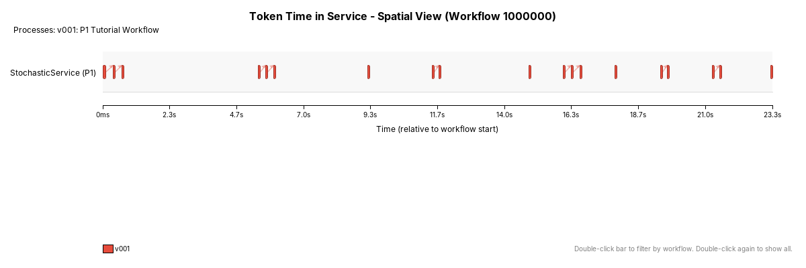

# P1 tutorial — captured results

These artefacts come from an actual run of the supplied P1 process on one
computer, using the local infrastructure and the existing runtime and chart
implementations. The [tutorial](../../../../Tutorial.md) builds the same loop on node P2 from the
editor and uses this run as its reference.

## Reference run

| Setting or measurement | Value |
|---|---|
| Runtime source | `97b9b5e2c81ec80aa77a7dbfc2b4cd6e4583a507` (the P1 tutorial launcher on the shared process runtime) |
| Configuration | `P1_Tutorial_LocalDeployment.json`: the shared `SingleHost.json` infrastructure with every host on `127.0.0.1`, and the P1 service deployment |
| Java / Ant | OpenJDK 21.0.12 / Apache Ant 1.10.15 |
| Workflow | `petrinet/Workflow/P1_Tutorial_Workflow` |
| Version / workflow base | `v001` / `1000000` |
| Roots generated / completed / incomplete | **10 / 10 / 0** |
| Business terminations | **10** |
| P1 logical visits / repeat visits | **19 / 9** |
| Fork children / successful joins | **0 / 0** |
| Measured root elapsed time | **244–1,048 ms** |
| Maximum observed queue wait per root | **142–284 ms** |
| Valid / invalid queue-visit samples | **19 / 0** |

The loop retains a root's identity. For example, root `1000000` made three P1
visits, including two false-return repeats, before terminating. Its measured
elapsed time was 1,048 ms and its maximum observed visit queue wait was 284 ms.
Root `1020000` terminated after one visit, with 244 ms elapsed and 152 ms maximum
queue wait. The [CSV](workflows.csv) records all ten roots and their visit counts.

Stochastic outcomes and machine timings vary. These numbers are a recorded
example, rather than required results for another run. The single-version
tutorial does not provide evidence of cross-version scheduling priority.

## Timing and activity views


Bars show generation-to-completion elapsed time. Black diamonds show the
maximum observed queue wait on any service visit within that root. Arrival
ranks 1–10 map to the ordered roots in [workflows.csv](workflows.csv). Queue
markers do not represent accumulated waiting time or a decomposition of the
elapsed bar.



Each service interval represents a P1 visit. Clusters show the same root
returning through the false loop. This view uses time relative to the earliest
recorded service activity; the timing chart compares individual root durations.
Monitor supplies observations separately from the business path.

## Files to reference

| Artefact | Use |
|---|---|
| [analysis.txt](analysis.txt) | Full `PetriNetAnalyzer --all` report, including `Time=...` marking events for ProcessEditor's **Load Analysis...** replay |
| [workflows.csv](workflows.csv) | Per-root generation/completion timestamps, elapsed time, maximum queue wait and visits |
| [workflow-summary.txt](workflow-summary.txt) | Timing chart's own measurement definitions and ordered root summary |
| [workflow-timing.png](workflow-timing.png) | Current `SwingGanttChart_WithLatency` rendering |
| [workflow-spatial.png](workflow-spatial.png) | Current `WorkflowSpatialView` rendering |
| [workflow-spatial-summary.txt](workflow-spatial-summary.txt) | Spatial view's own visit and timing summary |
| [workflow-timing.tex](workflow-timing.tex) | Timing figure generated by the existing chart's LaTeX exporter |
| [workflow-table.tex](workflow-table.tex) | LaTeX root timing table |
| [summary.json](summary.json) | Capture time, runtime source, completion counts and SHA-256 hashes of run inputs and chart source |

The runtime source identifies the revision that ran. The configuration files
are identified by their hashes in `summary.json`. The exported reports use collected Monitor
data; embedded Derby database files and host logs are working data, not
committed artefacts.

## Reproduce the exports

From the repository root:

```sh
ant -f btsn.petrinet.ProjectLoader/P1_Tutorial_Local_BuildAndRun.xml
```

Wait for Monitor's **UNIFIED COLLECTOR DATA PROCESSING COMPLETE** message,
then stop that Ant run to release Derby. Export in a separate invocation:

```sh
ant -f btsn.petrinet.ProjectLoader/P1_Tutorial_Local_BuildAndRun.xml export-tutorial-results
```

Exports go to `btsn.services/target/tutorial-results/P1`. The
[export helper](../ExportP1TutorialResults.java) renders the existing Swing
panels in a headless JVM and writes their existing summaries. It also captures
the full analyzer output and checks that ten roots of the supplied process
completed. It does not rerun or initialize the workflow.

To capture an intentional replacement reference in this directory, pass
`-Dtutorial.results.dir=/absolute/path/to/repository/docs/tutorials/p1/results`.
Pass `-Dtutorial.source.commit=<runtime-baseline-commit>` to identify the runtime
revision. Preserve the matching configuration and update this measured-results
page when replacing the reference. Never expect a new random run to reproduce
the exact times or repeat counts shown here.

The launcher runs on the shared process runtime and uses the shared
[SingleHost.json](../../../../btsn.common/InfrastructureDefinitionFolder/SingleHost.json)
and the [P1 service deployment](../../../../btsn.common/ServiceDeploymentFolder/petrinet/P1_Tutorial.json).
