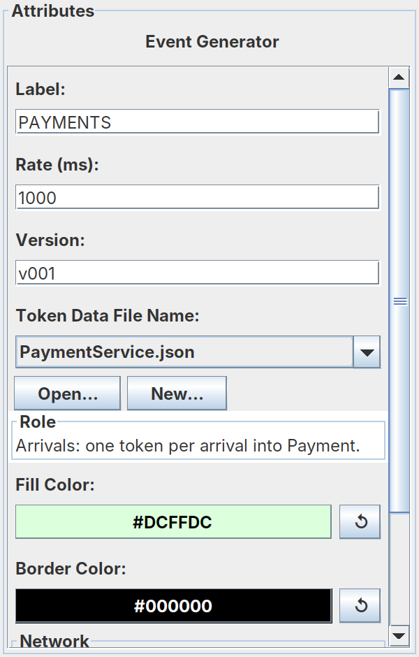
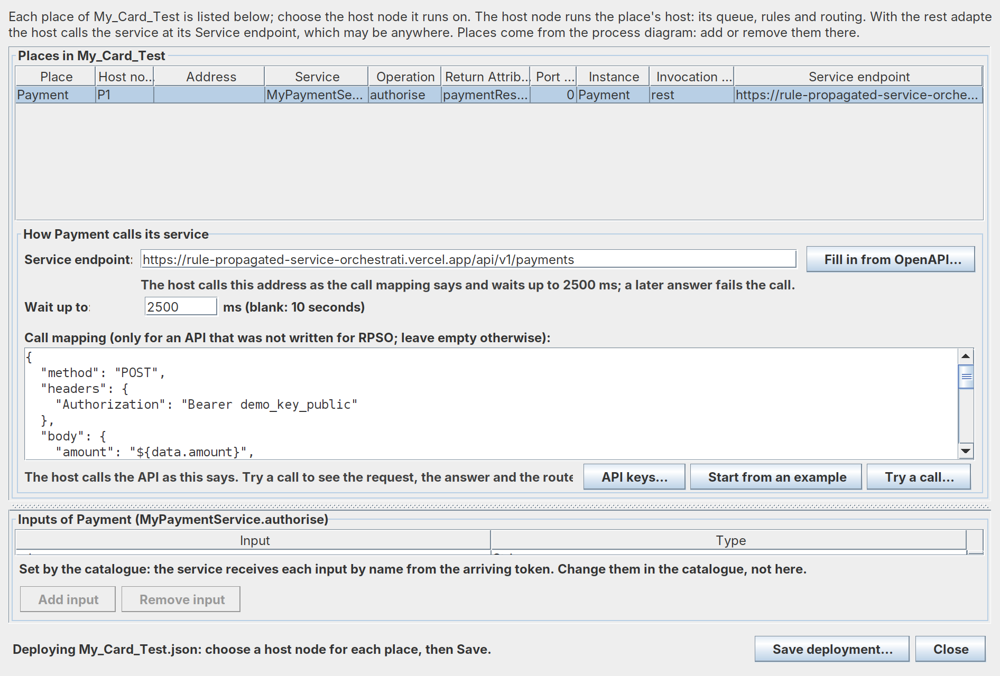
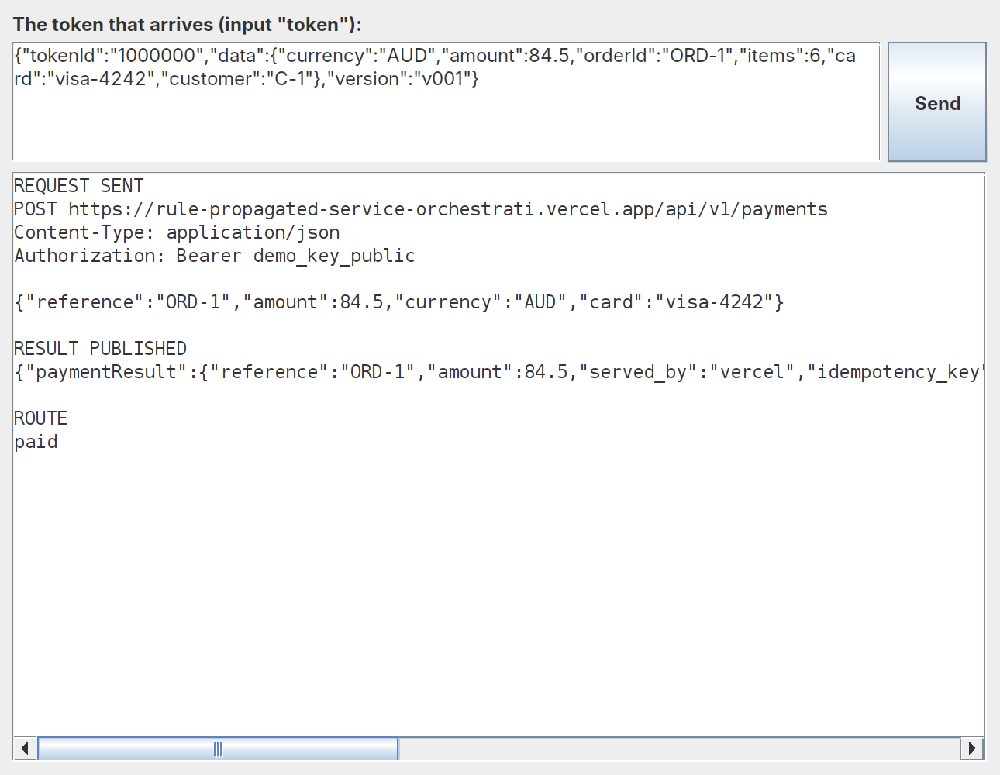

# Connect an existing REST API

Inside RPSO, a workflow moves as tokens: each token carries its data from host to host, and the hosts route it by the
rules installed from your model. A Place reaches a service outside through an adapter. With the `rest` adapter, the
Place's host turns the arriving token into an HTTP call, and turns the service's answer back into a result and a route.

A service written for RPSO accepts the token as its request and names the route in its answer, so the adapter has
nothing to translate. Most services were not written for RPSO. A card-payments API, for example, expects its own
fields and a key, answers with its own status, and declines with HTTP 402. For such an API you give the adapter a
**call mapping**: which of the token's fields go into the request, and which part of the answer picks the route.
Nothing in the API changes.

Here you build a one-step payment test that calls such an API as it is: an event generator sends orders, a `Payment`
place calls the API, and each order ends as paid or declined. The API is this project's mock of a typical one, running
on Vercel ([`examples/rest/card-payments.js`](../examples/rest/card-payments.js)). It declines every 8th payment and is
unavailable for every 13th.

**Before you start:** you need a JDK (15 or later), the repository's projects imported into Eclipse, and internet
access.

> **Want to skip the drawing?** The finished process is supplied. Start the editor (step 1), choose
> **File → Open → Process Definition...** and open `btsn.common/ProcessDefinitionFolder/payments/Workflow/Plain_Payment_Test.json`.
> Its service is the supplied `PaymentService`, and its tokens already take their data from `PaymentService.json`
> (select `PAYMENTS` to see it). Then go to [Tell the host how to call the API](#tell-the-host-how-to-call-the-api):
> **Deploy** shows its endpoint and call mapping already filled in, so you can read them, **Try a call**, and run it.
> Its launcher is supplied too, so **Run on hosts** works without **Build**; if it offers to build first, either
> choice is fine.

## Create the process

1. Start the editor: in Eclipse, run `com.editor.ProcessEditor` (project `btsn.workflowEditor`) as a Java application.
2. Choose **File → New → Process Definition**.
3. Choose **File → Save Process Definition As...** and save it as
   `btsn.common/ProcessDefinitionFolder/mycards/Workflow/My_Card_Test.json`. Use the dialog's **New Folder** button to
   make `mycards` and, inside it, `Workflow`.

   The folder under `ProcessDefinitionFolder`, here `mycards`, is the process's **domain**. It decides the catalogue
   your service goes into and where the editor puts every other file it makes, so it is the only location you choose.

## Draw it

4. Add the elements: click the tool in the palette (top left), click the canvas, then type the **Label** in the
   Attributes panel.
   - **Event Generator** `PAYMENTS`;
   - **Transition** `T_in_Payment`, **Place** `Payment`, **Transition** `T_out_Payment`, in a row;
   - **Transition** `Paid` and **Transition** `Declined`, to the right of `T_out_Payment`.
5. Connect them with **Arrow (drag)**:
   - `PAYMENTS` → `T_in_Payment` → `Payment` → `T_out_Payment`
   - `T_out_Payment` → `Paid`
   - `T_out_Payment` → `Declined`
6. Set the details:
   - `T_in_Payment`: **Node Type** `EdgeNode`, **Buffer** `40` (room for payments to queue);
   - `T_out_Payment`: **Node Type** `GatewayNode` (it sends each payment along the arrow its answer picks);
   - `Paid` and `Declined`: **Node Type** `TerminateNode`.
7. Save the process. The red dot on `Payment` means it has no service yet.

## Describe the service

8. Right-click `Payment` and choose **Choose/Create catalogue...**. **Create a catalogue for a new domain** is already
   chosen, with `mycards` filled in. Click **OK**.
9. Right-click `Payment` again and choose **Create New Service in Mycards.json...**. Fill in the form:

   | Field | Enter | Why |
   |---|---|---|
   | **Service** | `CardPaymentService` | Your name for the API in this process |
   | **Operation** | `authorise` | What the place asks it to do |
   | **What it does** / **What it returns** | In words | Shown wherever the service is chosen |
   | **Inputs** | `token` | The event generator sends each order under the name `token` |
   | **Return attribute** | `paymentResult` | The name the API's answer is published under |
   | **Routes on** | `paid, declined` | The outcomes the process routes on |
   | **How it runs** | **A service called over REST, in any language** | The API runs at its own address |

   Click **Add to Mycards.json**.
10. Click the arrow from `T_out_Payment` to `Paid` and, under **The service answers**, click **paid**. Click the arrow
    to `Declined` and click **declined**. Each click sets the arrow's guard and label.
11. Click **Validate**, then save the process.

## Give the tokens their data

The API needs each payment's amount, currency, card and order number. A token carries what its event generator's
**token data file** gives it.

12. Select `PAYMENTS`. Set **Token Data File Name** to `PaymentService.json`.
13. Click **Open...** to see the file and, under it, the data the first tokens will carry: order 1 is
    `{"orderId": "ORD-1", "amount": 84.5, "currency": "AUD", "card": "visa-4242", ...}`. Close it and save the process.



For your own service, **New...** makes a file of your own, started from `ExampleTokenDataFile.json`.

## Tell the host how to call the API

14. Click **Deploy**. Payment's row is already on the `rest` adapter, because the service is called over REST. Choose
    **Host node** `P1`. In **How Payment calls its service**, enter the **Service endpoint**
    `https://rule-propagated-service-orchestrati.vercel.app/api/v1/payments` and set **Wait up to** `2500` ms.
15. Click **Start from an example**. The **Call mapping** box fills with the mapping for this API:

    ```json
    {
      "method": "POST",
      "headers": {"Authorization": "Bearer demo_key_public"},
      "body": {"amount": "${data.amount}", "currency": "${data.currency}", "card": "${data.card}", "reference": "${data.orderId}"},
      "route": {"field": "status", "values": {"succeeded": "paid", "declined": "declined"}},
      "statusRoutes": {"402": "declined"}
    }
    ```

    | Part | What it tells the host |
    |---|---|
    | `headers` | Send the API's key. This mock's key is public on purpose; a real key is kept out of the deployment (see [Point it at your own API](#point-it-at-your-own-api)) |
    | `body` | Build the request the API expects. On the left of each line is the **API's** name for a field; on the right, `${data.…}` names the **token's** field that fills it. The API calls the order number `reference`; the token calls it `orderId` |
    | `route` | The answer's `status` picks the arrow: `succeeded` takes `paid`, `declined` takes `declined` (your guards) |
    | `statusRoutes` | HTTP 402 is the API's answer for a declined card, not a failure, so it takes `declined` too |

    If a `${data.…}` names a field the tokens do not carry, the note under the box turns red and lists the fields they do.



16. Click **Try a call...**, then **Send**. This is one real call, made exactly as the host will make it, before you run
    anything. Expect the request with the order's amount, card and `"reference": "ORD-1"`, and **ROUTE paid**.
17. In the token box, change `ORD-1` to `ORD-8` and **Send** again: HTTP 402, **ROUTE declined**. Try `ORD-13`: the
    call fails with `answered HTTP 503`, and a run would stop that payment at the place with that reason.



18. Click **Save deployment...**, accepting the name it suggests. Then save the process.

## Run it

19. Click **Build**. Set **Tokens per generator** to `16`, then click **Create**. (Build makes the launcher from the saved
    deployment; Run on hosts says so if you save the deployment again later without building.)
20. Click **Run on hosts**, then **Run**. Expect `v001: 16 generated, 15 completed`: 13 paid, 2 declined (orders 8 and
    16), and 1 failed at Payment with `answered HTTP 503` (order 13).
21. Click **▶ Replay the recorded run** to watch the payments take their routes.

## Use the API's published definition instead

Many APIs publish an OpenAPI (Swagger) file describing their calls. **Fill in from OpenAPI...**, beside the endpoint,
reads one and fills in the endpoint and the mapping for the call you choose. Try it on this API's definition,
[`examples/rest/card-payments.openapi.json`](../examples/rest/card-payments.openapi.json):

- Choose **Take a card payment**. The editor fills in the endpoint and the mapping, and asks for the API's key: the
  definition says it is `demo_key_public`.
- Its notes list what to check. Here two things: the route values are the API's (`succeeded`), so change
  `"succeeded": "succeeded"` to `"succeeded": "paid"`; and the body reads `${data.reference?}`, which the tokens call
  `orderId`, so change it to `${data.orderId}`.
- Then **Try a call...** as above.

## Point it at your own API

- **The address.** Put your API's address in **Service endpoint**, and set **Wait up to** to how long a call may take.
- **The key.** Write `${env:NAME}` where the key goes, for example `"Authorization": "Bearer ${env:PAYMENT_KEY}"`, then
  click **API keys...** and enter it. The key is kept on this computer, in `~/.rpso/api-keys.properties`, never in the
  deployment or the repository. Each computer that runs the place's host needs it too: enter it there, or set an
  environment variable of the same name.
- **The request.** In `body`, put your API's field names on the left and the token's fields on the right. Make the
  tokens carry what the API needs with **New...** beside **Token Data File Name**.
- **The answer.** In `route`, name the field of the answer that says what happened and map its values to your guards.
  Add `statusRoutes` for any HTTP status that is an answer rather than a failure.
- **Check it.** **Try a call...** before every run. The other settings (`result`, query parameters, optional fields)
  are in [Call an API that was not written for RPSO](../ServiceTutorial.md#call-an-api-that-was-not-written-for-rpso).

## Where your files go

| File | Where |
|---|---|
| The process | `btsn.common/ProcessDefinitionFolder/mycards/Workflow/My_Card_Test.json` |
| The catalogue, with `CardPaymentService` | `btsn.common/BusinessServiceDefinitions/mycards/Mycards.json`, listed in `btsn.services/packaging.json` |
| The deployment, with the endpoint and call mapping | `btsn.common/ServiceDeploymentFolder/mycards/My_Card_Test.json` |
| The launcher, its schedule and its deployment profile | `btsn.petrinet.ProjectLoader/My_Card_Test_BuildAndRun.xml`, `btsn.common.eventgenerators/EventTriggeringFile/My_Card_Test_BuildAndRun.csv` and `btsn.services/deployments/mycards/My_Card_TestDeployment.json` |
| The run's analysis | `btsn.common/AnalysisFolder/Mycards/Analysis_My_Card_Test.txt` |
| A token data file you make with **New...** | `btsn.common.eventgenerators/TokenFormats/<name>.json` |
| API keys | `~/.rpso/api-keys.properties` on each computer, never in the repository |

To start again, delete these files; the catalogue's line in `packaging.json` goes with it (the editor offers to remove it
the next time you run).

## Learn more

- [Call an API that was not written for RPSO](../ServiceTutorial.md#call-an-api-that-was-not-written-for-rpso): every setting of a call mapping
- The supplied copy: `btsn.common/ProcessDefinitionFolder/payments/Workflow/Plain_Payment_Test.json`

[← All tutorials](../Tutorial.md)
