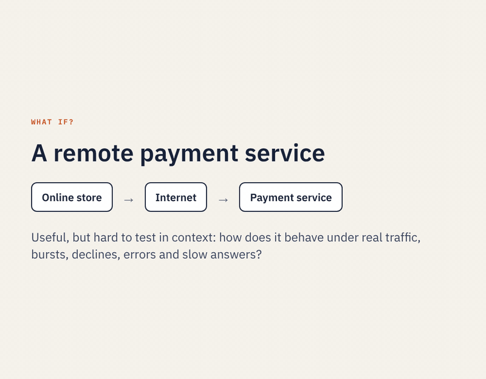

# Run the payment test: a quick step-through

Run the one-step payment test from the README yourself, in about ten minutes, without drawing or typing anything. The
process, its deployment and its launcher are all supplied: you open them, look at each part, make one real call to the
payment service, build it, run the test on your machine and watch the recorded run.

**Before you start:** you need a JDK (15 or later), the repository's projects imported into Eclipse, and internet
access. The payment service is a mock on Vercel: it declines every 8th payment, is unavailable for every 13th and too
slow for every 17th.

## Open the process

1. Start the editor: in Eclipse, run `com.editor.ProcessEditor` (project `btsn.workflowEditor`) as a Java application.
2. Choose **File → Open → Process Definition...** and open
   `btsn.common/ProcessDefinitionFolder/payments/Workflow/Remote_Payment_Test.json`.

   The diagram shows the whole test: `PAYMENTS` → `T_in_Payment` → `Payment` → `T_out_Payment`, which sends each
   payment to `Paid` or `Declined`.

## Look at each part

Click each element and read its **Attributes** panel on the left. Nothing here needs changing.

3. **`PAYMENTS`**, the event generator. Its **Rate (ms)** is `1000 x10, 0 x12, 1000`: ten payments a second apart,
   then a burst of twelve at once, then one a second for the rest. Its **Token Data File Name** is
   `PaymentService.json`; click **Open...** to see the orders it sends (order 1 is groceries, 84.50 AUD, on a Visa
   card), then **Close**.
4. **`T_in_Payment`**: an **EdgeNode** with a **Buffer** of 40, so payments can queue here when the service is slow.
5. **`Payment`**, the place: its service is `PaymentService.authorise`. **What it does** describes it, and **Runs on**
   shows the host, `P1`, that calls the service.
6. **The arrows out of `T_out_Payment`**: one tests `paid`, the other `declined`. `T_out_Payment` is a
   **GatewayNode**, so each payment takes the arrow its answer names.

## See how the place calls the service

7. Click **Deploy**. Payment's row shows its host, `P1`, and the `rest` adapter. Under **How Payment calls its
   service** are the payment service's address and **Wait up to** `2500` ms: a payment that takes longer fails at the
   place. The **Call mapping** is empty, because this service was written for RPSO: it accepts the token as its
   request and names the route in its answer.
8. Click **Try a call...**, then **Send**. This makes one real call, exactly as the host will. You see the request
   (the order, inside the token), the answer, and **ROUTE paid**.
9. Close the Try a call window, then close Deploy without saving.

## See what a run is made of

10. Click **Build**. Its summary lists what a run uses: the launcher, the token schedule and the deployment profile,
    the hosts it starts (`P1` and Monitor), the 30 payments (10 one every 1000 ms, 12 at once, then one every
    1000 ms for the rest), and that every payment takes its data from `PaymentService.json`. Click **Create**: it
    writes the launcher and its schedule from the process, the same as the ones supplied.

## Run it

11. Check that **Machines** on the toolbar is `SingleHost`. Click **Run on hosts**, leave **Run every host on this
    computer** ticked, and click **Run**.
12. Watch the steps across the top turn green, from **Build and start hosts** to **Replay**. The first run takes a
    few minutes, while the services are packaged; later runs are quicker. The test sends 30 payments: steady
    traffic, then a burst of twelve.
13. Wait for **Run complete**. Expect `v001: 30 generated, 27 completed`:
    - 24 paid and 3 declined, each routed on the service's own answer;
    - 3 failed at Payment, each with its reason: `answered HTTP 503` for payments 13 and 26, and
      `did not answer within 2500 ms (timeoutMs)` for payment 17.

## Watch the recorded run

14. Click **▶ Replay the recorded run**. The editor comes to the front and replays the run on the diagram: payments
    leave `PAYMENTS`, queue at `T_in_Payment` during the burst, pass through `Payment` and end at `Paid` or
    `Declined`.

15. Back in the Run window, click **Elapsed time and queue wait chart**: how long each payment took, and how long the
    burst waited in the queue. **Open analysis report** has every measurement.

## Where next

- **Test your own service.** [Test your own remote service](test-your-remote-service.md) builds this test from
  nothing, then points it at a service of yours.
- **Call an API that was not written for RPSO**, such as a card-payments API, as it is:
  [Connect an existing REST API](connect-an-existing-rest-api.md).
- **Learn the editor** with the guided examples in [Tutorial.md](../Tutorial.md).

[← All tutorials](../Tutorial.md)
