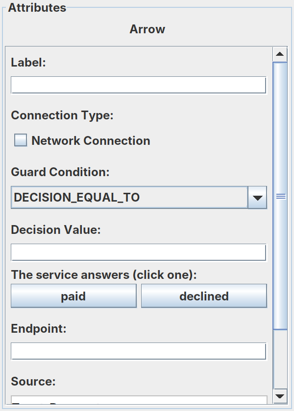
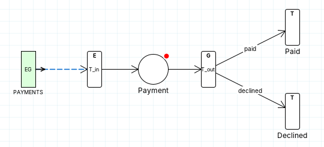

# Test your own remote service

You have a remote service, say a payment gateway, and want to see how it behaves in context: under steady traffic,
when it declines, fails or answers slowly. Here you build the one-place test from the README from nothing: an event
generator, a place that calls the service over REST, and two outcomes. You describe the service yourself, as you would
your own. It first calls this project's mock payment service on Vercel; at the end you point it at yours.

**Before you start:** you need a JDK (15 or later), the repository's projects imported into Eclipse, and internet
access. Start the editor: in Eclipse, run `com.editor.ProcessEditor` (project `btsn.workflowEditor`) as a Java
application.

## Create the process

1. Choose **File → New → Process Definition**.
2. Choose **File → Save Process Definition As...** and save it as
   `btsn.common/ProcessDefinitionFolder/mypayments/Workflow/My_Payment_Test.json`.
   Use the dialog's **New Folder** button to make `mypayments` and, inside it, `Workflow`.

   The folder under `ProcessDefinitionFolder` is the process's **domain**, here `mypayments`. It decides the process's
   catalogue and where the editor puts every other file it makes ([Where your files go](#where-your-files-go)), so
   this is the only location you choose.

## Draw it

3. Add the elements: click the tool in the palette (top left), click the canvas, then type the **Label** in the
   Attributes panel.
   - **Event Generator** `PAYMENTS`;
   - **Transition** `T_in_Payment`, **Place** `Payment`, **Transition** `T_out_Payment`, in a row;
   - **Transition** `Paid` and **Transition** `Declined`, to the right of `T_out_Payment`.
4. Connect them with **Arrow (drag)**:
   - `PAYMENTS` → `T_in_Payment` → `Payment` → `T_out_Payment`
   - `T_out_Payment` → `Paid`
   - `T_out_Payment` → `Declined`
5. Set the details:
   - `T_in_Payment`: **Node Type** `EdgeNode`, **Buffer** `40` (room for payments to queue);
   - `T_out_Payment`: **Node Type** `GatewayNode`;
   - `Paid` and `Declined`: **Node Type** `TerminateNode`;
   - the arrow to `Paid`: **Guard Condition** `DECISION_EQUAL_TO`, **Decision Value** and **Label** `paid`;
   - the arrow to `Declined`: the same, with `declined`.

   Once the service is described (step 7), an arrow leaving `T_out_Payment` lists the values the service answers as
   buttons under **Decision Value**: clicking one sets the guard and the label, so a guard cannot be mistyped.

   

Your design should now look like this. The red dot on `Payment` means it has no service yet; you describe one next.

## Describe the service

The process needs a catalogue to hold your service: one per domain, shared by its processes.

6. Right-click `Payment` and choose **Choose/Create catalogue...**. Because the process is saved in the `mypayments`
   folder, **Create a catalogue for a new domain** is already chosen, with `mypayments` filled in. Click **OK**.
7. Right-click `Payment` again and choose **Create New Service in Mypayments.json...**. Fill in the form:

   | Field | Enter | Why |
   |---|---|---|
   | **Service** | `MyPaymentService` | Your name for it. (The suggestion, `MypaymentsPaymentService`, avoids the supplied `PaymentService`.) |
   | **Operation** | `authorise` | What the place asks the service to do |
   | **What it does** / **What it returns** | In words | Shown wherever the service is chosen |
   | **Inputs** | `token` (suggested) | The event generator sends each payment under the name `token`, and an input is named after what arrives |
   | **Return attribute** | `paymentResult` | The name the service's answer is published under |
   | **Routes on** | `paid, declined` | The values its answer routes on: the guards you set in step 5 |
   | **How it runs** | **A service called over REST, in any language** | There is no Java class: the service runs at its endpoint |

   Click **Add to Mypayments.json**.
8. Click **Validate**. You should see **Validation passed!**
9. Choose **File → Save Process Definition**.

**You don't write any code here.** The payment service is already written and running on Vercel
([`examples/rest/payment.js`](../examples/rest/payment.js)); the form above only tells the editor how to call it. If you
want to see what it receives and sends back, [Follow one payment](../ServiceTutorial.md#follow-one-payment-what-a-service-receives-and-returns)
shows it step by step.

## Deploy it

10. Click **Deploy**. Payment's row is already on the `rest` adapter, because the service is called over REST.
    Choose **Host node** `P1`.
11. In **How Payment calls its service**, enter the **Service endpoint**
    `https://rule-propagated-service-orchestrati.vercel.app/api/payment/authorise`, and set **Wait up to** `2500` ms.
    A payment that takes longer fails at the place. Leave **Call mapping** empty: this mock was written for RPSO, so it
    accepts the token as its request and names the route in its answer ([Connect an existing REST API](connect-an-existing-rest-api.md) calls one that was not).
12. Click **Save deployment...** and accept the name it suggests. Then choose **File → Save Process Definition**.

*The parts of the Deploy panel you set: the row's **Host node**, then in **How Payment calls its service** the
**Service endpoint** and **Wait up to**, then **Save deployment...***

## Run it

13. Click **Build**. Set **Tokens per generator** to `30`, then click **Create**.
14. Click **Run on hosts**, then **Run**. Before it starts, the editor checks that the payment service answers.
15. Wait for **Run complete**. Expect `v001: 30 generated, 27 completed`. The mock service declines every 8th
    payment, is unavailable for every 13th and too slow for every 17th, so the report lists:
    - 24 paid and 3 declined;
    - 3 failed at Payment, each with its reason: `answered HTTP 503` for payments 13 and 26, and
      `did not answer within 2500 ms (timeoutMs)` for payment 17.
16. Click **▶ Replay the recorded run**, then **Elapsed time and queue wait chart**: how long each payment waited,
    and how long the service took.

## Where your files go

You choose only the process's folder (step 2). The editor creates every other file in its place, named after the
domain (`mypayments`) and the process (`My_Payment_Test`):

| File | Created by | Where |
|---|---|---|
| The process | Step 2 | `btsn.common/ProcessDefinitionFolder/mypayments/Workflow/My_Payment_Test.json` |
| The catalogue | Step 6 | `btsn.common/BusinessServiceDefinitions/mypayments/Mypayments.json`, and listed in `btsn.services/packaging.json` |
| The deployment | Step 12 | `btsn.common/ServiceDeploymentFolder/mypayments/My_Payment_Test.json` |
| The launcher, its schedule and its deployment profile | Step 13 | `btsn.petrinet.ProjectLoader/My_Payment_Test_BuildAndRun.xml`, `btsn.common.eventgenerators/EventTriggeringFile/My_Payment_Test_BuildAndRun.csv` and `btsn.services/deployments/mypayments/My_Payment_TestDeployment.json` |
| The run's analysis | Step 15 | `btsn.common/AnalysisFolder/Mypayments/Analysis_My_Payment_Test.txt` |

To start again, delete these files; the catalogue's line in `packaging.json` goes with it (the editor offers to remove it
the next time you run).

## Now test your own service

- **Your service has its own API?** Most do: then see [Connect an existing REST API](connect-an-existing-rest-api.md), which
  calls one as it is. The rest of this list is for a service you write for RPSO.
- **What your service must do.** Answer an HTTP POST. It receives
  `{"service": "MyPaymentService", "operation": "authorise", "sequenceId": …, "version": "v001", "inputs": {"token": {…}}}`
  and answers HTTP 200 with `{"paymentResult": {…, "routing_decision": {"routing_path": "paid"}}}`, or `declined`.
  Any other status, or no answer within **Wait up to**, fails the payment at the place, with the reason in the report.
- **A starting point.** [`examples/rest/payment.js`](../examples/rest/payment.js) is the mock, in a few lines of
  JavaScript. Run it on your machine with `node examples/rest/credit-service.js` (it answers at
  `http://127.0.0.1:8080/payment/authorise`), or host your own copy:
  [Serve it from the internet](../ServiceTutorial.md#serve-it-from-the-internet).
- **Point the place at it.** Click **Deploy**, put your address in **Service endpoint**, set **Wait up to**, save the
  deployment, then **Run on hosts** again.
- **Shape the traffic.** Select `PAYMENTS`: **Rate (ms)** sets how payments arrive (`1000` one a second, `0` all at once, or a pattern such as `1000 x10, 0 x12, 1000`), and **Token Data File Name** what
  each one carries (**Open...** shows it; **New...** starts your own). Then **Build → Create** and run. For bursts, see
  [Test a remote service in context](../ServiceTutorial.md#test-a-remote-service-in-context).
- **Grow it.** Add the places around the service, such as a receipt after **Paid**: each is another Node in the same
  model ([Follow one payment](../ServiceTutorial.md#follow-one-payment-what-a-service-receives-and-returns)).

## Learn more

- [Follow one payment: what a service receives and returns](../ServiceTutorial.md#follow-one-payment-what-a-service-receives-and-returns)
- [Priority at a shared service](../ServiceTutorial.md#priority-at-a-shared-service): two kinds of traffic, one service
- The supplied copy: `btsn.common/ProcessDefinitionFolder/payments/Workflow/Remote_Payment_Test.json`

[▶ Watch a recorded run of the finished test](https://alexanderadelau.github.io/Rule-Propagated-Service-Orchestration/docs/replay/?model=../../btsn.common/ProcessDefinitionFolder/payments/Workflow/Remote_Payment_Test.json&run=../../btsn.common/AnalysisFolder/Payments/Analysis_Remote_Payment_Test.txt)

[← All tutorials](../Tutorial.md)
